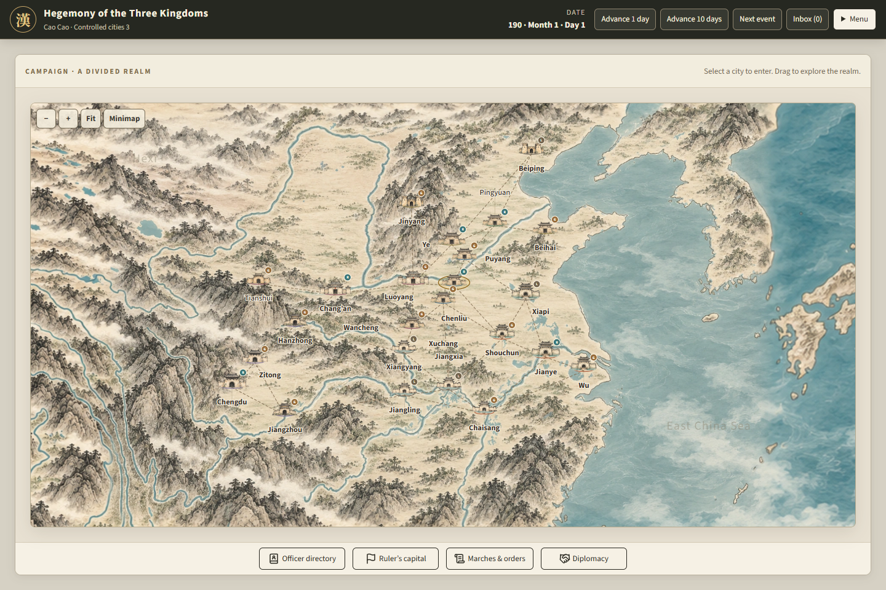
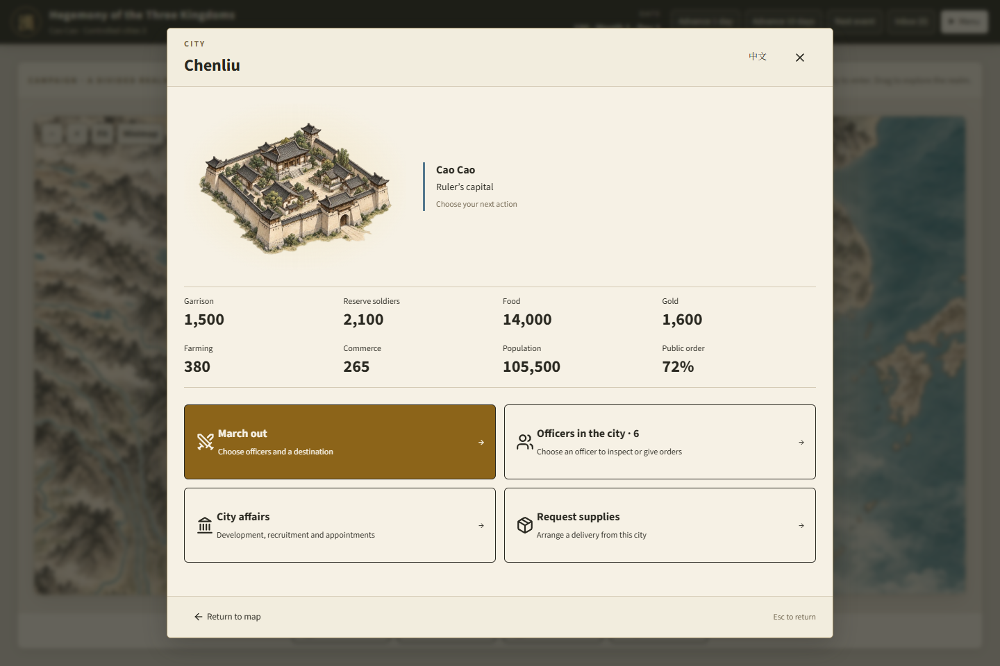
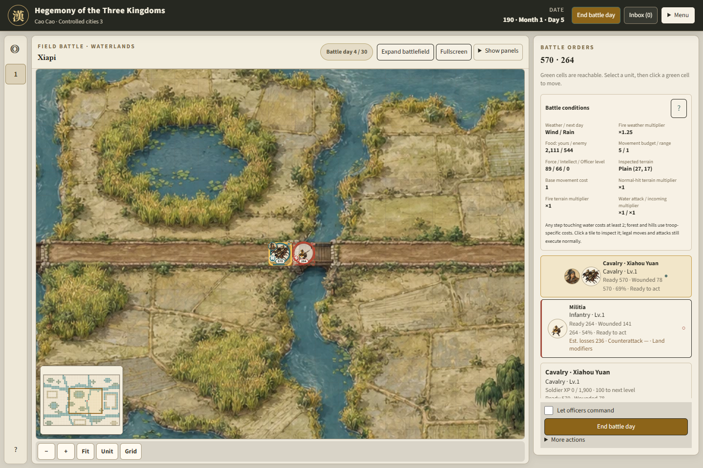

# Hegemony of the Three Kingdoms

**Development target: v0.4. Playable baseline: v0.3.** Start new work with the [v0.4 implementation plan](docs/implementation.md): coherent AI and trustworthy rules. The gameplay, saves, screenshots and validation records below describe v0.3; v0.4 implementation is not yet complete.

A single-player Three Kingdoms strategy game with Chinese/English UI, a daily campaign, autonomous governors, travelling armies and field battles on 15 painted 48×32 maps. The game has two scenarios (190 and 200), six playable houses per scenario, 24 cities and a 98-officer catalog with scenario-specific availability and annual appearances.

**Local playable candidate. Documentation checked October 28, 2026 against the current working tree.** Player balance sessions, real low-end hardware testing and final artwork approval remain open. Older commit IDs and test totals in dated records describe those snapshots.

[中文玩法指南](docs/v0.3/player-guide.md#中文玩法指南) · [English player guide](docs/v0.3/player-guide.md#english-player-guide) · [Release notes](docs/v0.3/release-notes.md) · [Implementation status](docs/v0.3/implementation-status.md) · [Documentation index](docs/README.md)

## Start playing

Requires Node.js **22.12 or newer**. From the repository root:

```powershell
npm ci
npm run dev
```

Keep the server terminal running and open the URL Vite prints, normally `http://127.0.0.1:5173/`. Use `npm run dev -- --port 5173 --strictPort` to keep a fixed address. Ctrl+C stops the server; an open browser tab alone does not keep the game server running.

A valid autosave opens automatically. Otherwise select a scenario and house, then **New campaign**. Use the in-game **Menu** for language, export/import, help and the Campaign menu. The Campaign menu offers Resume or a confirmed new campaign. **F1** opens the field guide.

Start by opening your capital's **City affairs**, recruiting into reserve, and assigning soldiers from **Officers in the city → officer → Set troop count**. **March out** selects whole officer contingents and provisions. Advance one day, ten days or to the next event; acknowledge critical reports and submit each manual battlefield's day when prompted. The [player guide](docs/v0.3/player-guide.md) explains the complete sequence.

## Current gameplay

| System                   | Behavior                                                                                                                                                                                                                                                                                                                                            |
| ------------------------ | --------------------------------------------------------------------------------------------------------------------------------------------------------------------------------------------------------------------------------------------------------------------------------------------------------------------------------------------------- |
| Time and work            | 30-day months; each owned city refreshes to **2 work points every 10 game days**, independent of officer count. Unused points do not accumulate. Execution still needs an eligible local officer.                                                                                                                                                   |
| City management          | Farming/commerce development, recruitment, search, public order, training, feasts, rewards, fine arms, relief and food trade. Development caps at **500**, retaining existing values. The city overview shows farming, commerce, population, reserves and public order alongside gold, food and garrison.                                           |
| Free preparations        | Troop assignment, contingent returns, rewards, equipment and ordinary officer transfers use no work points. Their resource, authority and availability rules still apply. Capital moves and appointments do not refund spent work.                                                                                                                  |
| Group actions            | Feast, reward and fine-arms screens support checkboxes and select-all. A feast uses 1 point for the group; rewards cost 100 gold/person and fine arms 180 gold/person. Preview the total and actual effects; invalid or unaffordable groups do not partially execute.                                                                               |
| Ordinary transfers       | **Source city → City affairs → Transfer officers** moves selected ordinary officers and all healthy/wounded personnel to another friendly city. Provisions and ETA are previewed; arrival stations them immediately, without a governor appointment or monthly wait.                                                                                |
| Governance               | The ruler's capital is directly administered; other cities use governors or local stewards. Cross-city appointees carry their contingents and take office at a legal monthly boundary after arrival. A ruler's effective appointment also moves the capital. Conquest reports lead to personal rule, governor appointment or a deferred Inbox task. |
| Orders and travel        | Actual outbound, waiting, return and redirected journeys; reserved stock, food consumption and arrival delivery. Governor campaign plans retain accept/reduce/wait/cancel decisions. In-transit transfers appear in **Marches & orders**.                                                                                                           |
| Battles                  | Three base troop types with elite presentation, six tactics, morale, control zones, damage forecasts, manual/automatic command and universal water access. Movement opens the unit action menu. After one field ends, unfinished player battles remain reachable; a fully submitted day can resume with **Advance 1 day**.                          |
| Prisoners and succession | A captured ruler is succeeded immediately. Recruiting that captive lowers the former house's remaining officers and cities by 10 loyalty; execution does not. Surviving houses display the current ruler's name.                                                                                                                                    |
| Interface and recovery   | Ink-wash maps, pan/zoom/Fit/focus/minimaps, battlefield expansion/fullscreen and panel toggles, officer directory, bilingual help, one autosave and portable export/import.                                                                                                                                                                         |

Normal battles last at most 30 battle days; raids at most 10. At timeout, more combat-ready troops wins; ties favor the defender. All troop types can enter passable water: attack ×0.75 and incoming troop damage ×1.25. There is **no siege system or camp-capture victory**.

Routes are historically informed gameplay estimates, not surveyed Han-era roads. There are 42 configured links; a party's ETA depends on its composition and route snapshot. Human campaign balance, multi-city coordinated planning, extra save slots and old-save conversion are outside the current delivery or remain unaccepted. See [scope and release notes](docs/v0.3/release-notes.md).

## Saves and recovery

Saves use `hegemony.save`, version 3, ruleset `hegemony-3`, with the current personnel and officer-roster schemas. Older versions, earlier roster/personnel schemas and 24×20 battle saves are rejected without deleting their original data. Compatible current saves retain work already spent and pending travel/governance decisions.

Browser storage belongs to the **profile and address**, including the port. Export before switching browsers, ports or clearing site data. Failed imports preserve the current campaign. If autosaving fails, keep the tab open, export a backup, then use **Retry save**. Exporting a file does not imply that browser autosaving succeeded.

If time stops, check the Inbox for critical reports and unfinished manual battles. If every remaining field has submitted, **Advance 1 day** completes the shared day once. [Troubleshooting](docs/v0.3/player-guide.md#8-常见疑问与反馈).

## Runtime views

Captured from the current game on **October 28, 2026**, at 1440×960. The campaign and city views use a new 190 Cao Cao campaign; the battlefield shows a seeded Puyang → Xiapi engagement on Waterlands.

**Campaign:** the map-first layout with city markers and the bottom navigation dock.



**City:** Chenliu's overview, showing all eight city statistics and the main action entries.



**Battle:** current unit artwork and wounded readouts, a floating minimap, expansion/fullscreen controls and manual orders.



## Development and validation

```powershell
npm test -- --maxWorkers=1
npm run build
npm run lint:ui
npm run test:e2e
```

The [v0.4 implementation plan](docs/implementation.md) defines the active scope, work order and release gates. The [v0.3 developer guide](docs/v0.3/development.md) covers the existing runtime, isolated browser-test ports, production subpaths, assets and save invariants. [v0.3 status](docs/v0.3/implementation-status.md) distinguishes recorded automated checks from player acceptance; [remaining v0.3 acceptance](docs/v0.3/next-steps.md) preserves the previous handoff. Historical test counts and timings are kept with their dates, not presented as measurements of the latest tree.

## Attribution and history

Original generated artwork has [provenance](docs/v0.3/assets/provenance.md) and an [asset manifest](docs/v0.3/assets/manifest.json); portrait sources are recorded in [portrait credits](docs/assets/portrait-credits.md). Artwork does not determine terrain, movement or combat rules.

BAYE is a historical reference: [erduoniba/baye-fmj-app](https://github.com/erduoniba/baye-fmj-app). This is an independent redesign, not an official BAYE or San10WPK product. No optional reference checkout is required to build or play. Previous versions and superseded designs remain in the [documentation archive](docs/archive/README.md).
