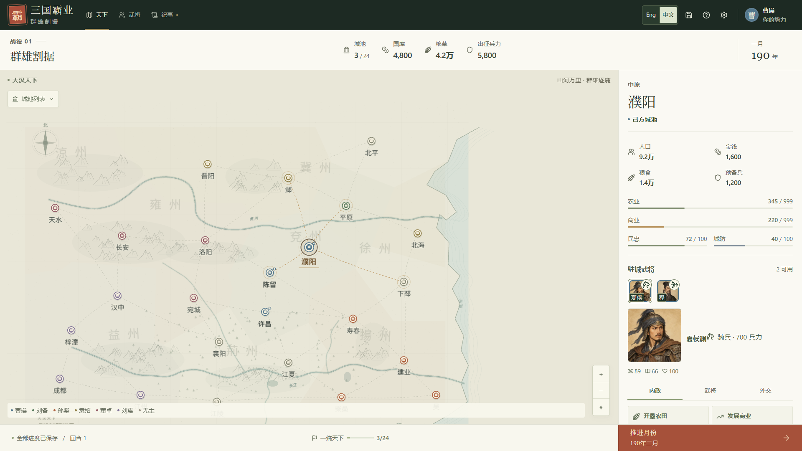
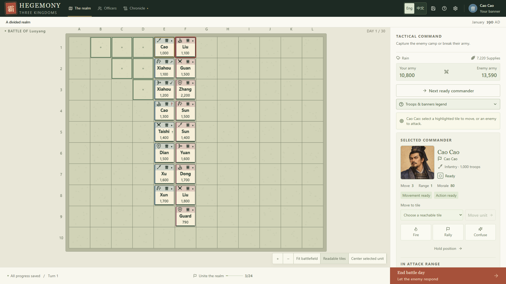

# Hegemony of the Three Kingdoms

### 三国霸业重制 · v0.1

**Build a kingdom. Command its officers. Unite a divided realm.**

A single-player, turn-based strategy game for desktop web browsers, inspired by **《三国霸业》 (Baye)** and rebuilt with **TypeScript, React, and PixiJS**. This is a learning project: readable game rules, reproducible saves, and a modern bilingual interface are the foundation for future expansion.



## Play in a few minutes

Requires **Node.js 24 LTS** (minimum 22.12) and a modern browser with WebGL enabled. Chrome is the currently tested browser.

```sh
npm ci
npm run dev
```

Open the local address printed in the terminal, normally **http://127.0.0.1:5173/**. On Windows, after installing dependencies, double-click **`Start-Hegemony.cmd`**. Keep the terminal open while playing. The former `Start-Baye.cmd` launcher still works.

Choose a ruler and select **Raise your banner**. The **How to play** button explains the commands. Use **Eng / 中文** in the top bar or any dialog to change language immediately, even in battle. Your browser remembers the choice.

## What is in v0.1?

| System          | Playable features                                                                                                               |
| --------------- | ------------------------------------------------------------------------------------------------------------------------------- |
| Campaign        | One authored 190 AD scenario, 24 connected cities, six playable rulers, 52 officers                                             |
| City management | Farming, commerce, fortifications, recruitment, troop assignment, training, provisions, rewards, and governor appointments      |
| Statecraft      | Search for talent, recruit officers, persuade rivals, scout cities, sow dissent, and negotiate alliances                        |
| Armies          | Transfer officers and supplies, queue marches, defend cities, and capture territory                                             |
| Tactical combat | 12 × 10 battlefields, six troop types, rivers and terrain, weather, morale, provisions, Fire, Rally, and Confuse                |
| Opponents       | Deterministic campaign and battle AI using the same resource and command rules                                                  |
| Persistence     | Autosave after successful commands, three manual slots, portable JSON import/export, and mid-battle continuation                |
| Presentation    | Procedural PixiJS maps, English / Simplified Chinese, responsive panels, reduced-motion setting, and optional synthesized sound |
| Campaign ending | Unify all 24 cities to win; losing your last city ends the campaign                                                             |

No account, server backend, API key, remote art service, or reference files are required to play.



## Your first campaign

1. **Start with Cao Cao** for a balanced position, or Liu Yan for a quieter western start.
2. **Select one of your cities and an available officer.** Each officer can receive one main assignment per month.
3. **Develop the economy.** Farms supply food; commerce and population support gold income. Soldiers consume food and pay every month.
4. **Build an army.** Recruitment adds city reserves; **Muster** assigns soldiers to an available officer.
5. **Plan a march to an adjacent city.** Orders resolve when you **Advance month**. Battles involving your forces open the tactical map.
6. **Move, attack, or use a tactic.** You can click the map or use the side-panel controls. Capture the enemy camp, defeat their army, or hold out as defender for 30 days.

Drag the map to pan, scroll to zoom, and double-click to reset. The city index provides a text alternative for selecting cities. **How to play** contains further guidance.

## Readable maps, recognizable commanders

Open **Settings** to choose **Compact**, **Comfortable** (default), or **Large**. The preference applies immediately to text, controls, and map presentation and stays with your browser. In battle, use **Fit battlefield** for an overview, **Readable tiles** for larger units, and **Center selected unit** to find your commander. Larger tiles can require panning on a laptop.

All **52 named officers have distinct illustrated headshots**. Banners show family names and current allegiance; six shared troop symbols identify Infantry, Cavalry, Archers, Marines, Vanguard, and Guard. The **Troops & banners legend** explains the symbols and action states. **Next ready commander** cycles through commanders who can still act. Enemy commander portraits and full names are available in the battle sidebar.


Choose **Cautious**, **Balanced**, or **Aggressive** rivals when starting a campaign, or change the setting during campaign planning. This changes how readily all rivals start wars, including against each other. It supplies no combat or resource bonuses. The **Monthly report** summarizes battles, alliance expirations, and recruitment near your borders; select a city event to focus its location.

## Saving your progress

**All progress saved** means the latest snapshot has committed to IndexedDB, including the current battle, RNG state, pending armies, and monthly continuation. Saving starts when a command is accepted. If a write fails, **Retry save** retries the latest in-memory state; failed writes preserve the previous committed save.

Use **Save and load** for three manual snapshots and JSON backups. An invalid import leaves the current game intact. Language switching never changes campaign data.

Saves belong to the current browser profile and website address. Export a JSON backup before clearing browser data or changing browsers, ports, or hosting addresses. Use one active campaign tab at a time; concurrent-tab conflict resolution and cloud synchronization are not implemented.

The rename preserves the original remake's `baye-atlas` database, `baye.*` preferences, `baye.save` version 1 format, and `baye-atlas-1` ruleset. Existing saves and their `baye-*.json` downloads remain compatible. Binary saves from the legacy game are not supported.

## Develop and test

```sh
npm run dev              # Vite development server
npm test                 # Simulation, save validation, and translation regressions
npm run test:e2e         # Full game, language, and storage browser journeys
npm run build            # Strict TypeScript check and production dist/
npm run test:production  # Test dist/ under /hegemony/, including reload and battle continuation
npm run preview          # Preview the production build
npm run format:check     # Source and documentation formatting
npm run validate:portraits # Coverage, provenance, dimensions, checksums, and payload budget
npm run diagnostics:ai   # Fixed 180-campaign rival-policy comparison (writes .artifacts/)
npm audit                # Known dependency advisories
```

Run `npm run build` before `npm run test:production`. Local browser tests use installed **Google Chrome**. GitHub Actions uses Playwright Chromium on Linux. To use Chromium locally instead, run `npx playwright install chromium` and set `CI=1` in your shell before the browser commands.

The [validation record](docs/validation.md) records the release checks, bug fixes, and remaining coverage limits. Passing tests are evidence of the tested behavior, not a guarantee of zero bugs or perfectly balanced campaigns.

## Architecture you can learn from

```text
React controls / PixiJS map
          │ GameCommand
          ▼
     app/session.ts
          │
          ▼
  Pure TypeScript simulation
   campaign.ts ↔ battle.ts
          │ new GameState
          ├──► autosave queue ──► IndexedDB
          └──► React + PixiJS ──► localized presentation
```

- **Rules are independent of rendering.** The engine validates commands, applies them atomically, and uses saved seeded randomness. A failed command changes nothing.
- **Interruption is data.** A saved battle contains the monthly queue and cursor, so reloading does not repeat casualties or income.
- **Language is presentation.** English canonical messages stay compatible with existing saves; Chinese catalogs translate the interface and history at display time.
- **The browser is the platform layer.** Storage, file downloads, and audio are separate from the simulation. React manages accessible controls; PixiJS draws the atlas and battlefield.

| Read next                                              | Purpose                                                                 |
| ------------------------------------------------------ | ----------------------------------------------------------------------- |
| [Implementation and rules](docs/implementation.md)     | Command costs, economy, AI, tactical formulas, and a guided source tour |
| [Architecture](docs/architecture.md)                   | Original design decisions and tradeoffs                                 |
| [Roadmap](docs/roadmap.md)                             | Milestones and future quality goals                                     |
| [Reference baseline](docs/reference-baseline.md)       | Findings from the original source                                       |
| [Validation](docs/validation.md)                       | Reproducible tests and release limitations                              |
| [v0.1 improvement plan](docs/v0.1-improvement-plan.md) | Scope, measurements, and implementation acceptance criteria             |
| [Rival policy measurements](docs/ai-balance.md)        | Baseline comparison and aggression tuning evidence                      |
| [Portrait credits](docs/assets/portrait-credits.md)    | Original artwork provenance and officer identity mapping                |

## Static hosting

Run `npm run build` and serve **only `dist/`** from any static HTTP(S) host. Relative asset paths support deployment in a subdirectory. Opening `dist/index.html` directly through `file://` is unsupported. There is no service worker or offline-installation guarantee.

The GitHub Actions workflow runs formatting, unit tests, compilation, gameplay browser tests, and production browser tests when this branch is pushed. No deployment is included in this release commit.

## Credits and relationship to 三国霸业

**Main reference:** [erduoniba/baye-fmj-app](https://github.com/erduoniba/baye-fmj-app/tree/main). Thank you to **erduoniba and the project's contributors** for sharing the Baye source and making this learning remake possible.

This is an unofficial learning remake of Baye's campaign-and-battle structure, with an authored scenario and ruleset. It does not claim exact legacy formulas, content, mod compatibility, or official affiliation. Maps, symbols, and sounds are generated in code; the new runtime includes no copied legacy sprites, portraits, libraries, music, or executables.

The headshots are original imagined historical illustrations created for this project using OpenAI's built-in image generation tool. They are artistic interpretations rather than authenticated contemporary likenesses. See the [portrait provenance and prompt records](docs/assets/portrait-credits.md).

The reference repository is not required to build or play this standalone remake. Installed dependencies, build output, browser reports, and local QA artifacts are ignored by Git.

Future work includes longer human balance testing, Firefox/Safari coverage, fuller accessibility testing, and richer authored content. Multiplayer, mobile-first controls, cloud saves, and mod support are outside v0.1.

## 中文快速开始

本项目是以《三国霸业》为灵感的学习型网页重制作品，英文名为 **Hegemony of the Three Kingdoms**，当前版本 **v0.1**。

- 安装 Node.js，运行 `npm ci`，再运行 `npm run dev`，打开终端显示的网址。
- Windows 用户安装依赖后，也可双击 `Start-Hegemony.cmd`。
- 随时通过 **Eng / 中文** 切换语言；选择势力后发展城池、招募武将、编组军队，逐步统一天下。
- 每次成功操作都会自动存档，战斗中也可续玩；请在“存档与读档”中导出 JSON 作为备份。
- 在“设置”选择紧凑、舒适或大字显示。战斗中可使用“适应战场”“清晰格子”“居中所选部队”和“下一位可行动武将”。
- 全部 52 位具名武将拥有独立头像；旗帜标明姓氏与当前势力，六种兵种图标和行动标记可在图例中查看。
- 开局或战役规划阶段可选择谨慎、均衡、激进的对手。此设置影响开战意愿，不增加战斗属性或资源；“月度军报”展示已发生的战事、盟约到期与边境募兵。
- 主要参考与致谢：[erduoniba/baye-fmj-app](https://github.com/erduoniba/baye-fmj-app/tree/main)。感谢 erduoniba 及项目贡献者开源分享《三国霸业》源码。此版本采用自编场景和规则，并非对原版全部内容与公式的逐项复刻。
