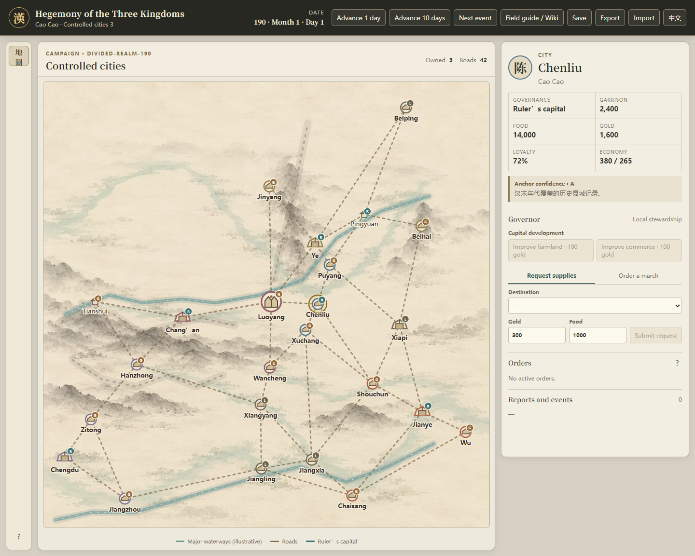
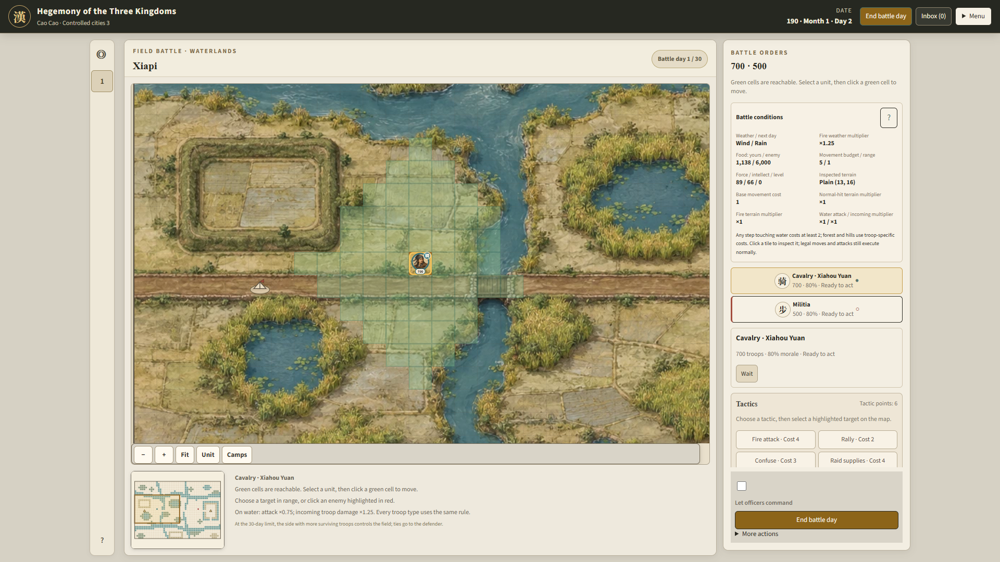

# Hegemony of the Three Kingdoms · v0.3

An independent single-player Three Kingdoms strategy game with Chinese/English UI, daily campaign time, historically informed travel estimates, autonomous governors and field battles on 15 hand-painted 48×32 battlefields. BAYE is a historical reference; v0.3 has its own rules and saves.

**Current local version:** branch `hegemony_of_the_three_kindoms_v0.3`, implementation commit `1e02e65`. Documentation checked October 22, 2026. Core feature tracks, the eight initial defect repairs and RV01–RV10 playability tasks are implemented. Player playtests, real low-end-machine testing and draft-art review remain open. Push, PR and remote CI remain deferred.

[中文玩法指南](docs/v0.3/player-guide.md#中文玩法指南) · [English player guide](docs/v0.3/player-guide.md#english-player-guide) · [What changed in v0.3](docs/v0.3/release-notes.md) · [Current status](docs/v0.3/implementation-status.md) · [All documentation](docs/README.md)

## Start playing

Requires Node.js 22.12 or newer.

```powershell
npm ci
npm run dev
```

Open the address Vite prints, normally `http://127.0.0.1:5173/`. On a fresh browser profile, choose the 190 or 200 scenario, select a house and click **New campaign**. Cao Cao is a reasonable first choice. A valid autosave opens automatically; use **Campaign menu** to resume or start a different campaign. The **中文 / EN** toggle changes language; **Field guide / Wiki / 游戏指南** and F1 open help during play. Use Ctrl+C in the server terminal to stop it.

On the first day, inspect your capital's food, reserve and work points. Recruit into reserve, assign soldiers to an officer, then issue a march with enough troops for a whole officer force. Request supplies or armies from your other cities through their plans. Advance one day, ten days or to the next event; acknowledge due reports when time pauses. On arrival, command your side in the field battle. [The player guide](docs/v0.3/player-guide.md) walks through the sequence, equipment, tactics, water and common problems.

## What this version includes

| System       | Playable behavior                                                                                                                                                                                                                                                                 |
| ------------ | --------------------------------------------------------------------------------------------------------------------------------------------------------------------------------------------------------------------------------------------------------------------------------- |
| Campaign     | Two scenarios, six playable houses per scenario, 24 cities, diplomacy, monthly events, true-unification and Hegemon endings.                                                                                                                                                      |
| Daily world  | One-day/ten-day/next-event controls, 30-day months, travel/arrival/return journeys, food and cargo accounting.                                                                                                                                                                    |
| Geography    | 24 historical regional anchors and 42 configured links; straight-line distance, estimated road distance and party ETA are distinct. Hanzhong–Chang'an has a 425 km / 33-day nominal baseline; actual party ETA varies.                                                            |
| Governors    | Direct capital administration; other cities use formal governors or local stewards. Orders expose available amounts, gaps and dates. Troop-free governor transfers travel and take effect at a month boundary.                                                                    |
| Capital work | Recruitment/assignment, public order, search, training, feasts, rewards, fine arms, relief and food trading within monthly work points and available stock. Farming/commerce development controls exist but are unavailable in all starting cities under the current value limit. |
| Battles      | 15 painted 48×32 battlefields (ten terrain types) chosen by the attacker's last route leg and direction; six unit types, six tactics, forecasts, morale, zone of control, camps, AI turns and manual player command.                                                              |
| Water        | Every unit type may enter passable water. On water, attack ×0.75 and incoming troop damage ×1.25; shore units can attack water units in normal range.                                                                                                                             |
| Interface    | Ink-wash atlas and a draggable top-down battlefield with officer-portrait unit tokens, pan/zoom/Fit/focus/minimaps, exact troop counts, weather/supply/terrain inspection, full order/report lists and bilingual Wiki.                                                            |
| Recovery     | One browser autosave, portable export/import, in-game Campaign menu/Resume, confirmed replacement and withdrawal, and Retry save after storage failure.                                                                                                                           |

Normal battles last at most 30 days; raids at most 10. At timeout, more surviving troops wins field control; ties favor the defender. Taking the opposing camp can also decide a battle. There is **no siege system**: no walls, gates, siege weapons or city-street phase. City administration and tactical command are separate.

Geographic routes and battlefields are documented approximations inspired by the real terrain, not surveyed Han-era maps. Multi-city plan coordination, full future-budget simulation, naval-skill gates, extra save slots and old-save conversion are not included. See [scope and release notes](docs/v0.3/release-notes.md).

**Known economy limit:** both scenarios start every city with farming and commerce above the current manual-development cap of 100. The development buttons stay disabled until a value falls below that cap. The initial-value/cap mismatch is [recorded for a scoped rules review](docs/next-steps.md#open-now); this documentation pass does not change the economy.

## Current runtime views

The atlas below is a runtime capture after the playability repairs. The battlefield is a campaign battle from Puyang to Xiapi, which the attack direction places on the Waterlands battlefield (④北). They demonstrate layout, not final art approval. [Battlefield plan and all 15 layouts](docs/v0.3/08-battlefield-canvas-plan.md).





## Saves

v0.3 uses `hegemony.save`, version 3, ruleset `hegemony-3`. Older saves, including v3 saves with 24×20 battles, are rejected without deleting them or replacing the current game. Browser saves belong to the browser profile and address; export before changing profiles, URLs or clearing site data. A different port has separate storage.

**Campaign menu / 战役菜单** offers Resume and New campaign. Replacing the campaign requires confirmation and offers Export first. Failed imports preserve the current game and drafts; successful imports reset campaign-bound controls. Export downloads a file independently of local saving. If local saving fails, keep the tab open, export a backup and use Retry save after storage is available.

## Validation and remaining acceptance

Recorded October 21, 2026 for the RV implementation candidate, not a new October 22 gameplay run:

- Full suite: **668 passed, 1 existing skip, 46 files**.
- Browser suite: **34 passed**, plus six affected cases rechecked after final CSS; EN/ZH, four maps, 390/1366/1920 effective CSS px and 200% zoom.
- TypeScript/build, production `/hegemony/` save-reload, tactical performance, formatting and portrait checks passed.

The [validation record](docs/v0.3/evidence/rv-implementation-2026-10-21/README.md) contains commands, environment, limits and screenshots. The accepted 96-month narrow-bot diagnostic produced no unifications or Hegemon wins; it is not a player win-rate claim. Art remains `draft`. Four 12-month/three-manual-battle play sessions and a real low-end-machine check await player observations. [Remaining tasks](docs/next-steps.md).

## Development and attribution

[Developer guide](docs/v0.3/development.md) covers the active React/SVG modules, scripts and save contract. Old React/Pixi/IndexedDB guides are in the [versioned archive](docs/archive/README.md).

Original ImageGen artwork has [provenance](docs/v0.3/assets/provenance.md) and a [manifest](docs/v0.3/assets/manifest.json). Existing portrait identity/provenance remains in [portrait credits](docs/assets/portrait-credits.md). Geographic overlays and combat data determine positions and rules, not painted decoration.

BAYE source reference: [erduoniba/baye-fmj-app](https://github.com/erduoniba/baye-fmj-app). This is an independent redesign, not an official BAYE or San10WPK product. The optional local reference checkout is not required to build or play.

October 22 playability/UI changes and current evidence: [implementation ledger](docs/v0.3/playability-implementation.md).
