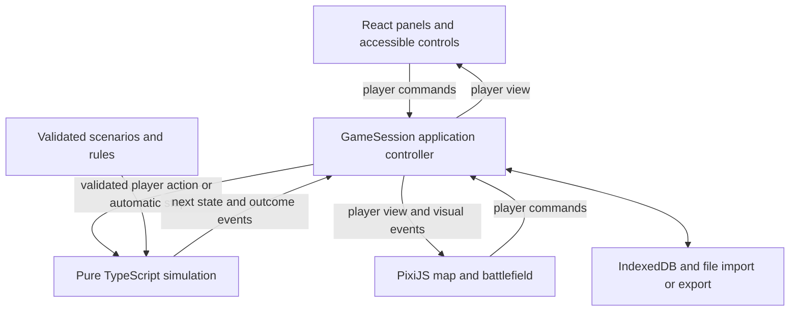

# Baye web architecture

> **Implementation status — October 17, 2026:** A runnable Atlas edition now implements the campaign, battles, AI, React/Pixi interface, and local saves. Read [the actual architecture and authored rules](implementation.md) first. This document preserves the original design proposal. Exact legacy fidelity, the full proposed content pipeline, and broad browser/performance release gates are not claimed complete.

Decision date: October 17, 2026. This is the proposed implementation design; the approved product direction is a substantial web-only rebuild using TypeScript, React, and PixiJS.

V1 is a single-player, illustrated 2D strategy game for desktop browsers. It preserves Baye's core campaign and tactical battle rules while rebuilding the interface, state ownership, rendering, and persistence. One complete historical scenario is the proposed first release scope. The [roadmap](archive/roadmap.md) defines the incremental delivery gates, and the [reference baseline](reference-baseline.md) explains what preserving the rules means.

## The central decision

The simulation owns everything that can change the outcome of a game. React and PixiJS present that state and request actions. Browser services load content and save snapshots.



This is runtime data flow. Source dependencies point inward: UI, rendering, content loaders, and browser adapters may use game types; the simulation imports none of those implementations.

**Learning point:** a button, a test, and an AI planner should reach the same rule implementation. Changing the layout should not change what an action costs.

## Technology choices

| Choice                                                  | Responsibility and reason                                             | Tradeoff                                                                    |
| ------------------------------------------------------- | --------------------------------------------------------------------- | --------------------------------------------------------------------------- |
| TypeScript with `strict` and `noUncheckedIndexedAccess` | Models, commands, rules, and explicit handling of missing data        | Types require care and do not validate imported JSON at runtime             |
| React and CSS Modules                                   | Panels, lists, dialogs, forms, tooltips, keyboard focus, and settings | Keep per-frame animation out of React state                                 |
| PixiJS with WebGL                                       | Map layers, sprites, terrain, units, camera, and visual effects       | It is a rendering library; we implement the game's progression ourselves    |
| Vite                                                    | Fast local development and static production output                   | Browser asset paths and caching still need verification                     |
| Zod at loading boundaries                               | Validate content and saves before constructing game state             | Structural validation must be followed by checks of IDs and game invariants |
| Vitest and Playwright                                   | Rule/integration tests and real browser player flows                  | Concentrate tests on behavior and important failure boundaries              |
| IndexedDB plus JSON file export                         | Local save slots and portable backups                                 | Browser storage can be unavailable or evicted                               |

Use one npm package and a committed lockfile. Select compatible stable dependency versions and a supported Node.js LTS version at M1, then record them. This plan does not require particular patch versions.

The initial application is a client-rendered static site. Single-player play needs no application server, login, or cloud database. The hosting provider can be selected when the first production build is ready.

React supports subscribing to an external store through [`useSyncExternalStore`](https://react.dev/reference/react/useSyncExternalStore). PixiJS currently recommends its [WebGL renderer](https://pixijs.com/8.x/guides/components/renderers) for production. [Vite](https://vite.dev/guide/) supplies the development server and production build, while [Zod](https://zod.dev/) validates data at runtime.

## Proposed project structure

Create directories when their first feature needs them; the tree describes ownership rather than a scaffolding checklist.

```text
src/
  main.tsx
  app/                  GameSession, subscriptions, scheduling, bootstrap
  game/
    model/              State, content contracts, IDs, commands, events
    campaign/           City orders, monthly phases, economy, diplomacy
    battle/             Grid rules, damage, skills, daily phases, aftermath
    ai/                 Campaign and battle decision policies
    queries/            Legal actions, costs, forecasts, player views
    random/             Versioned deterministic random generator
  content/              JSON schemas, loaders, semantic validation
  ui/
    campaign/           React management screens
    battle/             React battle controls and information
    shared/             Buttons, lists, dialogs, tooltips
    styles/             Design tokens, typography, CSS Modules
  rendering/
    PixiHost.tsx         Canvas lifecycle boundary
    world/              Campaign map presentation
    battle/             Battlefield presentation
  platform/
    saves/              IndexedDB, JSON codec, migrations, export/import
    audio/              Browser audio adapter
content/                Scenario and ruleset JSON
public/assets/          Artwork, fonts, audio, asset manifest
tests/
  simulation/           Rule examples and invariants
  integration/          Campaign/battle/save continuation
  e2e/                  Browser flows
  fixtures/             Small, explicit test states and content
tools/                  Content checks and optional reference extraction
docs/                   Architecture, roadmap, baseline, future decisions
baye-fmj-app-main/      Read-only reference, excluded from app inputs
```

Explicit application, test, and tool file lists should keep the reference out of TypeScript compilation, formatting, linting, asset copying, and build output. There is no runtime import from the reference. Future extraction tools read it and write only to a separate output directory.

## State, commands, and events

Separate four categories of data:

| Data                     | Owner                            | Examples                                                                                | Saved?                                                             |
| ------------------------ | -------------------------------- | --------------------------------------------------------------------------------------- | ------------------------------------------------------------------ |
| Content definitions      | Content bundle                   | City identities, map adjacency, officer biographies, terrain definitions, balance rules | Identified by version/hash; changes require compatibility handling |
| Authoritative game state | Simulation                       | Ownership, troops, officer assignments, pending orders, date, battle, RNG               | Yes                                                                |
| Interface state          | React or presentation controller | Selected city, open panel, sort order, hover                                            | Usually no; preferences may be stored separately                   |
| Renderer state           | PixiJS                           | Textures, display objects, camera interpolation, particles                              | No                                                                 |

Use stable string IDs and plain serializable records. An officer's assignment should have one canonical representation, such as city, army, captive, or unavailable on an order. Derive lists from that relationship instead of maintaining several competing lists. Keep resource values integral and define rounding explicitly.

The illustrative core contract is:

```ts
type Transition =
  { ok: true; state: GameState; events: readonly GameEvent[] } | { ok: false; error: CommandError };

function applyCommand(state: GameState, command: GameCommand, content: GameContent): Transition;

function advanceAutomaticStep(state: GameState, content: GameContent): Transition;
```

Commands express intent: develop agriculture, recruit troops, end the planning phase, move a unit, or attack. The core validates phase, ownership, officer availability, resources, and range. Rejection changes neither state nor RNG. Accepted transitions produce a new immutable state snapshot, reusing unchanged records where practical.

Events describe committed outcomes for reports, sounds, and animations. They are transient output, not an event-sourcing database. Durable reports belong in a bounded game log. A command log can help reproduce a bug, but a save contains a complete snapshot.

Queries explain legal actions and possible outcomes without mutation or random draws. The interface may show a range or probability; it must not roll combat RNG merely by opening a preview. Player-facing selectors should respect information visibility rules.

### Example from the reference

Agricultural development demonstrates why reading the rule matters. In this checkout, `AssartMake` immediately increases farming, charges money and officer stamina, and queues the officer's work. Later, `AssartDrv` returns the officer to the city. The increase is not universally postponed until month end. See the [source notes](reference-baseline.md#confirmed-behavior).

The new interface can explain immediate gain, cost, and officer availability separately. The core must first validate the whole action, including order capacity, then commit it atomically. A tooltip and the command handler use the same cost query. Any difference from legacy overflow or partial-failure behavior is recorded explicitly.

## Campaign and battle progression

Represent phases as a TypeScript discriminated union: each named phase has only the data valid for that phase. This prevents impossible combinations such as a battle without its campaign continuation.

The campaign follows the reference's staged sequence: planning/setup, player decisions, AI decisions, order resolution, and monthly updates. The battle loop separately follows daily updates, player actions, AI actions, and provision consumption. Exact victory checks, upkeep, and event ordering are baseline work, not interchangeable implementation details.

An attack may interrupt order resolution. Persist the ordered work list, next unresolved order, committed army/resources, and battle ID. The active battle carries this continuation. Once the simulation determines its result, it applies aftermath exactly once, clears the battle, and resumes the saved campaign position. The interface never submits an arbitrary battle victory.

This continuation is data, not a long-running `await` waiting for a battle screen. It therefore survives save/reload. Saving at an atomic boundary must never leave half a capture or a duplicated resource deduction.

AI selects actions through the same command rules. Preserve explicitly documented AI exceptions from the chosen baseline as named rules rather than hidden mutations. Temporary simple AI in an early milestone must be labeled and replaced before claiming baseline fidelity.

## Determinism and responsiveness

The same starting state, content/ruleset versions, RNG state, and command sequence should produce the same result. Persist both RNG algorithm/version and current state. Define stable faction/order iteration and tie-breaking; generate entity IDs from saved counters. Avoid `Math.random()`, wall-clock time, frame delta, and browser calls in the core.

C arithmetic does not translate automatically to JavaScript numbers. Document division rounding, bounds, shifts, and overflow decisions beside each translated formula. Tests may supply fixed random draws when comparing legacy calculations; the original runtime RNG need not match the new generator's sequence.

Automatic processing advances in bounded atomic steps. `GameSession` may yield between steps to keep the browser responsive, but scheduling must not affect results. Animation speed, background-tab throttling, and reduced motion do not advance a month or alter damage.

Start on the main thread and profile a representative scenario. Introduce a Web Worker only if measured simulation work blocks interaction. The pure core makes that later move possible without redesigning every screen.

## React and PixiJS integration

`GameSession` owns the current authoritative snapshot and accepts commands serially. It publishes a cached immutable player view. React subscribes with `useSyncExternalStore`; `getSnapshot` returns the same reference until something changes. Views must not mutate nested records. Development checks and tests should catch accidental mutation.

React owns text-heavy interfaces, dialogs, tooltips, focus, and keyboard-accessible controls. PixiJS owns the map, grid, unit sprites, highlights, camera, and animation. Canvas picking identifies an entity or tile and requests an action through `GameSession`. A DOM city/unit list provides an alternative to canvas-only selection.

Use direct PixiJS integration inside one React canvas host initially. Create the Pixi application when the host mounts, handle initialization finishing after unmount, and clean up subscriptions, tickers, listeners, and owned resources. Development remounts and screen changes must not create duplicate loops. React does not recreate the scene on every state update.

The renderer can interpolate committed outcomes. While a relevant animation plays, presentation may gate the next input; skipping it restores interaction with the same state. Rebuild visuals from the latest snapshot after load, resize, or context recovery. Combat correctness never depends on an animation callback.

## Content and save boundaries

Load UTF-8 JSON through runtime schemas, then validate relationships: unique IDs, valid references, map bounds, ownership, officer assignments, and allowed resource ranges. TypeScript protects code written by us; runtime validation protects against malformed files and incompatible older data.

A save envelope includes `formatVersion`, content identity, ruleset version, application build metadata, and the full authoritative state. It includes phase, RNG, queued orders, active battle, and continuation. Human-readable creation time is metadata outside the simulation.

Use an IndexedDB adapter for slots. Save after completed atomic transitions and serialize writes so an older asynchronous write cannot replace a newer revision. Confirm success only after the storage transaction completes. On failure, keep the current session alive, show the failure, and offer file export. Do not rely on a tab-close callback for the last save.

Import into a temporary value, enforce size limits, migrate supported old versions, validate shape and semantics, and only then replace the active session. Unsupported future formats or unavailable content versions leave existing data intact. Retain compatible content or provide an explicit migration when scenarios change.

[IndexedDB](https://developer.mozilla.org/en-US/docs/Web/API/IndexedDB_API) provides browser storage for structured data, but [browser quotas and eviction policies](https://developer.mozilla.org/en-US/docs/Web/API/Storage_API/Storage_quotas_and_eviction_criteria) make explicit JSON export/import part of the design. This supports portability without making cloud synchronization a V1 requirement.

## Visual direction and interaction

The proposed starting direction is an illustrated historical atlas: layered terrain, rivers and routes, restrained faction colors, readable officer portraits, and crisp information panels. Use texture in map/art surfaces while keeping data panels clear. Treat this as an initial design hypothesis to evaluate in M0.

Define tokens for type scale, spacing, colors, borders, elevation, and motion. Build reusable controls with explicit hover, focus, disabled, loading, and error states. Establish Chinese text/font coverage and long-label handling early; keep interface strings separate from rules even before adding another language.

The campaign screen should answer: what city is selected, what resources and officers are available, what each command changes, and what happens next. The battle screen should answer: whose action is available, where a unit can move, what an attack may do, and why an action is unavailable.

Design for a laptop and a larger desktop viewport, keyboard and mouse, browser zoom, reduced motion, and information that is not communicated only by color. Visual work starts with representative screens and continues through every milestone. Use clearly identified development art until original or appropriately licensed production assets are ready.

## Quality gates and deliberate limits

At each implementation milestone, run strict type checking, boundary/import checks, focused rule tests, relevant integration tests, and a production build. Add real browser tests for changed player flows, including actual canvas interaction. CI should enforce the reference exclusion and run the same reproducible commands.

Prioritize invalid-command atomicity, fixed-seed repeatability, resource accounting, officer assignment consistency, turn ordering, and save/resume equivalence. Explicitly test a battle interrupted by reload and a month resumed around battle aftermath. Browser tests complement these rules; screenshots cannot prove the simulation is correct.

Keep one package and a small controller. Add a larger state library, ECS, event sourcing, workers, or a plugin architecture only when a concrete problem warrants it. Accounts, multiplayer, arbitrary legacy JavaScript mods, legacy binary save compatibility, 3D, native wrappers, and service-worker offline caching are outside the proposed V1 scope. A single-player session can run without ongoing server requests once loaded; offline reopening would be a separate caching feature.

For reference reuse, preserve the source folder and record provenance of any copied material. The checked-in licenses differ between components; see the baseline notes. The implementation and initial development scenario can proceed using new code and deliberately authored data.
