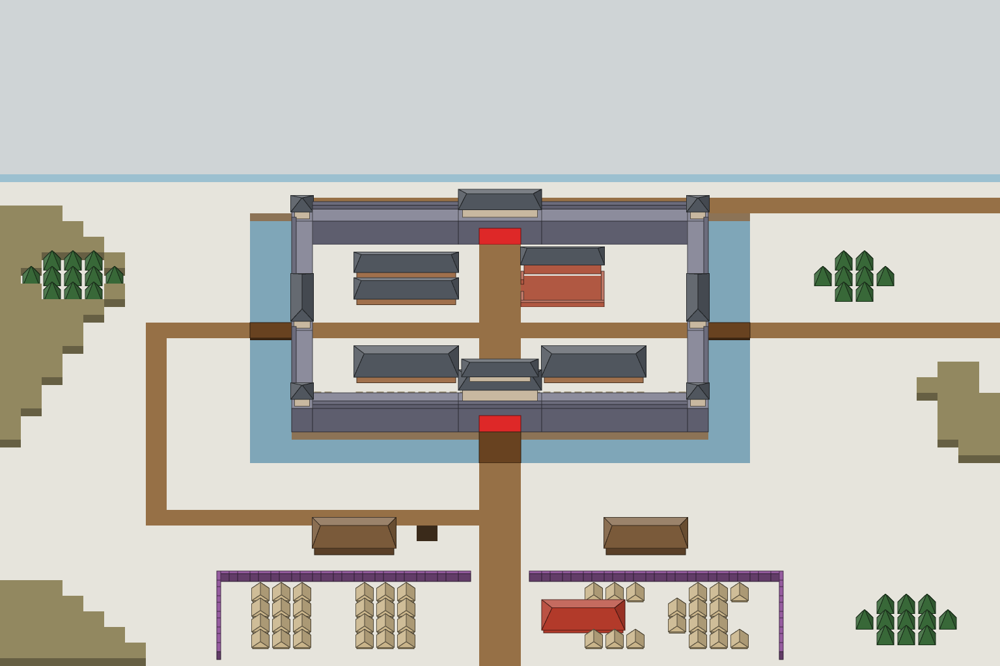

# 陈仓攻城战：美术资产

由 `node tools/build-siege-blockout.mjs` 生成，请改脚本而不是改这个文件。计划见 [01-chencang-art-plan.md](../../01-chencang-art-plan.md)。

## 全图灰盒

48×32 全图按计划 §4 的斜俯视投影渲染，缩到 50%（每格 32×24，一层 12px）。只用来检查布局和高度，不上传 ImageGen。

## S1 风格锁定（2026-11-02 通过）

| ID    | 资产                                              | 尺寸      | 出图                   |
| ----- | ------------------------------------------------- | --------- | ---------------------- |
| S1-01 | [陈仓全城小景](s1-01-city-vignette/README.md)     | 1536×1024 | 6 张，定稿 `v2-a.webp` |
| S1-02 | [南门门楼（标准件）](s1-02-south-gate/README.md)  | 1024×1024 | 4 张，定稿 `v4.webp`   |
| S1-03 | [城墙模块表](s1-03-wall-kit/README.md)            | 1536×1024 | 4 张，定稿 `v4.webp`   |
| S1-04 | [地表底板](s1-04-ground-plate/README.md)          | 1536×1024 | 3 张，定稿 `v2.webp`   |
| S1-05 | [蜀戟兵姿态表](s1-05-shu-halberd-sheet/README.md) | 1536×1024 | 5 张，定稿 `v5.webp`   |
| S1-06 | [魏弓兵姿态表](s1-06-wei-archer-sheet/README.md)  | 1536×1024 | 4 张，定稿 `v4.webp`   |

顺序：S1-01（三种风格）→ 你选风格 → S1-02 → 你确认标准件 → S1-03、S1-04 → S1-05、S1-06 → 预览页测试场景（计划 §11）。每个提示词出 3–4 张，选一张。

**画法：α 整画切层**（2026-11-01 在预览页对比后定，计划 §9.2）。城池是一整张画，按 `masks/` 切层，会变的部分在整画上局部重画；营地、器械、部队等不在城池画里的东西才出分件。S1-03、S1-04 只在预览页作 β 对照。

## S2 全图与完好态（2026-11-02 通过）

| ID    | 资产                                       | 尺寸      | 出图                 |
| ----- | ------------------------------------------ | --------- | -------------------- |
| S2-01 | [全图整画](s2-01-full-map/README.md)       | 3072×1536 | 21 张                |
| S2-08 | [中军帐和营帐](s2-08-camp-tents/README.md) | 1536×1024 | 3 张，定稿 `v2.webp` |
| S2-09 | [木栅模块](s2-09-palisade-kit/README.md)   | 1536×1024 | 3 张，定稿 `v2.webp` |
| S2-10 | [器械工棚](s2-10-workshop/README.md)       | 1536×1024 | 6 张，定稿 `v6.webp` |
| S2-11 | [野外点缀](s2-11-field-scenery/README.md)  | 1536×1024 | 3 张，定稿 `v3.webp` |

顺序：S2-01 分六步，一步一步来：先在 S1-01 v2-a 上补画马道，再按西北、东北、南、西南、东南五块向外扩画；每步选定后跑 `node tools/compose-siege-map.mjs` 拿到下一步的输入（见 S2-01 的说明）。S2-08 到 S2-11 是分件表，和 S2-01、和彼此都不相干，随时可以出。

S1-02 以后的提示词按脚本里的 `CHOSEN_STYLE`（风格字母）和 `CHOSEN_VIGNETTE`（作风格参考上传的那张 S1-01）生成，现在是 A 和 `v2-a.webp`；S1-03 起上传的标准件是 `CHOSEN_GATE`，现在是 S1-02 的 `v4.webp`。改选别的，就改这几项再重新生成。分件的提示词开头有一段由灰盒算出的像素坐标（对位坐标段），帮 ImageGen 把屋顶、门、女墙放准。

## S3 状态变体

| ID       | 资产                                               | 尺寸      | 出图                                                              |
| -------- | -------------------------------------------------- | --------- | ----------------------------------------------------------------- |
| S3-01    | [城堑填堑](s3-01-trench-fill/README.md)            | 1536×1024 | 6 张，定稿 `trench-half-v1.webp`、`trench-filled-v3.webp`         |
| S3-02    | [南门受损](s3-02-gate-south-damaged/README.md)     | 1536×1024 | 3 张，定稿 `gate-south-damaged-v2.webp`                           |
| S3-03    | [南门门破](s3-03-gate-south-broken/README.md)      | 1536×1024 | 3 张，定稿 `gate-south-broken-v2.webp`                            |
| S3-04    | [北门门破](s3-04-gate-north-broken/README.md)      | 1536×1024 | 3 张，定稿 `gate-north-broken-v2.webp`                            |
| S3-05    | [西门门破](s3-05-gate-west-broken/README.md)       | 1536×1024 | 3 张，定稿 `gate-west-broken-v2.webp`                             |
| S3-06    | [东门门破](s3-06-gate-east-broken/README.md)       | 1536×1024 | 3 张，定稿 `gate-east-broken-v2.webp`                             |
| S3-07/08 | [重墙（施工中、建成）](s3-07-inner-wall/README.md) | 1536×1024 | 6 张，定稿 `inner-wall-works-v1.webp`、`inner-wall-built-v1.webp` |

做法（计划 §9.2）：每一态是 S2-01 定稿全图上一块 1536×1024 的局部重画。跑 `node tools/compose-siege-states.mjs` 从全图裁出每一态的输入 `inputs/<态>.png`（新几何如重墙，先贴上灰盒）；选定后把文件名填进脚本的 `STATE_PICKS`，重跑两个脚本，就切出和全图对齐的补丁 `patches/<态>.png`（位置在 `patches/<态>.json`），以及贴回全图的对比 `previews/<态>.webp`。各件互不相干，可以同时出。

## S4 器械与反制

| ID    | 资产                                                 | 尺寸      | 出图                 |
| ----- | ---------------------------------------------------- | --------- | -------------------- |
| S4-01 | [云梯车](s4-01-ladder-cart/README.md)                | 1536×1024 | 3 张，定稿 `v2.webp` |
| S4-02 | [云梯架上墙面](s4-02-ladder-on-wall/README.md)       | 1536×1024 | 3 张，定稿 `v3.webp` |
| S4-03 | [冲车](s4-03-ram/README.md)                          | 1536×1024 | 3 张，定稿 `v1.webp` |
| S4-04 | [井阑](s4-04-siege-tower/README.md)                  | 1536×1024 | 3 张，定稿 `v1.webp` |
| S4-05 | [井阑燃烧、倾覆](s4-05-siege-tower-wrecks/README.md) | 1536×1024 | 3 张，定稿 `v3.webp` |
| S4-06 | [土车](s4-06-earth-cart/README.md)                   | 1536×1024 | 3 张，定稿 `v3.webp` |
| S4-07 | [城头石磨吊架](s4-07-millstone-crane/README.md)      | 1536×1024 | 2 张，定稿 `v3.webp` |

和 S2-08 到 S2-11 一样是品红底的 2 倍分件表，上传 S1-02 当标准件，各件互不相干。燃烧态只画焦黑和余烬，火苗和烟由程序加（MVP 计划 §8.3）；朝西推行由程序把朝东那件左右翻转。

## S5 部队与武将

| ID    | 资产                                                   | 尺寸      | 出图                 |
| ----- | ------------------------------------------------------ | --------- | -------------------- |
| S5-01 | [蜀步兵攀梯、运土](s5-01-shu-siege-poses/README.md)    | 1536×1024 | 3 张，定稿 `v2.webp` |
| S5-02 | [蜀弓弩兵姿态表](s5-02-shu-crossbow-sheet/README.md)   | 1536×1024 | 3 张，定稿 `v1.webp` |
| S5-03 | [魏步兵姿态表](s5-03-wei-infantry-sheet/README.md)     | 1536×1024 | 3 张，定稿 `v1.webp` |
| S5-04 | [旗帜](s5-04-banners/README.md)                        | 1536×1024 | 3 张，定稿 `v2.webp` |
| S5-05 | [诸葛亮乘四轮车](s5-05-zhuge-liang-carriage/README.md) | 1536×1024 | 3 张，定稿 `v1.webp` |
| S5-06 | [郝昭城头形象](s5-06-hao-zhao-wall/README.md)          | 1536×1024 | 3 张，定稿 `v3.webp` |
| S5-07 | [立绘：郝昭](s5-07-portrait-hao-zhao/README.md)        | 1024×1024 | 3 张，定稿 `v1.webp` |
| S5-08 | [立绘：王生](s5-08-portrait-wang-sheng/README.md)      | 1024×1024 | 3 张，定稿 `v2.webp` |
| S5-09 | [立绘：靳详](s5-09-portrait-jin-xiang/README.md)       | 1024×1024 | 3 张，定稿 `v2.webp` |

姿态表的做法同 S1-05、S1-06：上传版式图 `guide.png` 和对应阵营的 S1 定稿表（蜀用 S1-05 v5，魏用 S1-06 v4），保证是同一支军队。旗面留白，字和颜色由程序加。立绘照 v0.3 立绘的提示词结构（`docs/assets/v0.3-portraits/`），不上传参考图。

## S6 特效元素与界面

| ID    | 资产                                                                    | 尺寸      | 出图                 |
| ----- | ----------------------------------------------------------------------- | --------- | -------------------- |
| S6-01 | [火与烟](s6-01-fire-smoke/README.md)                                    | 1536×1024 | 3 张，定稿 `v1.webp` |
| S6-02 | [冲击](s6-02-impacts/README.md)                                         | 1536×1024 | 3 张，定稿 `v1.webp` |
| S6-03 | [图标表一：器械、反制、军令](s6-03-icons-siege/README.md)               | 1536×1024 | 3 张，定稿 `v3.webp` |
| S6-04 | [图标表二：高度、登城、填堑、余粮、援军等](s6-04-icons-state/README.md) | 1536×1024 | 3 张，定稿 `v3.webp` |
| S6-05 | [卷轴横幅和面板纸纹](s6-05-paper/README.md)                             | 1536×1024 | 3 张，定稿 `v2.webp` |

都是静态元素，动起来全靠程序（移动、缩放、淡入淡出、换图，MVP 计划 §8.3）。这一阶段要 ImageGen 直接出透明底（烟、尘、光晕要半透明，品红抠不出来）；特效以 S2-01 定稿全图的一块作风格参考，图标和纸纹不上传参考。

## S7 叙事与主视觉

| ID    | 资产                                                                      | 尺寸      | 出图                 |
| ----- | ------------------------------------------------------------------------- | --------- | -------------------- |
| S7-01 | [主视觉：雪中陈仓](s7-01-key-visual/README.md)                            | 1536×1024 | 3 张，定稿 `v2.webp` |
| S7-02 | [开场一：靳详城下劝降](s7-02-opening-persuasion/README.md)                | 1536×1024 | 3 张，定稿 `v1.webp` |
| S7-03 | [开场二：郝昭城头拒降](s7-03-opening-refusal/README.md)                   | 1536×1024 | 3 张，定稿 `v1.webp` |
| S7-04 | [幕间：火箭逆射，烧毁云梯](s7-04-fire-arrows/README.md)                   | 1536×1024 | 3 张，定稿 `v2.webp` |
| S7-05 | [结局：陈仓陷落（架空）](s7-05-ending-fall/README.md)                     | 1536×1024 | 3 张，定稿 `v3.webp` |
| S7-06 | [结局：粮尽退兵，王双追击被斩（史实）](s7-06-ending-withdrawal/README.md) | 1536×1024 | 3 张，定稿 `v1.webp` |
| S7-07 | [结局：蜀军溃败（架空）](s7-07-ending-rout/README.md)                     | 1536×1024 | 3 张，定稿 `v1.webp` |

完整的叙事画，和全图同一套水墨淡彩，但构图按插画，不用游戏机位。每张先上传 S2-01 定稿全图南半城作风格和建筑参考；有名有姓的人物再上传立绘，只作人物参考。旗面都空白，没有文字和血腥。

## 每个文件夹里有什么

- `blockout.png`（姿态表是 `guide.png`）：上传 ImageGen 的参考图。
- `grid.png`：透明底的格子和轮廓，叠在出图上检查对位。
- `masks/`：每个立体件在画面上的轮廓蒙版，α 法切层用；女墙前沿单独一张（`*-parapet.png`，L4 层）。只有 S1-01 和 S2-01 有。
- `footprints.json`：每个物件的占地格、高度、锚点（占地西南角的地面点）和像素框。
- `README.md`：说明、上传清单、完整提示词和检查项。
- `attempts/`：出的图。
