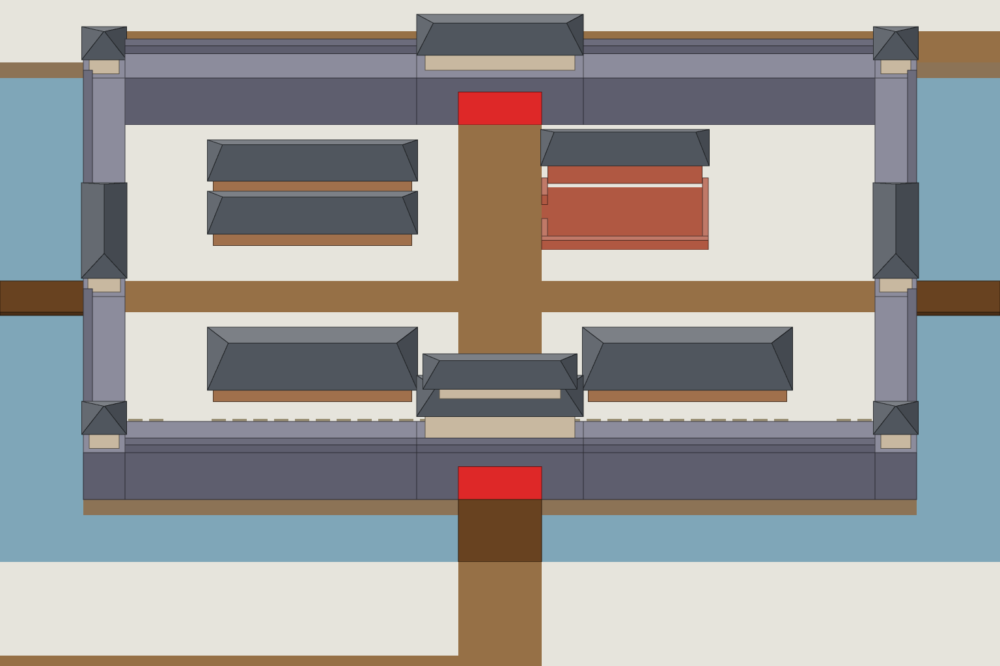

# S1-01 陈仓全城小景

`s1-01-city-vignette` · 由 `node tools/build-siege-blockout.mjs` 生成，请改脚本而不是改这个文件。计划见 [01-chencang-art-plan.md](../../../01-chencang-art-plan.md) §10。

- 取景 x 12–35、y 1–21（24×21 格），每格 64×48、每层 24px，正好是游戏 100% 缩放的分辨率，不用放大；底部多出 16px。
- 出三张，提示词只差风格段：A 界画淡彩、B 写意淡彩、C 沙盘微缩。你选定风格后，选中的那张也是 α 法（整画切层）的测试图，`masks/` 就是切层用的蒙版。

## 参考图



叠图检查用 `grid.png`（透明底）：黑线是地面格子，红线是立体件的面，橙线是墙顶等顶面上的格子。

## 上传与提示词

尺寸 1536×1024。上传：

1. `blockout.png`

### A 界画淡彩

出图存为 `attempts/v1-a.webp`。

```text
The attached image is a colour-coded 3D block-out, not a style reference. Strictly preserve the position, footprint, height and outline of every block: each block's top face and front face must stay within about a quarter of a grid cell of where it is drawn. Replace the flat colours with finished materials and keep straight architecture straight. Natural features (snow drifts, ice edges, trench banks, paths) may have soft organic edges, within half a cell of where they are marked.

Camera: orthographic three-quarter top-down view, looking due north and tilted about 50 degrees down from the horizon. Strictly parallel projection: no perspective, no vanishing points, near and far objects the same size. Every vertical edge is perfectly vertical, every east-west edge perfectly horizontal, and north-south edges run straight up the image. Only top faces and south-facing front faces are visible; east and west side faces are never visible.

Subject: the walled fortress of Chencang seen from the south, a battlefield map for a Three Kingdoms strategy game. Output 1536×1024, landscape, filled edge to edge. In the block-out, one grid cell is 64 pixels wide and 48 pixels deep, and one height level is 24 pixels.

Block-out legend (each colour means exactly this):
- pale grey-white (#e6e4dc): open ground under fresh snow
- brown (#967046): trampled mud-and-snow roads: the two streets that cross the city between its four gates, the approach roads, and the road along the river bank
- steel blue, one level below the ground (#7fa6b8), with ochre-brown earth banks (#8c7356): the defensive trench around the walls, half-frozen dark water between steep earth banks
- dark brown (#684220): plank bridges over the trench in front of the gates
- blue-grey top with a darker front (#8c8c9c / #5e5e6e): the city wall, rammed earth faced with grey brick, three levels high; the light top is the walkway and the darker strip along its outer edge (#6c6c7c) is a crenellated parapet
- red (#de2828): gate passages through the wall; paint them as dark open gateways with heavy closed timber doors, never red
- cream walls under slate roofs (#c8b8a0 / #50565e): timber gate towers and corner towers with snow-covered grey tile hip-and-gable roofs; the south gate tower has two storeys and is the tallest building, the others have one. The west and east gates open sideways, so their passages are hidden from this view and the road simply runs into the gate tower
- red-brown (#b05842): the commandant's residence: a main hall with a tiled roof along the north side, and a paved front courtyard inside a low wall
- tan walls under slate roofs (#a0704c / #50565e): long single-storey barracks, armoury and granary with snow-covered tiled roofs
- short dashes on the ground (#9a8f74): where an inner wall will later be built; paint only trampled ground with a few stacks of timber and baskets of earth

Setting: Chencang, a small but formidable Wei frontier fortress in the Wei River valley, winter of 228 AD. Compact and military rather than grand: brick-faced rammed-earth walls, a deep trench, trampled paths, snow on every roof and walkway. A clear, cold winter day.

Light: low winter sun from the lower left (south-west). Front faces catch a pale warm light, top faces carry fresh snow, and soft cool blue-grey shadows fall toward the upper right.

Style: traditional Chinese ink-wash painting with light colour (水墨淡彩), with the precision of jiehua (界画) ruled-line architectural painting: crisp, straight, evenly weighted ink lines on walls, gate towers, timber and roof tiles; soft transparent washes on snow, earth, ice and water; subtle rice-paper grain. Restrained winter palette: warm paper-white snow, ochre rammed earth, grey brick, dark timber, slate roof tiles, muted pine green, with small accents of red lacquer.

Game readability: surfaces soldiers stand on (open ground, roads, wall walkways, gate passages) are calm, flat and light, with low texture contrast. Vertical faces are clearly darker than top faces, so every height step reads at a glance. Walls are exactly as thick as marked; the walkway on top of each wall is a clean light strip with a crenellated parapet along its outer edge. Keep detail density even across the image, with no vignette and no darkened corners.

Do not include: any text, letters, calligraphy, seals or signatures; grid lines; borders, frames or paper margins; legend or compass; people, soldiers, horses, flags, banners or pennants; perspective views, horizon or sky; vignette; modern objects.
```

### B 写意淡彩

出图存为 `attempts/v1-b.webp`。

```text
The attached image is a colour-coded 3D block-out, not a style reference. Strictly preserve the position, footprint, height and outline of every block: each block's top face and front face must stay within about a quarter of a grid cell of where it is drawn. Replace the flat colours with finished materials and keep straight architecture straight. Natural features (snow drifts, ice edges, trench banks, paths) may have soft organic edges, within half a cell of where they are marked.

Camera: orthographic three-quarter top-down view, looking due north and tilted about 50 degrees down from the horizon. Strictly parallel projection: no perspective, no vanishing points, near and far objects the same size. Every vertical edge is perfectly vertical, every east-west edge perfectly horizontal, and north-south edges run straight up the image. Only top faces and south-facing front faces are visible; east and west side faces are never visible.

Subject: the walled fortress of Chencang seen from the south, a battlefield map for a Three Kingdoms strategy game. Output 1536×1024, landscape, filled edge to edge. In the block-out, one grid cell is 64 pixels wide and 48 pixels deep, and one height level is 24 pixels.

Block-out legend (each colour means exactly this):
- pale grey-white (#e6e4dc): open ground under fresh snow
- brown (#967046): trampled mud-and-snow roads: the two streets that cross the city between its four gates, the approach roads, and the road along the river bank
- steel blue, one level below the ground (#7fa6b8), with ochre-brown earth banks (#8c7356): the defensive trench around the walls, half-frozen dark water between steep earth banks
- dark brown (#684220): plank bridges over the trench in front of the gates
- blue-grey top with a darker front (#8c8c9c / #5e5e6e): the city wall, rammed earth faced with grey brick, three levels high; the light top is the walkway and the darker strip along its outer edge (#6c6c7c) is a crenellated parapet
- red (#de2828): gate passages through the wall; paint them as dark open gateways with heavy closed timber doors, never red
- cream walls under slate roofs (#c8b8a0 / #50565e): timber gate towers and corner towers with snow-covered grey tile hip-and-gable roofs; the south gate tower has two storeys and is the tallest building, the others have one. The west and east gates open sideways, so their passages are hidden from this view and the road simply runs into the gate tower
- red-brown (#b05842): the commandant's residence: a main hall with a tiled roof along the north side, and a paved front courtyard inside a low wall
- tan walls under slate roofs (#a0704c / #50565e): long single-storey barracks, armoury and granary with snow-covered tiled roofs
- short dashes on the ground (#9a8f74): where an inner wall will later be built; paint only trampled ground with a few stacks of timber and baskets of earth

Setting: Chencang, a small but formidable Wei frontier fortress in the Wei River valley, winter of 228 AD. Compact and military rather than grand: brick-faced rammed-earth walls, a deep trench, trampled paths, snow on every roof and walkway. A clear, cold winter day.

Light: low winter sun from the lower left (south-west). Front faces catch a pale warm light, top faces carry fresh snow, and soft cool blue-grey shadows fall toward the upper right.

Style: expressive Chinese ink-wash painting with light colour (写意淡彩): confident loose brush strokes and wet-on-wet washes, architecture suggested with fewer lines but still straight and readable, generous paper-white snow, subtle rice-paper grain. Restrained winter palette: ochre earth, grey brick, dark timber, slate roofs, muted pine green.

Game readability: surfaces soldiers stand on (open ground, roads, wall walkways, gate passages) are calm, flat and light, with low texture contrast. Vertical faces are clearly darker than top faces, so every height step reads at a glance. Walls are exactly as thick as marked; the walkway on top of each wall is a clean light strip with a crenellated parapet along its outer edge. Keep detail density even across the image, with no vignette and no darkened corners.

Do not include: any text, letters, calligraphy, seals or signatures; grid lines; borders, frames or paper margins; legend or compass; people, soldiers, horses, flags, banners or pennants; perspective views, horizon or sky; vignette; modern objects.
```

### C 沙盘微缩

出图存为 `attempts/v1-c.webp`。

```text
The attached image is a colour-coded 3D block-out, not a style reference. Strictly preserve the position, footprint, height and outline of every block: each block's top face and front face must stay within about a quarter of a grid cell of where it is drawn. Replace the flat colours with finished materials and keep straight architecture straight. Natural features (snow drifts, ice edges, trench banks, paths) may have soft organic edges, within half a cell of where they are marked.

Camera: orthographic three-quarter top-down view, looking due north and tilted about 50 degrees down from the horizon. Strictly parallel projection: no perspective, no vanishing points, near and far objects the same size. Every vertical edge is perfectly vertical, every east-west edge perfectly horizontal, and north-south edges run straight up the image. Only top faces and south-facing front faces are visible; east and west side faces are never visible.

Subject: the walled fortress of Chencang seen from the south, a battlefield map for a Three Kingdoms strategy game. Output 1536×1024, landscape, filled edge to edge. In the block-out, one grid cell is 64 pixels wide and 48 pixels deep, and one height level is 24 pixels.

Block-out legend (each colour means exactly this):
- pale grey-white (#e6e4dc): open ground under fresh snow
- brown (#967046): trampled mud-and-snow roads: the two streets that cross the city between its four gates, the approach roads, and the road along the river bank
- steel blue, one level below the ground (#7fa6b8), with ochre-brown earth banks (#8c7356): the defensive trench around the walls, half-frozen dark water between steep earth banks
- dark brown (#684220): plank bridges over the trench in front of the gates
- blue-grey top with a darker front (#8c8c9c / #5e5e6e): the city wall, rammed earth faced with grey brick, three levels high; the light top is the walkway and the darker strip along its outer edge (#6c6c7c) is a crenellated parapet
- red (#de2828): gate passages through the wall; paint them as dark open gateways with heavy closed timber doors, never red
- cream walls under slate roofs (#c8b8a0 / #50565e): timber gate towers and corner towers with snow-covered grey tile hip-and-gable roofs; the south gate tower has two storeys and is the tallest building, the others have one. The west and east gates open sideways, so their passages are hidden from this view and the road simply runs into the gate tower
- red-brown (#b05842): the commandant's residence: a main hall with a tiled roof along the north side, and a paved front courtyard inside a low wall
- tan walls under slate roofs (#a0704c / #50565e): long single-storey barracks, armoury and granary with snow-covered tiled roofs
- short dashes on the ground (#9a8f74): where an inner wall will later be built; paint only trampled ground with a few stacks of timber and baskets of earth

Setting: Chencang, a small but formidable Wei frontier fortress in the Wei River valley, winter of 228 AD. Compact and military rather than grand: brick-faced rammed-earth walls, a deep trench, trampled paths, snow on every roof and walkway. A clear, cold winter day.

Light: low winter sun from the lower left (south-west). Front faces catch a pale warm light, top faces carry fresh snow, and soft cool blue-grey shadows fall toward the upper right.

Style: a hand-made military sand-table diorama (沙盘) finished in Chinese ink-wash colours: matte clay ground, carved wooden buildings with slightly softened edges, gentle ambient occlusion where surfaces meet, faint ink outlines. Everything stays in sharp focus; no tilt-shift blur. Restrained winter palette: paper-white snow, ochre earth, grey brick, dark timber, slate roofs.

Game readability: surfaces soldiers stand on (open ground, roads, wall walkways, gate passages) are calm, flat and light, with low texture contrast. Vertical faces are clearly darker than top faces, so every height step reads at a glance. Walls are exactly as thick as marked; the walkway on top of each wall is a clean light strip with a crenellated parapet along its outer edge. Keep detail density even across the image, with no vignette and no darkened corners.

Do not include: any text, letters, calligraphy, seals or signatures; grid lines; borders, frames or paper margins; legend or compass; people, soldiers, horses, flags, banners or pennants; perspective views, horizon or sky; vignette; modern objects.
```

## 看什么

- 整体好不好看，三种风格哪种最好。
- 100% 缩放下，城墙顶走道、城门、堑和桥是否一眼能认出。
- 有没有透视、有没有画出建筑的东西侧面（都不该有），竖直棱线是否竖直。
- 把 `grid.png` 叠在出图上：墙、门楼、营房的顶面与灰盒误差不超过 1/4 格（横 16px、纵 12px）。
- 灰盒里的红色门洞、蓝灰墙体有没有被照搬成颜色。

## 出图记录

出的图放进 `attempts/`，依次命名 `v1-a.webp`、`v1-b.webp`、`v1-c.webp`，第二轮 `v2-a.webp`……
