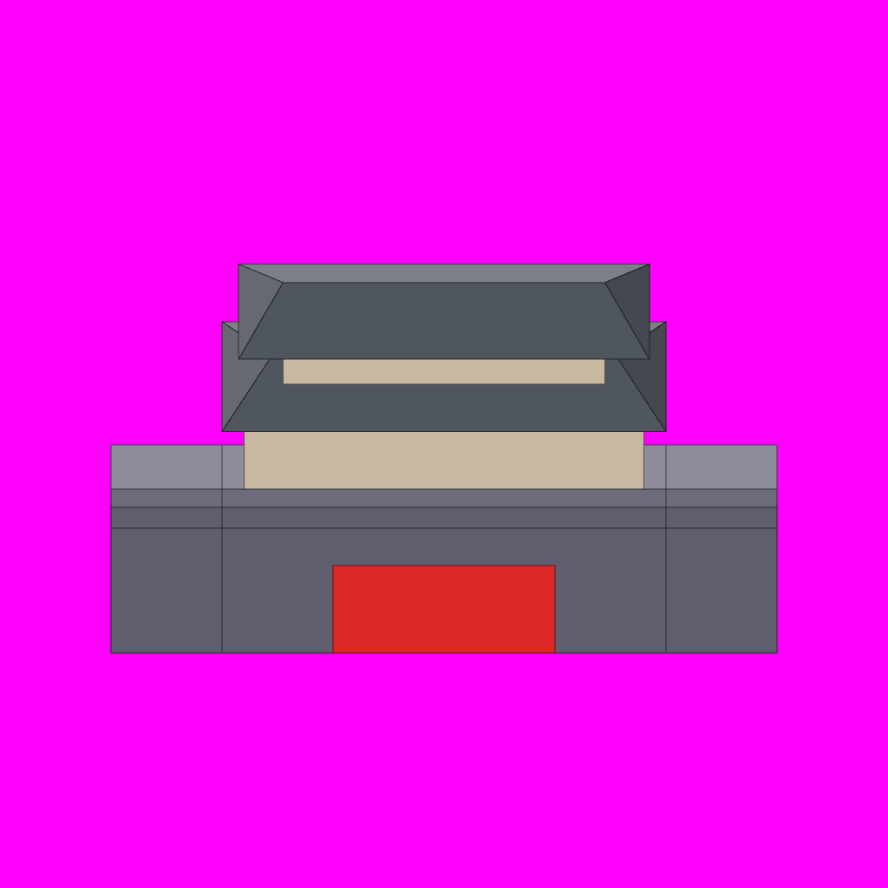

# S1-02 南门门楼（标准件）

`s1-02-south-gate` · 由 `node tools/build-siege-blockout.mjs` 生成，请改脚本而不是改这个文件。计划见 [01-chencang-art-plan.md](../../../01-chencang-art-plan.md) §10。

- 取景 x 21–26：6 格城墙，城门洞 x 23–24，门楼 x 22–25（两层，屋脊在 7 层）。每格 128×96、每层 48px，是 100% 的 2 倍。
- 只画物件本身：底边是地面线，不含地面和堑。
- 这一件定了就是**标准件**：从 S1-03 起，每件都上传它当风格参考。
- **2026-11-01 定稿：`attempts/v4.webp`**。它是 v3 抠掉背景后的版本：四角纯品红。透明版是 `selected-transparent.png`（复制自仓库根目录出图工作区的 `attempts/s1-02/v4-transparent.png`），预览页的 β 对照用它拼城。每一轮实际用的提示词记在 `generation-manifest.json`。v1 没有对位坐标段，屋顶偏高、门下漏出缺口；v2 起加了坐标段才对齐，下面的提示词已由脚本自动生成这一段。

## 参考图



叠图检查用 `grid.png`（透明底）：黑线是地面格子，红线是立体件的面，橙线是墙顶等顶面上的格子。

## 上传与提示词

尺寸 1024×1024。上传：

1. `blockout.png`
2. `docs/siege/chencang/art/s1-01-city-vignette/attempts/v2-a.webp`（第二张，风格参考）

```text
Output requirements: create an image exactly 1024 by 1024 pixels. Treat the first attached block-out as the exact 1024×1024 registration canvas. Paint only the architecture; every empty background pixel must be perfectly uniform pure magenta RGB(255,0,255), hex #FF00FF. Apply paper grain and watercolour texture only inside the building silhouettes, never on the magenta background. No paper sheet, paper margin, background texture, cast shadow, floor or haze.

Registration landmarks on this canvas (pixel boxes measured from the block-out):
- wall, from the back edge of its walkway down to its base: x=128..896, y=513..753
- crenellated parapet: x=128..896, y=564..609
- closed gate doors, reaching all the way down to the wall base: x=384..640, y=652..753
- gate tower lower roof: x=256..768, y=371..498
- gate tower upper roof: x=275..749, y=305..414
Match every roof height and position to these boxes rather than making towers taller or walls longer.

Match the brushwork, line weight, colours and lighting of the second attached image (the chosen city view) exactly.

Style priority — A 界画淡彩: Paint the object as a TWO-DIMENSIONAL TRADITIONAL CHINESE JIEHUA PAINTING. Finely ruled, uniform slender ink contours define the architecture with quiet precise architectural draughtsmanship. Flat, pale, transparent ochre and grey watercolour washes with soft ink diffusion; snow left as clean paper-white. Keep brick and roof-tile marks sparse and deliberately drawn by hand, with generous calm untextured surfaces. The result must unmistakably read as fine Chinese ink-and-light-colour architectural painting, not a realistic digital render. No photographic material textures, physically based rendering, glossy surfaces, dense mottling or dark heavy outlines.

The first attached image is a colour-coded 3D block-out, not a style reference. Strictly preserve the position, footprint, height and outline of every block: each block's top face and front face must stay within about a quarter of a grid cell of where it is drawn. Replace the flat colours with finished materials and keep straight architecture straight. Natural features (snow drifts, ice edges, trench banks, paths) may have soft organic edges, within half a cell of where they are marked.

Camera: orthographic three-quarter top-down view, looking due north and tilted about 50 degrees down from the horizon. Strictly parallel projection: no perspective, no vanishing points, near and far objects the same size. Every vertical edge is perfectly vertical, every east-west edge perfectly horizontal, and north-south edges run straight up the image. Only top faces and south-facing front faces are visible; east and west side faces are never visible.

Subject: one building piece for a strategy game: the south gate of Chencang. A six-cell section of the city wall (rammed earth faced with grey brick, three levels high, a light walkway on top, a crenellated parapet along the front edge and only a low plain kerb along the back edge) with a two-cell gate passage in the middle. Heavy iron-studded timber gate doors stand closed inside the passage. On the wall above the passage stands a two-storey timber gate tower: red-lacquered columns, white plastered walls with lattice windows, a wooden gallery around the upper storey, and a snow-covered grey tile hip-and-gable roof with gently upturned eaves. In the block-out the red panel marks the gate passage: paint it as a dark gateway with the closed doors inside, never red. Output 1024×1024. In the block-out, one grid cell is 128 pixels wide and 96 pixels deep, and one height level is 48 pixels.

Isolated object only, on a perfectly flat solid magenta (#FF00FF) background with no gradient, texture or ground. Nothing else in the frame. Clean edges against the background, and no magenta tint reflected onto the object.

Light: low winter sun from the lower left (south-west). Front faces catch a pale warm light and top faces carry fresh snow. Shade the object itself only; do not paint any cast shadow on the ground.

Style: traditional Chinese ink-wash painting with light colour (水墨淡彩), with the precision of jiehua (界画) ruled-line architectural painting: crisp, straight, evenly weighted ink lines on walls, gate towers, timber and roof tiles; soft transparent washes on snow, earth, ice and water; subtle rice-paper grain. Restrained winter palette: warm paper-white snow, ochre rammed earth, grey brick, dark timber, slate roof tiles, muted pine green, with small accents of red lacquer.

Do not include: any text, letters, calligraphy, seals or signatures; grid lines or guide marks; ground, scenery or cast shadows; people, soldiers, horses, flags, banners or pennants; modern objects.
```

## 看什么

- 和选定的 S1-01 是不是同一套笔法、颜色和光照；细节比 S1-01 多，但不能变成另一种画法。
- 比例、线条、歇山顶、积雪、立面明暗、门扇。
- 门楼两层，屋脊是灰盒里的最高点；城墙三层高，墙顶走道和外沿女墙清楚。
- 背景是纯品红，没有地面、堑和落地影子。
- 把 `grid.png` 叠上去：墙顶、门楼的位置和灰盒对得上。

## 出图记录

出的图放进 `attempts/`，依次命名 `v1.webp`、`v2.webp`……
