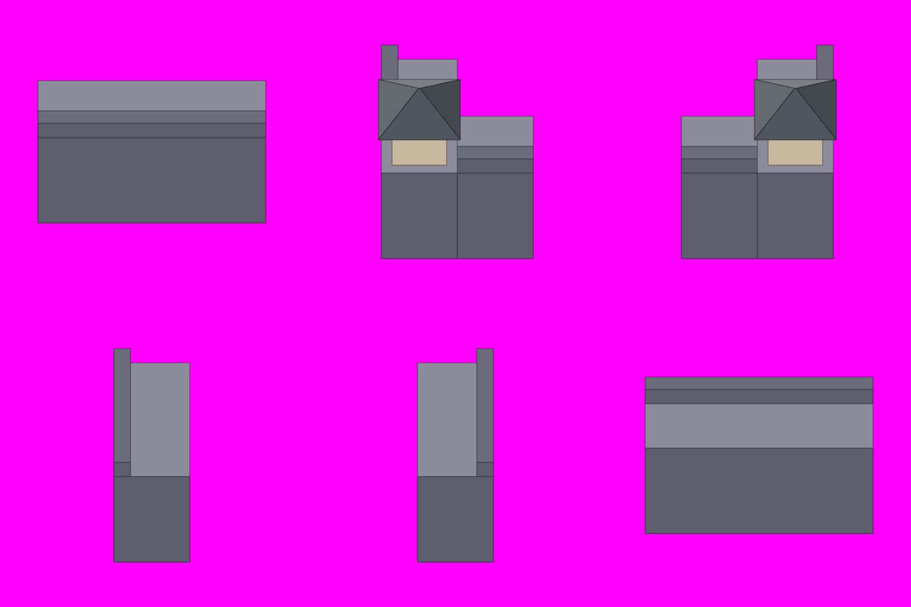

# S1-03 城墙模块表

`s1-03-wall-kit` · 由 `node tools/build-siege-blockout.mjs` 生成，请改脚本而不是改这个文件。计划见 [01-chencang-art-plan.md](../../../01-chencang-art-plan.md) §10。

- 3×2 宫格，每格 512×512 放一件；每格 128×96、每层 48px，同 S1-02。
- 六件：上排是南墙直段（3 格）、西南角楼、东南角楼；下排是西墙段（南北向 2 格）、东墙段（2 格）、北墙直段（3 格，从城内看）。
- 和计划初稿相比：南墙直段从 4 格改成 3 格、西墙段从 3 格改成 2 格，否则放不进 512 格还留 32px 边；西门（一层门楼）高 3 格、放不下，挪到 S2 和东门一起做，这里换成北墙直段，补上"从城内看女墙"这种情况。

## 参考图



叠图检查用 `grid.png`（透明底）：黑线是地面格子，红线是立体件的面，橙线是墙顶等顶面上的格子。

## 上传与提示词

尺寸 1536×1024。上传：

1. `blockout.png`
2. 定稿的 S1-02（第二张，风格参考）

```text
Match the brushwork, line weight, colours and lighting of the second attached image exactly.

The attached image is a colour-coded 3D block-out, not a style reference. Strictly preserve the position, footprint, height and outline of every block: each block's top face and front face must stay within about a quarter of a grid cell of where it is drawn. Replace the flat colours with finished materials and keep straight architecture straight. Natural features (snow drifts, ice edges, trench banks, paths) may have soft organic edges, within half a cell of where they are marked.

Camera: orthographic three-quarter top-down view, looking due north and tilted about 50 degrees down from the horizon. Strictly parallel projection: no perspective, no vanishing points, near and far objects the same size. Every vertical edge is perfectly vertical, every east-west edge perfectly horizontal, and north-south edges run straight up the image. Only top faces and south-facing front faces are visible; east and west side faces are never visible.

Subject: a modular kit of city-wall pieces for a strategy game, six separate pieces arranged in a 3 by 2 grid exactly as in the block-out, one piece centred in each 512×512 cell, with clear empty space between pieces. All pieces share the same wall: rammed earth faced with grey brick, three levels high, a light walkway on top with a crenellated parapet along the outer edge, snow on every top surface.
Top row, left to right: a straight three-cell section of the south wall, parapet along its front (south) edge; the south-west corner, where the south wall meets the west wall, with a small one-storey corner tower; the south-east corner, the same mirrored.
Bottom row, left to right: a two-cell section of the west wall running north-south, so only its top walkway and its southern end face are visible, parapet along the west edge; the same for the east wall, parapet along the east edge; a straight three-cell section of the north wall seen from inside the city, parapet along its back (north) edge, so the inner face of the parapet shows above the walkway.
In the block-out, one grid cell is 128 pixels wide and 96 pixels deep, and one height level is 48 pixels.

Isolated object only, on a perfectly flat solid magenta (#FF00FF) background with no gradient, texture or ground. Nothing else in the frame. Clean edges against the background, and no magenta tint reflected onto the object.

Light: low winter sun from the lower left (south-west). Front faces catch a pale warm light and top faces carry fresh snow. Shade the object itself only; do not paint any cast shadow on the ground.

Style: traditional Chinese ink-wash painting with light colour (水墨淡彩), with the precision of jiehua (界画) ruled-line architectural painting: crisp, straight, evenly weighted ink lines on walls, gate towers, timber and roof tiles; soft transparent washes on snow, earth, ice and water; subtle rice-paper grain. Restrained winter palette: warm paper-white snow, ochre rammed earth, grey brick, dark timber, slate roof tiles, muted pine green, with small accents of red lacquer.

Do not include: any text, letters, calligraphy, seals or signatures; grid lines or guide marks; ground, scenery or cast shadows; people, soldiers, horses, flags, banners or pennants; modern objects.
```

## 看什么

- 六件和 S1-02 是不是同一套笔法、颜色和光照。
- 南北向墙段只见墙顶和南端截面，没有画出东西侧面。
- 直段左右两端、南北墙段上下两端能不能无缝拼接。
- 女墙都在外沿；北墙那件看得到女墙的内侧。

## 出图记录

出的图放进 `attempts/`，依次命名 `v1.webp`、`v2.webp`……
