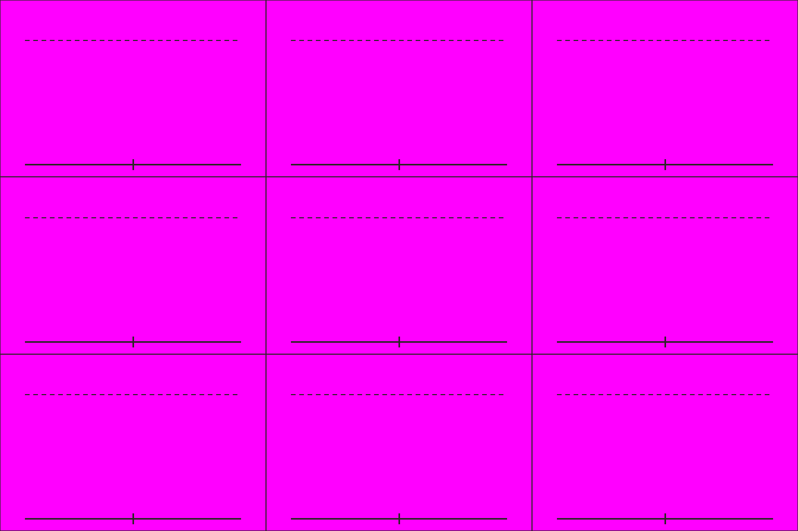

# S1-05 蜀戟兵姿态表

`s1-05-shu-halberd-sheet` · 由 `node tools/build-siege-blockout.mjs` 生成，请改脚本而不是改这个文件。计划见 [01-chencang-art-plan.md](../../../01-chencang-art-plan.md) §10。

- 3×3 宫格，每格约 512×341：行是背面（朝北）、侧面（朝东）、正面（朝南），列是待机、行进、攻击。
- 人物从脚底到头盔顶约 240px（计划初稿写 280px，但格子只有 341px 高，戟会顶出格子），戟可以高出头顶线。
- 2026-11-01 完成五版，采用 `attempts/v5.webp`，已缩短正面突刺的戟尖。透明表见 `selected-transparent.png`；九个独立姿态在 `poses/`，逐格缩放及脚底锚点见 `poses.json`，提示词及检查见 `generation-manifest.json`。

## 参考图



## 上传与提示词

尺寸 1536×1024。上传：

1. `guide.png`
2. `docs/v0.3/assets/generated/units-count-ink-04/infantry.png`（第二张）

```text
Subject: a character pose sheet of one Shu-Han halberd infantryman for a strategy game, the same soldier drawn nine times. Arrange the sheet as a 3 by 3 grid of equal cells (512×341 pixels each) exactly as in the first attached guide: one full-body figure per cell, every figure the same size (about 240 pixels from the soles to the top of the helmet, up to the dashed line; the halberd may reach higher), feet on the solid baseline.
Rows, top to bottom: seen from behind, facing away (north); seen from the side, facing right (east); seen from the front, facing the viewer (south).
Columns, left to right: standing ready; marching mid-stride; attacking, thrusting the halberd forward.
Camera: the same orthographic three-quarter top-down camera as the battlefield, about 50 degrees from above, so the top of the helmet and the shoulders are visible and the figure is slightly foreshortened.
The soldier: a late Eastern Han infantryman in a bright jade-green (#5f9a5a) padded war coat with red (#a8432f) trim over dark iron lamellar armour, a fur-lined collar against the winter cold, a rounded iron helmet with a neck guard, wrapped leggings and boots, a ji (戟) halberd and a small round wooden shield. No facial features, like the reference figure. Identical armour, colours, weapon and proportions in every cell.
Style: match the second attached reference figure exactly in brushwork and colour handling: bold dark ink outline, flat ink-textured colour fills, no facial features. Match its style only, not its camera angle.
Light: low winter sun from the lower left (south-west); shade the figure only, with no cast shadow.

Isolated object only, on a perfectly flat solid magenta (#FF00FF) background with no gradient, texture or ground. Nothing else in the frame. Clean edges against the background, and no magenta tint reflected onto the object.

Do not include: any text, letters, calligraphy, seals or signatures; grid lines or guide marks; ground, scenery or cast shadows; additional figures, horses, flags, banners or pennants; modern objects.
```

## 看什么

- 把图缩到约 1/7（人物约 36px 高）看：三个朝向、三个姿势是否都看得懂。
- 和现有 ink-04 步兵是不是同一套画风。
- 九格是同一个人：甲胄、颜色、兵器、比例一致，脚都踩在基线上。

## 出图记录

出的图放进 `attempts/`，依次命名 `v1.webp`、`v2.webp`……
