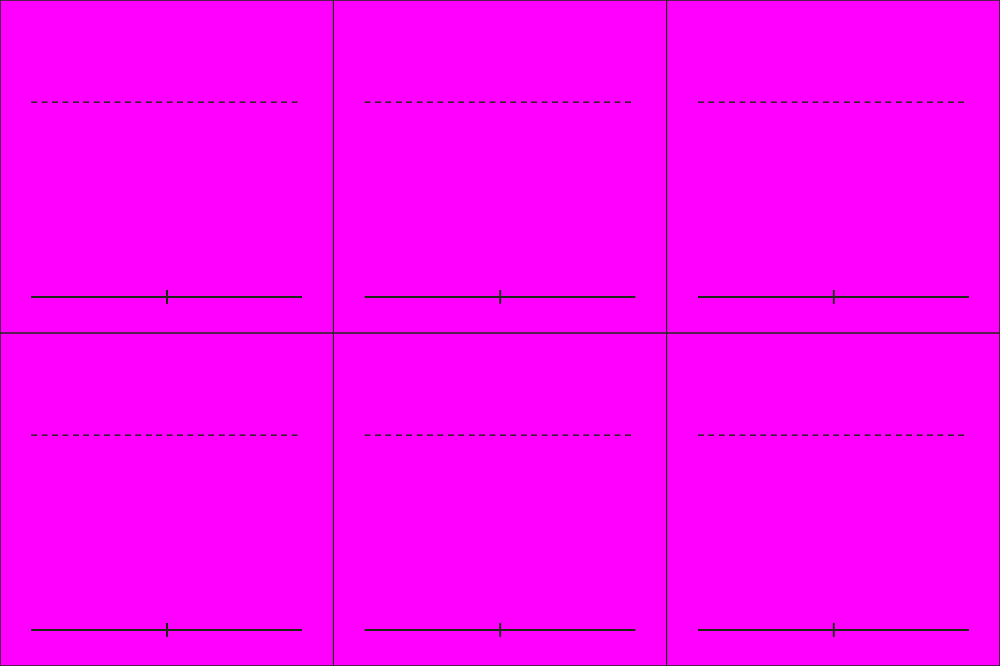

# S1-06 魏弓兵姿态表

`s1-06-wei-archer-sheet` · 由 `node tools/build-siege-blockout.mjs` 生成，请改脚本而不是改这个文件。计划见 [01-chencang-art-plan.md](../../../01-chencang-art-plan.md) §10。

- 3×2 宫格，每格 512×512。第一行正面（朝南）的待机、拉弓、放火箭；第二行背面待机、侧面（朝东）待机、侧面拉弓。
- 人物从脚底到头盔顶约 300px。

## 参考图



## 上传与提示词

尺寸 1536×1024。上传：

1. `guide.png`
2. `docs/v0.3/assets/generated/units-count-ink-04/archer.png`（第二张）

```text
Subject: a character pose sheet of one Wei archer for a strategy game, the same soldier drawn six times. Arrange the sheet as a 3 by 2 grid of equal cells (512×512 pixels each) exactly as in the first attached guide: one full-body figure per cell, every figure the same size (about 300 pixels from the soles to the top of the helmet, up to the dashed line), feet on the solid baseline.
Top row, all seen from the front facing the viewer (south): standing ready; drawing the bow; loosing a fire arrow with a burning arrowhead.
Bottom row: standing ready, seen from behind (north); standing ready, seen from the side facing right (east); drawing the bow, seen from the side facing right.
Camera: the same orthographic three-quarter top-down camera as the battlefield, about 50 degrees from above, so the top of the helmet and the shoulders are visible and the figure is slightly foreshortened.
The soldier: a Wei archer in a deep indigo (#2f4a6e) padded war coat over black lacquered lamellar armour, a fur-lined collar against the winter cold, a round iron helmet with a neck guard, a long recurve bow and a quiver at the hip. No facial features, like the reference figure. Identical armour, colours, bow and proportions in every cell.
Style: match the second attached reference figure exactly in brushwork and colour handling: bold dark ink outline, flat ink-textured colour fills, no facial features. Match its style only, not its camera angle.
Light: low winter sun from the lower left (south-west); shade the figure only, with no cast shadow.

Isolated object only, on a perfectly flat solid magenta (#FF00FF) background with no gradient, texture or ground. Nothing else in the frame. Clean edges against the background, and no magenta tint reflected onto the object.

Do not include: any text, letters, calligraphy, seals or signatures; grid lines or guide marks; ground, scenery or cast shadows; people, soldiers, horses, flags, banners or pennants; modern objects.
```

## 看什么

- 缩到人物约 36px 高看：三个朝向、拉弓和放火箭是否看得懂，火箭的箭头有火。
- 和 S1-05 的蜀兵放在一起、再转成灰度，能否一眼分出蜀魏。
- 六格是同一个人，脚都踩在基线上。

## 出图记录

出的图放进 `attempts/`，依次命名 `v1.webp`、`v2.webp`……
