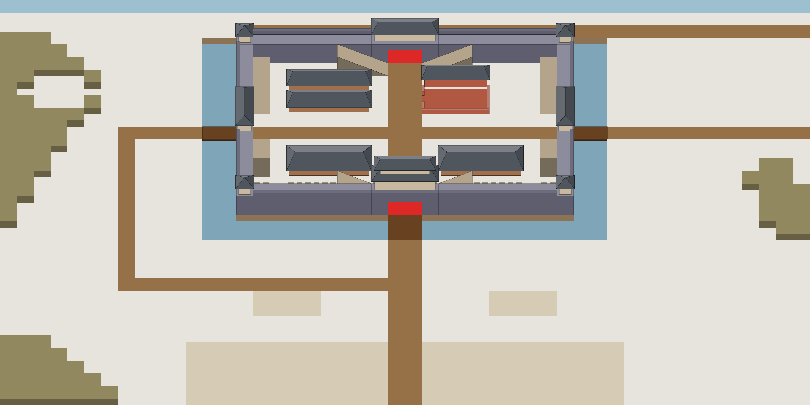

# S2-01 全图整画

`s2-01-full-map` · 由 `node tools/build-siege-blockout.mjs` 生成，请改脚本而不是改这个文件。计划见 [01-chencang-art-plan.md](../../../01-chencang-art-plan.md) §9.2、§13。

- 全图 3072×1536：48×32 格，每格 64×48、每层 24px，正好是游戏 100% 缩放的分辨率，原点在西北角。冰河以北多出的 24px 画成冰面。地图四边由程序淡出成纸色（留白），所以不画远山，B02 远景留到 S7。
- **城池本体直接用 S1-01 v2-a**，放在全图的 (768, 48)，不重画：它和灰盒对得准，蒙版已经能切。第 1 步在它上面补画八条马道，第 2–6 步以它为中心分五块向外扩画。
- 整画里只画地面：营帐、木栅、辕门、工棚、树都是分件（S2-08～S2-11），这里只画营地踩实的雪地和林下的雪地。地道口留到 v0.2，这里画成雪地。
- 每一步都是 ImageGen 的**编辑**：只上传一张 `inputs/<步>.png`，它是已画好的部分加上这一步要画的灰盒。`inputs/` 由 `node tools/compose-siege-map.mjs` 生成：脚本把已选定的各步拼起来，写出下一步的输入，以及拼图进度 `composite.webp`（100%）和 `preview.webp`（50%）。
- 拼接：每块只取它新画的部分，在已画好的一侧留 48px 渐变；马道补画只取马道外扩 12px、再渐变 10px 的一圈。编辑会把已画的部分也轻微重画，所以脚本拼之前先找出整块的错位（±8px），对齐后再拼，并报出偏移和差值。
- 选定一张后，把文件名填进 `tools/build-siege-blockout.mjs` 的 `MAP_PICKS`，重跑这个脚本，再跑 compose 脚本，就得到下一步的输入。
- `steps/` 里每步两张：`<步>-paint.png`（白色是这一步要画的地方；工具支持蒙版编辑时可以一起上传）和 `<步>-blend.png`（拼接权重）。`masks/`、`footprints.json` 用全图坐标，游戏按它们切层；`steps.json` 给 compose 脚本读。
- **2026-11-02 六步都已选定**（2026-11-02 你在审阅页确认）：马道 `city-v3`、西北 `nw-v1`、东北 `ne-v2`、南 `s-v6`、西南 `sw-v3`、东南 `se-v3`；compose 报的偏移都是 0,0，差值 5.3–9.0。南块第一轮（v1–v3）把十字路画到了营地边上，于是南、西南、东南三块的场景描述里写明了路和营地的像素位置，第二轮起都对。出图用 Codex 内置 image_gen（gpt-6.1-sol，xhigh），每步每张的提示词、源文件和选择理由记在 `generation-manifest.json`。

## 参考图



叠图检查用 `grid.png`（透明底）：黑线是地面格子，红线是立体件的面，橙线是墙顶等顶面上的格子。

## 上传与提示词

尺寸 3072×1536。上传：

1. 每一步只上传一张：`inputs/<步>.png`（编辑对象，先跑 `node tools/compose-siege-map.mjs` 生成）。工具支持蒙版编辑时，可以同时给 `steps/<步>-paint.png`。

### 第 1 步 · 马道补画（city）

上传 `inputs/city.png`：v2-a 上贴了八块马道灰盒。出图存为 `attempts/city-v1.webp`、`city-v2.webp`……

```text
Edit task: add eight horse ramps to a finished painting. The attached image is the edit target, exactly 1536×1024, and the output must be exactly 1536×1024 too.

It is the finished painting of the walled city of Chencang, a traditional Chinese jiehua ink-and-light-colour painting. Eight flat sandy-grey shapes (#b4a48c, some with a darker front) have been pasted onto it inside the walls; each marks a horse ramp (马道) to paint in. A horse ramp is a sloping ramp of rammed earth faced with grey brick, built against the inner face of the city wall, rising from the ground inside the city to the walkway on top of the wall, with a smooth paved slope (no steps) and a low plain kerb along its open side. Where a ramp reaches the walkway, open the walkway's inner kerb so the two join.

Ramp positions on this canvas (pixel boxes measured from the block-out):
- against the north wall, west of its gate: low at its east end beside the gate road, reaching the walkway at its west end: x=512..704, y=120..240
- against the north wall, east of its gate: low at its west end beside the gate road, reaching the walkway at its east end: x=832..1024, y=120..240
- against the west wall, north of its gate, running north-south: low at its south end beside the gate road, reaching the walkway at its north end: x=192..256, y=168..384
- against the east wall, north of its gate, running north-south: low at its south end beside the gate road, reaching the walkway at its north end: x=1280..1344, y=168..384
- against the west wall, south of its gate, running north-south: low at its north end beside the gate road, reaching the walkway at its south end, where its south end face shows: x=192..256, y=480..624
- against the east wall, south of its gate, running north-south: low at its north end beside the gate road, reaching the walkway at its south end, where its south end face shows: x=1280..1344, y=480..624
- against the south wall, west of its gate: low at its east end beside the gate road, reaching the walkway at its west end: x=512..704, y=600..720
- against the south wall, east of its gate: low at its west end beside the gate road, reaching the walkway at its east end: x=832..1024, y=600..720
Paint each ramp inside its box and no larger.

Repaint only the eight marked shapes and the few pixels around them needed to blend them in. Keep everything else exactly as it is: do not move, redraw, recolour, sharpen or blur it, and keep the output aligned pixel for pixel with the input, at exactly the same size.

Paint the ramps with exactly the brushwork, line weight, colours and light of the walls around them.

Camera: orthographic three-quarter top-down view, looking due north and tilted about 50 degrees down from the horizon. Strictly parallel projection: no perspective, no vanishing points, near and far objects the same size. Every vertical edge is perfectly vertical, every east-west edge perfectly horizontal, and north-south edges run straight up the image. Only top faces and south-facing front faces are visible; east and west side faces are never visible.

Light: low winter sun from the lower left (south-west). Front faces catch a pale warm light, top faces carry fresh snow, and soft cool blue-grey shadows fall toward the upper right.

Style: traditional Chinese ink-wash painting with light colour (水墨淡彩), with the precision of jiehua (界画) ruled-line architectural painting: crisp, straight, evenly weighted ink lines on walls, gate towers, timber and roof tiles; soft transparent washes on snow, earth, ice and water; subtle rice-paper grain. Restrained winter palette: warm paper-white snow, ochre rammed earth, grey brick, dark timber, slate roof tiles, muted pine green, with small accents of red lacquer.

Do not include: any text, letters, calligraphy, seals or signatures; grid lines; borders, frames or paper margins; legend or compass; people, soldiers, horses, flags, banners or pennants; perspective views, horizon or sky; vignette; modern objects.
```

### 第 2 步 · 西北块（nw）

上传 `inputs/nw.png`：要画的是 x=0..768, y=0..1024、x=768..1536, y=0..48，其余已经画好。出图存为 `attempts/nw-v1.webp`……

```text
Edit task: extend a finished painting over the rest of the frame (outpainting). The attached image is the edit target, exactly 1536×1024, and the output must be exactly 1536×1024 too.

Part of it is already finished: a traditional Chinese jiehua ink-and-light-colour painting of a battlefield map. The rest, the left half of the image and the thin strip along its top edge (x=0..768, y=0..1024 and x=768..1536, y=0..48), is still a flat colour-coded block-out. Repaint only the block-out area, as a seamless continuation of the finished painting, as if the whole image had been painted at once by the same hand: the same brushwork, line weight, paper grain, colours, light and density of detail. Roads, banks, hills and snow that cross into the block-out area continue without a seam or a change of tone. Keep the finished area exactly as it is: do not move, redraw, recolour, sharpen or blur it, and keep the output aligned pixel for pixel with the input, at exactly the same size.

Style priority — A 界画淡彩: The entire image is a TWO-DIMENSIONAL TRADITIONAL CHINESE JIEHUA PAINTING on warm rice paper. Finely ruled, uniform slender ink contours define the architecture with quiet precise architectural draughtsmanship. Flat, pale, transparent ochre and grey watercolour washes; broad untouched paper-white snow. Show soft ink diffusion and visible subtle paper fibres throughout the image. Keep brick and roof-tile marks sparse and deliberately drawn by hand, with generous calm untextured surfaces. The result must unmistakably read as fine Chinese ink-and-light-colour architectural painting, not a realistic digital environment. No photographic material textures, physically based rendering, glossy surfaces, dense mottling or dark heavy outlines. Preserve every block's location and silhouette from the reference, and keep open snow and roads free of added trees, rocks or extra buildings.

The block-out area is a colour-coded 3D block-out, not a style reference. Strictly preserve the position, footprint, height and outline of every block: each block's top face and front face must stay within about a quarter of a grid cell of where it is drawn. Replace the flat colours with finished materials and keep straight architecture straight. Natural features (snow drifts, ice edges, trench banks, paths) may have soft organic edges, within half a cell of where they are marked.

Camera: orthographic three-quarter top-down view, looking due north and tilted about 50 degrees down from the horizon. Strictly parallel projection: no perspective, no vanishing points, near and far objects the same size. Every vertical edge is perfectly vertical, every east-west edge perfectly horizontal, and north-south edges run straight up the image. Only top faces and south-facing front faces are visible; east and west side faces are never visible.

Subject of the block-out area: the country west of the fortress: the frozen Wei River along the top edge, open snowy ground, the low snowy foothills of the Qinling along the west edge with a small snowy hollow among them where a wood will stand (its trees are added later), and a road that comes up from the south-west and turns east to the bridge at the west gate. Along the right edge of the block-out area runs the outer earth bank of the city trench, whose water is already painted on the other side. In the block-out, one grid cell is 64 pixels wide and 48 pixels deep, and one height level is 24 pixels.

Block-out legend (each colour means exactly this):
- pale grey-white (#e6e4dc): open ground under fresh snow
- brown (#967046): trampled mud-and-snow roads: the two streets that cross the city between its four gates, the approach roads, and the road along the river bank
- pale icy blue, one level below the ground (#9cc0d0): the frozen Wei River
- olive (#928860): low snowy hills

Setting: the siege of Chencang, a small Wei frontier fortress in the Wei River valley, winter of 228 AD. A clear, cold winter day.

Light: low winter sun from the lower left (south-west). Front faces catch a pale warm light, top faces carry fresh snow, and soft cool blue-grey shadows fall toward the upper right.

Style: traditional Chinese ink-wash painting with light colour (水墨淡彩), with the precision of jiehua (界画) ruled-line architectural painting: crisp, straight, evenly weighted ink lines on walls, gate towers, timber and roof tiles; soft transparent washes on snow, earth, ice and water; subtle rice-paper grain. Restrained winter palette: warm paper-white snow, ochre rammed earth, grey brick, dark timber, slate roof tiles, muted pine green, with small accents of red lacquer.

Game readability: open ground, roads and camp ground are calm, flat and light, with low texture contrast, so soldiers, tents and trees placed on top later stay readable. The fronts of hills and trench banks are clearly darker than the ground. Keep the density of detail of the finished area, with no vignette and no darkened corners.

Do not include: any text, letters, calligraphy, seals or signatures; grid lines; borders, frames or paper margins; legend or compass; people, soldiers, horses, flags, banners or pennants; tents, fences, sheds, siege engines, trees or rocks, which are added later as separate pieces; perspective views, horizon or sky; vignette; modern objects.
```

### 第 3 步 · 东北块（ne）

上传 `inputs/ne.png`：要画的是 x=768..1536, y=0..1024、x=0..768, y=0..48，其余已经画好。出图存为 `attempts/ne-v1.webp`……

```text
Edit task: extend a finished painting over the rest of the frame (outpainting). The attached image is the edit target, exactly 1536×1024, and the output must be exactly 1536×1024 too.

Part of it is already finished: a traditional Chinese jiehua ink-and-light-colour painting of a battlefield map. The rest, the right half of the image and the thin strip along its top edge (x=768..1536, y=0..1024 and x=0..768, y=0..48), is still a flat colour-coded block-out. Repaint only the block-out area, as a seamless continuation of the finished painting, as if the whole image had been painted at once by the same hand: the same brushwork, line weight, paper grain, colours, light and density of detail. Roads, banks, hills and snow that cross into the block-out area continue without a seam or a change of tone. Keep the finished area exactly as it is: do not move, redraw, recolour, sharpen or blur it, and keep the output aligned pixel for pixel with the input, at exactly the same size.

Style priority — A 界画淡彩: The entire image is a TWO-DIMENSIONAL TRADITIONAL CHINESE JIEHUA PAINTING on warm rice paper. Finely ruled, uniform slender ink contours define the architecture with quiet precise architectural draughtsmanship. Flat, pale, transparent ochre and grey watercolour washes; broad untouched paper-white snow. Show soft ink diffusion and visible subtle paper fibres throughout the image. Keep brick and roof-tile marks sparse and deliberately drawn by hand, with generous calm untextured surfaces. The result must unmistakably read as fine Chinese ink-and-light-colour architectural painting, not a realistic digital environment. No photographic material textures, physically based rendering, glossy surfaces, dense mottling or dark heavy outlines. Preserve every block's location and silhouette from the reference, and keep open snow and roads free of added trees, rocks or extra buildings.

The block-out area is a colour-coded 3D block-out, not a style reference. Strictly preserve the position, footprint, height and outline of every block: each block's top face and front face must stay within about a quarter of a grid cell of where it is drawn. Replace the flat colours with finished materials and keep straight architecture straight. Natural features (snow drifts, ice edges, trench banks, paths) may have soft organic edges, within half a cell of where they are marked.

Camera: orthographic three-quarter top-down view, looking due north and tilted about 50 degrees down from the horizon. Strictly parallel projection: no perspective, no vanishing points, near and far objects the same size. Every vertical edge is perfectly vertical, every east-west edge perfectly horizontal, and north-south edges run straight up the image. Only top faces and south-facing front faces are visible; east and west side faces are never visible.

Subject of the block-out area: the country east of the fortress: the frozen Wei River along the top edge, the river-bank road and the road from the east gate running off east toward Chang'an, open snowy ground, and low snowy hills at the bottom right. Along the left edge of the block-out area runs the outer earth bank of the city trench, whose water is already painted on the other side. In the block-out, one grid cell is 64 pixels wide and 48 pixels deep, and one height level is 24 pixels.

Block-out legend (each colour means exactly this):
- pale grey-white (#e6e4dc): open ground under fresh snow
- brown (#967046): trampled mud-and-snow roads: the two streets that cross the city between its four gates, the approach roads, and the road along the river bank
- pale icy blue, one level below the ground (#9cc0d0): the frozen Wei River
- olive (#928860): low snowy hills

Setting: the siege of Chencang, a small Wei frontier fortress in the Wei River valley, winter of 228 AD. A clear, cold winter day.

Light: low winter sun from the lower left (south-west). Front faces catch a pale warm light, top faces carry fresh snow, and soft cool blue-grey shadows fall toward the upper right.

Style: traditional Chinese ink-wash painting with light colour (水墨淡彩), with the precision of jiehua (界画) ruled-line architectural painting: crisp, straight, evenly weighted ink lines on walls, gate towers, timber and roof tiles; soft transparent washes on snow, earth, ice and water; subtle rice-paper grain. Restrained winter palette: warm paper-white snow, ochre rammed earth, grey brick, dark timber, slate roof tiles, muted pine green, with small accents of red lacquer.

Game readability: open ground, roads and camp ground are calm, flat and light, with low texture contrast, so soldiers, tents and trees placed on top later stay readable. The fronts of hills and trench banks are clearly darker than the ground. Keep the density of detail of the finished area, with no vignette and no darkened corners.

Do not include: any text, letters, calligraphy, seals or signatures; grid lines; borders, frames or paper margins; legend or compass; people, soldiers, horses, flags, banners or pennants; tents, fences, sheds, siege engines, trees or rocks, which are added later as separate pieces; perspective views, horizon or sky; vignette; modern objects.
```

### 第 4 步 · 南块（s）

上传 `inputs/s.png`：要画的是 x=0..1536, y=560..1024，其余已经画好。出图存为 `attempts/s-v1.webp`……

```text
Edit task: extend a finished painting over the rest of the frame (outpainting). The attached image is the edit target, exactly 1536×1024, and the output must be exactly 1536×1024 too.

Part of it is already finished: a traditional Chinese jiehua ink-and-light-colour painting of a battlefield map. The rest, the bottom part of the image, below y=560 (x=0..1536, y=560..1024), is still a flat colour-coded block-out. Repaint only the block-out area, as a seamless continuation of the finished painting, as if the whole image had been painted at once by the same hand: the same brushwork, line weight, paper grain, colours, light and density of detail. Roads, banks, hills and snow that cross into the block-out area continue without a seam or a change of tone. Keep the finished area exactly as it is: do not move, redraw, recolour, sharpen or blur it, and keep the output aligned pixel for pixel with the input, at exactly the same size.

Style priority — A 界画淡彩: The entire image is a TWO-DIMENSIONAL TRADITIONAL CHINESE JIEHUA PAINTING on warm rice paper. Finely ruled, uniform slender ink contours define the architecture with quiet precise architectural draughtsmanship. Flat, pale, transparent ochre and grey watercolour washes; broad untouched paper-white snow. Show soft ink diffusion and visible subtle paper fibres throughout the image. Keep brick and roof-tile marks sparse and deliberately drawn by hand, with generous calm untextured surfaces. The result must unmistakably read as fine Chinese ink-and-light-colour architectural painting, not a realistic digital environment. No photographic material textures, physically based rendering, glossy surfaces, dense mottling or dark heavy outlines. Preserve every block's location and silhouette from the reference, and keep open snow and roads free of added trees, rocks or extra buildings.

The block-out area is a colour-coded 3D block-out, not a style reference. Strictly preserve the position, footprint, height and outline of every block: each block's top face and front face must stay within about a quarter of a grid cell of where it is drawn. Replace the flat colours with finished materials and keep straight architecture straight. Natural features (snow drifts, ice edges, trench banks, paths) may have soft organic edges, within half a cell of where they are marked.

Camera: orthographic three-quarter top-down view, looking due north and tilted about 50 degrees down from the horizon. Strictly parallel projection: no perspective, no vanishing points, near and far objects the same size. Every vertical edge is perfectly vertical, every east-west edge perfectly horizontal, and north-south edges run straight up the image. Only top faces and south-facing front faces are visible; east and west side faces are never visible.

Subject of the block-out area: the ground south of the fortress where the Shu-Han army is encamped: the main road from the south running straight up to the south gate (x=704..832); a cross road that comes in from the left edge and joins the main road from the west only, along y=544..592, and does not continue east of the main road; the trampled yards of two siege workshops (x=192..448 and x=1088..1344, y=592..688); and, below y=784, the trampled ground of the camp, which meets the snow directly, with no road along its edge; the camp is still empty because its tents, fences and sheds are added later. In the block-out, one grid cell is 64 pixels wide and 48 pixels deep, and one height level is 24 pixels.

Block-out legend (each colour means exactly this):
- pale grey-white (#e6e4dc): open ground under fresh snow
- brown (#967046): trampled mud-and-snow roads: the two streets that cross the city between its four gates, the approach roads, and the road along the river bank
- pale tan (#d6ccb6): the lightly trampled snow of an army camp, flat and empty, with a few faint footpaths; the tents, fences and sheds are added later as separate pieces

Setting: the siege of Chencang, a small Wei frontier fortress in the Wei River valley, winter of 228 AD. A clear, cold winter day.

Light: low winter sun from the lower left (south-west). Front faces catch a pale warm light, top faces carry fresh snow, and soft cool blue-grey shadows fall toward the upper right.

Style: traditional Chinese ink-wash painting with light colour (水墨淡彩), with the precision of jiehua (界画) ruled-line architectural painting: crisp, straight, evenly weighted ink lines on walls, gate towers, timber and roof tiles; soft transparent washes on snow, earth, ice and water; subtle rice-paper grain. Restrained winter palette: warm paper-white snow, ochre rammed earth, grey brick, dark timber, slate roof tiles, muted pine green, with small accents of red lacquer.

Game readability: open ground, roads and camp ground are calm, flat and light, with low texture contrast, so soldiers, tents and trees placed on top later stay readable. The fronts of hills and trench banks are clearly darker than the ground. Keep the density of detail of the finished area, with no vignette and no darkened corners.

Do not include: any text, letters, calligraphy, seals or signatures; grid lines; borders, frames or paper margins; legend or compass; people, soldiers, horses, flags, banners or pennants; tents, fences, sheds, siege engines, trees or rocks, which are added later as separate pieces; perspective views, horizon or sky; vignette; modern objects.
```

### 第 5 步 · 西南块（sw）

上传 `inputs/sw.png`：要画的是 x=0..768, y=512..1024，其余已经画好。出图存为 `attempts/sw-v1.webp`……

```text
Edit task: extend a finished painting over the rest of the frame (outpainting). The attached image is the edit target, exactly 1536×1024, and the output must be exactly 1536×1024 too.

Part of it is already finished: a traditional Chinese jiehua ink-and-light-colour painting of a battlefield map. The rest, the bottom-left quarter of the image (x=0..768, y=512..1024), is still a flat colour-coded block-out. Repaint only the block-out area, as a seamless continuation of the finished painting, as if the whole image had been painted at once by the same hand: the same brushwork, line weight, paper grain, colours, light and density of detail. Roads, banks, hills and snow that cross into the block-out area continue without a seam or a change of tone. Keep the finished area exactly as it is: do not move, redraw, recolour, sharpen or blur it, and keep the output aligned pixel for pixel with the input, at exactly the same size.

Style priority — A 界画淡彩: The entire image is a TWO-DIMENSIONAL TRADITIONAL CHINESE JIEHUA PAINTING on warm rice paper. Finely ruled, uniform slender ink contours define the architecture with quiet precise architectural draughtsmanship. Flat, pale, transparent ochre and grey watercolour washes; broad untouched paper-white snow. Show soft ink diffusion and visible subtle paper fibres throughout the image. Keep brick and roof-tile marks sparse and deliberately drawn by hand, with generous calm untextured surfaces. The result must unmistakably read as fine Chinese ink-and-light-colour architectural painting, not a realistic digital environment. No photographic material textures, physically based rendering, glossy surfaces, dense mottling or dark heavy outlines. Preserve every block's location and silhouette from the reference, and keep open snow and roads free of added trees, rocks or extra buildings.

The block-out area is a colour-coded 3D block-out, not a style reference. Strictly preserve the position, footprint, height and outline of every block: each block's top face and front face must stay within about a quarter of a grid cell of where it is drawn. Replace the flat colours with finished materials and keep straight architecture straight. Natural features (snow drifts, ice edges, trench banks, paths) may have soft organic edges, within half a cell of where they are marked.

Camera: orthographic three-quarter top-down view, looking due north and tilted about 50 degrees down from the horizon. Strictly parallel projection: no perspective, no vanishing points, near and far objects the same size. Every vertical edge is perfectly vertical, every east-west edge perfectly horizontal, and north-south edges run straight up the image. Only top faces and south-facing front faces are visible; east and west side faces are never visible.

Subject of the block-out area: the south-west of the battlefield: open snowy ground; the road that comes down from the west gate along x=448..512 and, at y=544..592, turns east and runs to the right edge as the cross road (it does not continue south or west); low snowy hills in the bottom-left corner (x=0..448, below y=760); and, along the right edge below y=784 (x=704..768), the western edge of the empty camp ground. In the block-out, one grid cell is 64 pixels wide and 48 pixels deep, and one height level is 24 pixels.

Block-out legend (each colour means exactly this):
- pale grey-white (#e6e4dc): open ground under fresh snow
- brown (#967046): trampled mud-and-snow roads: the two streets that cross the city between its four gates, the approach roads, and the road along the river bank
- olive (#928860): low snowy hills
- pale tan (#d6ccb6): the lightly trampled snow of an army camp, flat and empty, with a few faint footpaths; the tents, fences and sheds are added later as separate pieces

Setting: the siege of Chencang, a small Wei frontier fortress in the Wei River valley, winter of 228 AD. A clear, cold winter day.

Light: low winter sun from the lower left (south-west). Front faces catch a pale warm light, top faces carry fresh snow, and soft cool blue-grey shadows fall toward the upper right.

Style: traditional Chinese ink-wash painting with light colour (水墨淡彩), with the precision of jiehua (界画) ruled-line architectural painting: crisp, straight, evenly weighted ink lines on walls, gate towers, timber and roof tiles; soft transparent washes on snow, earth, ice and water; subtle rice-paper grain. Restrained winter palette: warm paper-white snow, ochre rammed earth, grey brick, dark timber, slate roof tiles, muted pine green, with small accents of red lacquer.

Game readability: open ground, roads and camp ground are calm, flat and light, with low texture contrast, so soldiers, tents and trees placed on top later stay readable. The fronts of hills and trench banks are clearly darker than the ground. Keep the density of detail of the finished area, with no vignette and no darkened corners.

Do not include: any text, letters, calligraphy, seals or signatures; grid lines; borders, frames or paper margins; legend or compass; people, soldiers, horses, flags, banners or pennants; tents, fences, sheds, siege engines, trees or rocks, which are added later as separate pieces; perspective views, horizon or sky; vignette; modern objects.
```

### 第 6 步 · 东南块（se）

上传 `inputs/se.png`：要画的是 x=768..1536, y=512..1024，其余已经画好。出图存为 `attempts/se-v1.webp`……

```text
Edit task: extend a finished painting over the rest of the frame (outpainting). The attached image is the edit target, exactly 1536×1024, and the output must be exactly 1536×1024 too.

Part of it is already finished: a traditional Chinese jiehua ink-and-light-colour painting of a battlefield map. The rest, the bottom-right quarter of the image (x=768..1536, y=512..1024), is still a flat colour-coded block-out. Repaint only the block-out area, as a seamless continuation of the finished painting, as if the whole image had been painted at once by the same hand: the same brushwork, line weight, paper grain, colours, light and density of detail. Roads, banks, hills and snow that cross into the block-out area continue without a seam or a change of tone. Keep the finished area exactly as it is: do not move, redraw, recolour, sharpen or blur it, and keep the output aligned pixel for pixel with the input, at exactly the same size.

Style priority — A 界画淡彩: The entire image is a TWO-DIMENSIONAL TRADITIONAL CHINESE JIEHUA PAINTING on warm rice paper. Finely ruled, uniform slender ink contours define the architecture with quiet precise architectural draughtsmanship. Flat, pale, transparent ochre and grey watercolour washes; broad untouched paper-white snow. Show soft ink diffusion and visible subtle paper fibres throughout the image. Keep brick and roof-tile marks sparse and deliberately drawn by hand, with generous calm untextured surfaces. The result must unmistakably read as fine Chinese ink-and-light-colour architectural painting, not a realistic digital environment. No photographic material textures, physically based rendering, glossy surfaces, dense mottling or dark heavy outlines. Preserve every block's location and silhouette from the reference, and keep open snow and roads free of added trees, rocks or extra buildings.

The block-out area is a colour-coded 3D block-out, not a style reference. Strictly preserve the position, footprint, height and outline of every block: each block's top face and front face must stay within about a quarter of a grid cell of where it is drawn. Replace the flat colours with finished materials and keep straight architecture straight. Natural features (snow drifts, ice edges, trench banks, paths) may have soft organic edges, within half a cell of where they are marked.

Camera: orthographic three-quarter top-down view, looking due north and tilted about 50 degrees down from the horizon. Strictly parallel projection: no perspective, no vanishing points, near and far objects the same size. Every vertical edge is perfectly vertical, every east-west edge perfectly horizontal, and north-south edges run straight up the image. Only top faces and south-facing front faces are visible; east and west side faces are never visible.

Subject of the block-out area: the south-east of the battlefield: open snowy ground, no roads; the eastern edge of the empty camp ground, running straight down at x=832 below y=784; and plain snow where a small wood will stand (its trees are added later). In the block-out, one grid cell is 64 pixels wide and 48 pixels deep, and one height level is 24 pixels.

Block-out legend (each colour means exactly this):
- pale grey-white (#e6e4dc): open ground under fresh snow
- pale tan (#d6ccb6): the lightly trampled snow of an army camp, flat and empty, with a few faint footpaths; the tents, fences and sheds are added later as separate pieces

Setting: the siege of Chencang, a small Wei frontier fortress in the Wei River valley, winter of 228 AD. A clear, cold winter day.

Light: low winter sun from the lower left (south-west). Front faces catch a pale warm light, top faces carry fresh snow, and soft cool blue-grey shadows fall toward the upper right.

Style: traditional Chinese ink-wash painting with light colour (水墨淡彩), with the precision of jiehua (界画) ruled-line architectural painting: crisp, straight, evenly weighted ink lines on walls, gate towers, timber and roof tiles; soft transparent washes on snow, earth, ice and water; subtle rice-paper grain. Restrained winter palette: warm paper-white snow, ochre rammed earth, grey brick, dark timber, slate roof tiles, muted pine green, with small accents of red lacquer.

Game readability: open ground, roads and camp ground are calm, flat and light, with low texture contrast, so soldiers, tents and trees placed on top later stay readable. The fronts of hills and trench banks are clearly darker than the ground. Keep the density of detail of the finished area, with no vignette and no darkened corners.

Do not include: any text, letters, calligraphy, seals or signatures; grid lines; borders, frames or paper margins; legend or compass; people, soldiers, horses, flags, banners or pennants; tents, fences, sheds, siege engines, trees or rocks, which are added later as separate pieces; perspective views, horizon or sky; vignette; modern objects.
```

## 看什么

- 第 1 步：八条马道都在标出的范围里，坡面看得出高低，顶端接上墙顶走道；别处没变（compose 报的偏移应是 0,0，差值很小）。
- 第 2–6 步：`preview.webp` 里看不出接缝；路、堑岸、丘陵、冰河和灰盒对得上（把 `grid.png` 叠在 `composite.webp` 上看）；新画的部分没有帐篷、木栅、树和石头。
- 每块的笔法、纸纹和颜色深浅和城池那块一致，不发灰、不发黄。
- compose 报的偏移超过 ±4px，或者差值明显比别的块大，就重出这一块。

## 出图记录

出的图放进 `attempts/`，每步分开编号：`city-v1.webp`、`nw-v1.webp`……，保持 1536×1024 原尺寸，不缩放、不裁切。
