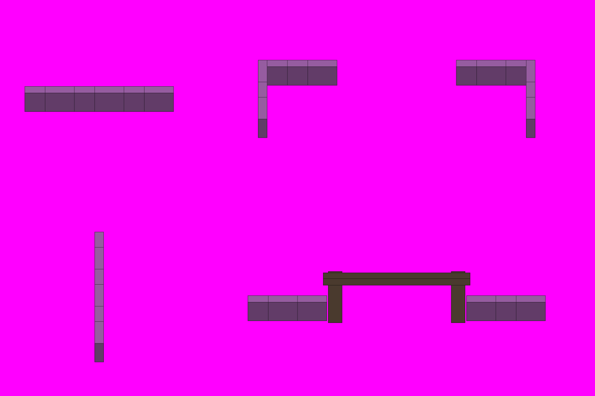

# S2-09 木栅模块

`s2-09-palisade-kit` · 由 `node tools/build-siege-blockout.mjs` 生成，请改脚本而不是改这个文件。计划见 [01-chencang-art-plan.md](../../../01-chencang-art-plan.md) §9.2、§13。

- 五件：上排是东西向直段（3 格）、营地西北角、东北角；下排是南北向直段（3 格）和辕门（门两侧各带两格木栅）。每格 128×96、每层 48px。
- 游戏按每格的邻居拼：直段从中间裁一格出来重复用，所以左右（上下）两端要能接上。
- **2026-11-02 选定 `attempts/v2.webp`**（2026-11-02 你在审阅页确认）：三张都在 7px 以内，v2 最准（直段 1px、转角 3px），木桩节奏均匀，重复拼接看不出接缝；辕门横梁三张都比灰盒高 6–7px。透明版 `selected-transparent.png` 由 `attempts/key.py`（仓库根目录出图工作区）确定性抠出品红：不重画，不透明像素原样保留，边缘按背景色反混合去品红边。出图用 Codex 内置 image_gen（gpt-6.1-sol，xhigh），每张的提示词、源文件和对位量测记在 `generation-manifest.json`。

## 参考图



叠图检查用 `grid.png`（透明底）：黑线是地面格子，红线是立体件的面，橙线是墙顶等顶面上的格子。

## 上传与提示词

尺寸 1536×1024。上传：

1. `blockout.png`
2. `docs/siege/chencang/art/s1-02-south-gate/attempts/v4.webp`（第二张，标准件）

```text
Output requirements: create an image exactly 1536 by 1024 pixels. Treat the first attached block-out as the exact 1536×1024 registration canvas. Paint only the requested pieces; every empty background pixel must be perfectly uniform pure magenta RGB(255,0,255), hex #FF00FF. Apply paper grain and watercolour texture only inside their silhouettes, never on the magenta background. No paper sheet, paper margin, background texture, cast shadow, floor or haze.

Registration landmarks on this canvas (pixel boxes measured from the block-out):
Piece 1, an east-west run, three cells:
- whole piece: x=64..448, y=223..289
- ground footprint, where it stands: x=64..448, y=232..328
Piece 2, the north-west corner of the camp:
- whole piece: x=666..870, y=155..356
- ground footprint, where it stands: x=614..870, y=164..356
Piece 3, the north-east corner of the camp:
- whole piece: x=1178..1382, y=155..356
- ground footprint, where it stands: x=1178..1434, y=164..356
Piece 4, a north-south run, three cells:
- whole piece: x=244..268, y=600..936
- ground footprint, where it stands: x=192..320, y=648..936
Piece 5, the camp gate with the palisade ending at each post:
- whole piece: x=640..1408, y=702..834
- ground footprint, where it stands: x=640..1408, y=773..869
Keep each piece inside its whole-piece box and stand it on its ground footprint; match heights to the block-out rather than making anything taller.

Match the brushwork, line weight, colours and lighting of the second attached image exactly.

Style priority — A 界画淡彩: Paint the object as a TWO-DIMENSIONAL TRADITIONAL CHINESE JIEHUA PAINTING. Finely ruled, uniform slender ink contours define the architecture with quiet precise architectural draughtsmanship. Flat, pale, transparent ochre and grey watercolour washes with soft ink diffusion; snow left as clean paper-white. Keep brick and roof-tile marks sparse and deliberately drawn by hand, with generous calm untextured surfaces. The result must unmistakably read as fine Chinese ink-and-light-colour architectural painting, not a realistic digital render. No photographic material textures, physically based rendering, glossy surfaces, dense mottling or dark heavy outlines.

The first attached image is a colour-coded 3D block-out, not a style reference. Strictly preserve the position, footprint, height and outline of every block: each block's top face and front face must stay within about a quarter of a grid cell of where it is drawn. Replace the flat colours with finished materials and keep straight architecture straight. Natural features (snow drifts, ice edges, trench banks, paths) may have soft organic edges, within half a cell of where they are marked.

Camera: orthographic three-quarter top-down view, looking due north and tilted about 50 degrees down from the horizon. Strictly parallel projection: no perspective, no vanishing points, near and far objects the same size. Every vertical edge is perfectly vertical, every east-west edge perfectly horizontal, and north-south edges run straight up the image. Only top faces and south-facing front faces are visible; east and west side faces are never visible.

Subject: a modular kit of the Shu-Han camp palisade for a strategy game, five separate pieces arranged exactly as in the block-out, with clear empty space between pieces. The palisade is a single line of sharpened log stakes about one level high, lashed to two horizontal rails, with snow on the stake tops and rails.
Top row, left to right: a straight three-cell run going east-west, whose left and right ends must join seamlessly when copies are placed side by side; the north-west corner of the camp, where the east-west run turns south; the north-east corner, the same mirrored.
Bottom row: on the left, a three-cell run going north-south, seen from above so only the stake tops, the rails and the south end show, never its east or west side; on the right, the camp gate (辕门): two tall timber posts and a cross-beam spanning the road, with the palisade ending against each post.
In the block-out, one grid cell is 128 pixels wide and 96 pixels deep, and one height level is 48 pixels.

Isolated object only, on a perfectly flat solid magenta (#FF00FF) background with no gradient, texture or ground. Nothing else in the frame. Clean edges against the background, and no magenta tint reflected onto the object.

Light: low winter sun from the lower left (south-west). Front faces catch a pale warm light and top faces carry fresh snow. Shade the object itself only; do not paint any cast shadow on the ground.

Style: traditional Chinese ink-wash painting with light colour (水墨淡彩), with the precision of jiehua (界画) ruled-line architectural painting: crisp, straight, evenly weighted ink lines on walls, gate towers, timber and roof tiles; soft transparent washes on snow, earth, ice and water; subtle rice-paper grain. Restrained winter palette: warm paper-white snow, ochre rammed earth, grey brick, dark timber, slate roof tiles, muted pine green, with small accents of red lacquer.

Do not include: any text, letters, calligraphy, seals or signatures; grid lines or guide marks; ground, snowfield, cast shadows or anything besides the requested pieces; people, soldiers, horses, flags, banners or pennants; modern objects.
```

## 看什么

- 和 S1-02 标准件、S1-01 v2-a 是不是同一套笔法、颜色和光照。
- 每件都在自己的框里，底边落在灰盒的地面框上；背景纯品红，没有地面、雪地和落地影子。
- 直段的两端能接上：东西段左右相接、南北段上下相接都看不出缝。
- 南北段只看得到桩顶、横木和南端，没有画出东西侧面。
- 辕门的门洞空着，路从中间穿过。
- 把图缩到一半（游戏 100% 的大小）看：放在 S1-01 的雪地上不突兀。

## 出图记录

出的图放进 `attempts/`，依次命名 `v1.webp`、`v2.webp`……
