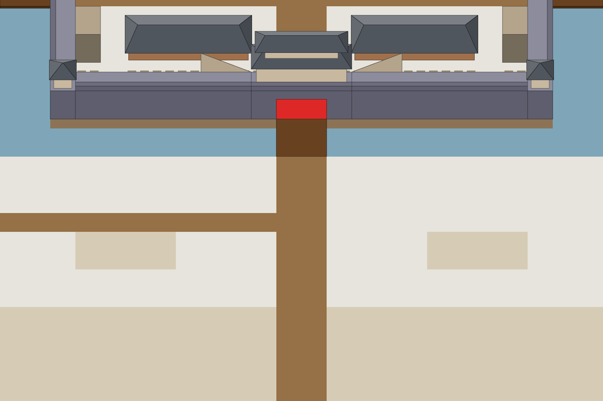

# S3-01 城堑填堑

`s3-01-trench-fill` · 由 `node tools/build-siege-blockout.mjs` 生成，请改脚本而不是改这个文件。计划见 [01-chencang-art-plan.md](../../../01-chencang-art-plan.md) §9.2、§13。

- 南墙外的城堑两行（y 17–18，x 12–35，桥下 x 23–24 不动），画两态：半填、填平。规则见 MVP 计划 §4.6：外侧一行先填平，内侧一行才能填。
- 定 α 后不再出单格贴片：整条城堑各画一张半填、一张填平，游戏按格从里面切（`job.json` 的 `cells` 给出每格的像素框），一格一格换状态，所以三种花样从整条里自然得来。
- 裁取全图 (768, 512) 起的 1536×1024，和 S2-01 南块同一块。
- **2026-11-02 选定**（待你确认）：半填 `trench-half-v1.webp`，填平 `trench-filled-v3.webp`。补丁在 `patches/`（`<态>.json` 记它在全图上的位置），贴回全图的前后对比在 `previews/`；每张的提示词、源文件和选择理由记在 `generation-manifest.json`。出图用 Codex 内置 image_gen（gpt-6.1-sol，xhigh）。

## 参考图



叠图检查用 `grid.png`（透明底）：黑线是地面格子，红线是立体件的面，橙线是墙顶等顶面上的格子。

## 上传与提示词

尺寸 1536×1024。上传：

1. 每一态只上传一张：`inputs/<态>.png`（编辑对象，由 `node tools/compose-siege-states.mjs` 从 S2-01 定稿全图裁出）。工具支持蒙版编辑时，可以同时给 `steps/<态>-paint.png`。

### 半填（trench-half）

上传 `inputs/trench-half.png`（先跑 `node tools/compose-siege-states.mjs` 生成）。出图存为 `attempts/trench-half-v1.webp`……

```text
Edit task: change one part of a finished painting to show the city trench half filled in. The attached image is the edit target, exactly 1536×1024, and the output must be exactly 1536×1024 too.

It is part of a finished battlefield map of the walled city of Chencang, a traditional Chinese jiehua ink-and-light-colour painting.

The attackers have begun to fill the trench along the south wall, on both sides of the gate bridge. Loose earth, rubble and bundles of brushwood have been tipped in from the outer (south) bank and form uneven mounds that cover about half of the trench, mostly along its south side; broken ice and dark water still show between the mounds, mostly along the wall side. Fresh earth is trodden into the snow along the outer bank. The bridge, the wall and the bank on the wall side stay as they are.

Positions on this canvas (pixel boxes measured from the block-out):
- the trench west of the bridge: x=0..704, y=304..424
- the trench east of the bridge: x=832..1536, y=304..424
- the gate bridge, which stays unchanged: x=704..832, y=304..424

Repaint only the trench inside these two boxes and the few pixels around it needed to blend it in. Keep everything else exactly as it is: do not move, redraw, recolour, sharpen or blur it, and keep the output aligned pixel for pixel with the input, at exactly the same size.

Paint the change with exactly the brushwork, line weight, colours and light of the painting around it, as if the same hand had painted it from the start.

Camera: orthographic three-quarter top-down view, looking due north and tilted about 50 degrees down from the horizon. Strictly parallel projection: no perspective, no vanishing points, near and far objects the same size. Every vertical edge is perfectly vertical, every east-west edge perfectly horizontal, and north-south edges run straight up the image. Only top faces and south-facing front faces are visible; east and west side faces are never visible.

Light: low winter sun from the lower left (south-west). Front faces catch a pale warm light, top faces carry fresh snow, and soft cool blue-grey shadows fall toward the upper right.

Style: traditional Chinese ink-wash painting with light colour (水墨淡彩), with the precision of jiehua (界画) ruled-line architectural painting: crisp, straight, evenly weighted ink lines on walls, gate towers, timber and roof tiles; soft transparent washes on snow, earth, ice and water; subtle rice-paper grain. Restrained winter palette: warm paper-white snow, ochre rammed earth, grey brick, dark timber, slate roof tiles, muted pine green, with small accents of red lacquer.

Do not include: any text, letters, calligraphy, seals or signatures; grid lines; borders, frames or paper margins; legend or compass; people, soldiers, horses, flags, banners or pennants; perspective views, horizon or sky; vignette; modern objects.
```

### 填平（trench-filled）

上传 `inputs/trench-filled.png`（先跑 `node tools/compose-siege-states.mjs` 生成）。出图存为 `attempts/trench-filled-v1.webp`……

```text
Edit task: change one part of a finished painting to show the city trench filled level. The attached image is the edit target, exactly 1536×1024, and the output must be exactly 1536×1024 too.

It is part of a finished battlefield map of the walled city of Chencang, a traditional Chinese jiehua ink-and-light-colour painting.

The attackers have filled the trench along the south wall, on both sides of the gate bridge, level with the ground: packed earth, rubble and brushwood trampled flat, muddy and trodden into the snow, so that it reads as a rough causeway along the foot of the wall. Only a faint dip and a few stones of the old bank edges remain; no water or ice shows. The bridge and the wall stay as they are.

Positions on this canvas (pixel boxes measured from the block-out):
- the trench west of the bridge: x=0..704, y=304..424
- the trench east of the bridge: x=832..1536, y=304..424
- the gate bridge, which stays unchanged: x=704..832, y=304..424

Repaint only the trench inside these two boxes and the few pixels around it needed to blend it in. Keep everything else exactly as it is: do not move, redraw, recolour, sharpen or blur it, and keep the output aligned pixel for pixel with the input, at exactly the same size.

Paint the change with exactly the brushwork, line weight, colours and light of the painting around it, as if the same hand had painted it from the start.

Camera: orthographic three-quarter top-down view, looking due north and tilted about 50 degrees down from the horizon. Strictly parallel projection: no perspective, no vanishing points, near and far objects the same size. Every vertical edge is perfectly vertical, every east-west edge perfectly horizontal, and north-south edges run straight up the image. Only top faces and south-facing front faces are visible; east and west side faces are never visible.

Light: low winter sun from the lower left (south-west). Front faces catch a pale warm light, top faces carry fresh snow, and soft cool blue-grey shadows fall toward the upper right.

Style: traditional Chinese ink-wash painting with light colour (水墨淡彩), with the precision of jiehua (界画) ruled-line architectural painting: crisp, straight, evenly weighted ink lines on walls, gate towers, timber and roof tiles; soft transparent washes on snow, earth, ice and water; subtle rice-paper grain. Restrained winter palette: warm paper-white snow, ochre rammed earth, grey brick, dark timber, slate roof tiles, muted pine green, with small accents of red lacquer.

Do not include: any text, letters, calligraphy, seals or signatures; grid lines; borders, frames or paper margins; legend or compass; people, soldiers, horses, flags, banners or pennants; perspective views, horizon or sky; vignette; modern objects.
```

## 看什么

- 半填：土堆从外岸（南）往里堆，盖住约一半，靠墙一侧还见冰和水；填平：和地面齐平，看不到水和冰，像一条土道。
- 桥、城墙、墙脚不变；城堑以外的雪地、路不变。
- 按格切出来拼（外侧一行填平、内侧一行完好）时，两行之间的过渡说得过去。
- 只有标出的地方变了；compose 报的偏移应在 ±4px 以内、差值和 S2-01 各步相近，补丁 `patches/<态>.png` 贴回全图后（`previews/<态>.webp`）看不出边。

## 出图记录

出的图放进 `attempts/`，每态分开编号：`<态>-v1.webp`、`<态>-v2.webp`……，保持 1536×1024 原尺寸，不缩放、不裁切。
