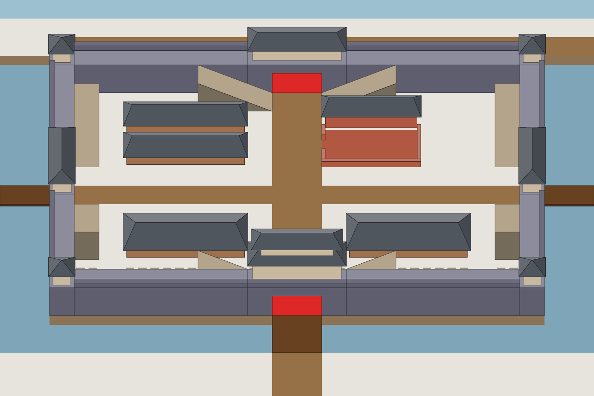

# S3-05 西门门破

`s3-05-gate-west-broken` · 由 `node tools/build-siege-blockout.mjs` 生成，请改脚本而不是改这个文件。计划见 [01-chencang-art-plan.md](../../../01-chencang-art-plan.md) §9.2、§13。

- 西门门破：门洞变成双方都能进的格（MVP 计划 §4.5）。补丁只取门楼蒙版外扩 6px、再渐变 12px 的一圈。
- 东西门的门扇朝东西，这个机位看不到，所以门破靠门洞两头散出来的碎门板、铁件和碎砖、门楼南面的烟痕来表现。
- 裁取全图 (768, 0) 起的 1536×1024。
- **2026-11-02 选定**（待你确认）：门破 `gate-west-broken-v2.webp`。补丁在 `patches/`（`<态>.json` 记它在全图上的位置），贴回全图的前后对比在 `previews/`；每张的提示词、源文件和选择理由记在 `generation-manifest.json`。出图用 Codex 内置 image_gen（gpt-6.1-sol，xhigh）。

## 参考图



叠图检查用 `grid.png`（透明底）：黑线是地面格子，红线是立体件的面，橙线是墙顶等顶面上的格子。

## 上传与提示词

尺寸 1536×1024。上传：

1. 每一态只上传一张：`inputs/<态>.png`（编辑对象，由 `node tools/compose-siege-states.mjs` 从 S2-01 定稿全图裁出）。工具支持蒙版编辑时，可以同时给 `steps/<态>-paint.png`。

### 门破（gate-west-broken）

上传 `inputs/gate-west-broken.png`（先跑 `node tools/compose-siege-states.mjs` 生成）。出图存为 `attempts/gate-west-broken-v1.webp`……

```text
Edit task: change one part of a finished painting to show the west gate broken. The attached image is the edit target, exactly 1536×1024, and the output must be exactly 1536×1024 too.

It is part of a finished battlefield map of the walled city of Chencang, a traditional Chinese jiehua ink-and-light-colour painting.

The west gate has been broken through. Its doors face west and cannot be seen from this camera, so show the break by what spills out of the gate passage: splintered door planks, iron straps and broken brick strewn across the road and the bridge where they meet the gate, trampled mud, soot streaks on the gate tower's south face, and a few roof tiles knocked off its eaves. The gate tower and the wall still stand.

Positions on this canvas (pixel boxes measured from the block-out):
- the west gate with its tower: x=124..196, y=328..504

Repaint only the west gate inside this box and the few pixels around it needed to blend it in. Keep everything else exactly as it is: do not move, redraw, recolour, sharpen or blur it, and keep the output aligned pixel for pixel with the input, at exactly the same size.

Paint the change with exactly the brushwork, line weight, colours and light of the painting around it, as if the same hand had painted it from the start.

Camera: orthographic three-quarter top-down view, looking due north and tilted about 50 degrees down from the horizon. Strictly parallel projection: no perspective, no vanishing points, near and far objects the same size. Every vertical edge is perfectly vertical, every east-west edge perfectly horizontal, and north-south edges run straight up the image. Only top faces and south-facing front faces are visible; east and west side faces are never visible.

Light: low winter sun from the lower left (south-west). Front faces catch a pale warm light, top faces carry fresh snow, and soft cool blue-grey shadows fall toward the upper right.

Style: traditional Chinese ink-wash painting with light colour (水墨淡彩), with the precision of jiehua (界画) ruled-line architectural painting: crisp, straight, evenly weighted ink lines on walls, gate towers, timber and roof tiles; soft transparent washes on snow, earth, ice and water; subtle rice-paper grain. Restrained winter palette: warm paper-white snow, ochre rammed earth, grey brick, dark timber, slate roof tiles, muted pine green, with small accents of red lacquer.

Do not include: any text, letters, calligraphy, seals or signatures; grid lines; borders, frames or paper margins; legend or compass; people, soldiers, horses, flags, banners or pennants; perspective views, horizon or sky; vignette; modern objects.
```

## 看什么

- 门洞看得出已经打开、能走人；门楼和城墙还在，没有塌。
- 只改了这座门：两边的墙段、别的门楼、路和桥不变。
- 只有标出的地方变了；compose 报的偏移应在 ±4px 以内、差值和 S2-01 各步相近，补丁 `patches/<态>.png` 贴回全图后（`previews/<态>.webp`）看不出边。

## 出图记录

出的图放进 `attempts/`，每态分开编号：`<态>-v1.webp`、`<态>-v2.webp`……，保持 1536×1024 原尺寸，不缩放、不裁切。
