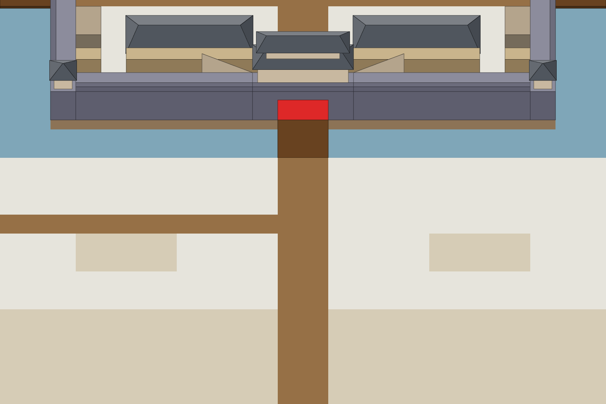

# S3-07/08 重墙（施工中、建成）

`s3-07-inner-wall` · 由 `node tools/build-siege-blockout.mjs` 生成，请改脚本而不是改这个文件。计划见 [01-chencang-art-plan.md](../../../01-chencang-art-plan.md) §9.2、§13。

- 重墙在 y 14，分四段：x 15、x 17–22、x 25–30、x 32；缺口在 x 16、x 23–24（路口）、x 31（MVP 计划 §4.8）。两态各是一次编辑：施工中（灰盒 1 层高）、建成（灰盒 2 层高，比城墙矮一层，顶上能站人）。
- 输入图上按这一态的高度贴了重墙灰盒；补丁取灰盒蒙版外扩 8px、再渐变 12px。建成的墙在 y 14 那一行，挡住南营房的墙脚，排序时和城墙同一层（L3）。
- `steps/inner-wall-*-overlay.png` 就是贴上去的灰盒；切层蒙版按建成态的灰盒（`footprints.json`）。
- 裁取全图 (768, 512) 起的 1536×1024。
- **2026-11-02 选定**（待你确认）：施工中（S3-07） `inner-wall-works-v1.webp`，建成（S3-08） `inner-wall-built-v1.webp`。补丁在 `patches/`（`<态>.json` 记它在全图上的位置），贴回全图的前后对比在 `previews/`；每张的提示词、源文件和选择理由记在 `generation-manifest.json`。出图用 Codex 内置 image_gen（gpt-6.1-sol，xhigh）。

## 参考图



叠图检查用 `grid.png`（透明底）：黑线是地面格子，红线是立体件的面，橙线是墙顶等顶面上的格子。

## 上传与提示词

尺寸 1536×1024。上传：

1. 每一态只上传一张：`inputs/<态>.png`（编辑对象，由 `node tools/compose-siege-states.mjs` 从 S2-01 定稿全图裁出）。工具支持蒙版编辑时，可以同时给 `steps/<态>-paint.png`。

### 施工中（S3-07）（inner-wall-works）

上传 `inputs/inner-wall-works.png`（先跑 `node tools/compose-siege-states.mjs` 生成）：画面上贴了这一态的灰盒。出图存为 `attempts/inner-wall-works-v1.webp`……

```text
Edit task: change one part of a finished painting to show an inner wall being built. The attached image is the edit target, exactly 1536×1024, and the output must be exactly 1536×1024 too.

It is part of a finished battlefield map of the walled city of Chencang, a traditional Chinese jiehua ink-and-light-colour painting. Four flat sandy shapes (a pale top and a darker front) have been pasted onto it across the city, between the southern barracks and the south wall; each marks one run of a new inner wall that the defenders are building in haste overnight. Paint over the four shapes; they are the block-out, not part of the painting.

Paint each run as rammed earth (夯土) half raised: a long low body of fresh tamped yellow-brown earth exactly filling the marked shape, held between timber shuttering boards lashed to upright poles and cross-ties; the poles stand about twice as high as the earth. Along the runs lie baskets of earth, wooden rammers, a ladder and loose planks, and fresh earth is spilled and trodden into the snow around them. The four runs stay separate, with the gaps between them clear (the street to the south gate passes through the middle gap).

Positions on this canvas (pixel boxes measured from the block-out):
- the four runs of the inner wall, all inside: x=192..1344, y=145..184

Repaint only the four marked shapes and the few pixels around it needed to blend it in. Keep everything else exactly as it is: do not move, redraw, recolour, sharpen or blur it, and keep the output aligned pixel for pixel with the input, at exactly the same size.

Paint the change with exactly the brushwork, line weight, colours and light of the painting around it, as if the same hand had painted it from the start.

Camera: orthographic three-quarter top-down view, looking due north and tilted about 50 degrees down from the horizon. Strictly parallel projection: no perspective, no vanishing points, near and far objects the same size. Every vertical edge is perfectly vertical, every east-west edge perfectly horizontal, and north-south edges run straight up the image. Only top faces and south-facing front faces are visible; east and west side faces are never visible.

Light: low winter sun from the lower left (south-west). Front faces catch a pale warm light, top faces carry fresh snow, and soft cool blue-grey shadows fall toward the upper right.

Style: traditional Chinese ink-wash painting with light colour (水墨淡彩), with the precision of jiehua (界画) ruled-line architectural painting: crisp, straight, evenly weighted ink lines on walls, gate towers, timber and roof tiles; soft transparent washes on snow, earth, ice and water; subtle rice-paper grain. Restrained winter palette: warm paper-white snow, ochre rammed earth, grey brick, dark timber, slate roof tiles, muted pine green, with small accents of red lacquer.

Do not include: any text, letters, calligraphy, seals or signatures; grid lines; borders, frames or paper margins; legend or compass; people, soldiers, horses, flags, banners or pennants; perspective views, horizon or sky; vignette; modern objects.
```

### 建成（S3-08）（inner-wall-built）

上传 `inputs/inner-wall-built.png`（先跑 `node tools/compose-siege-states.mjs` 生成）：画面上贴了这一态的灰盒。出图存为 `attempts/inner-wall-built-v1.webp`……

```text
Edit task: change one part of a finished painting to show a finished inner wall. The attached image is the edit target, exactly 1536×1024, and the output must be exactly 1536×1024 too.

It is part of a finished battlefield map of the walled city of Chencang, a traditional Chinese jiehua ink-and-light-colour painting. Four flat sandy shapes (a pale top and a darker front) have been pasted onto it across the city, between the southern barracks and the south wall; each marks one run of a new inner wall (重墙) that the defenders built in haste. Paint over the four shapes; they are the block-out, not part of the painting.

Paint each run as a finished rammed-earth wall exactly filling its marked shape: smooth tamped yellow-brown earth with faint horizontal layer lines left by the shuttering, lower than the city wall, with a narrow flat walkway on top under fresh snow and a low crenellated earth parapet along its south (front) edge only. It is plainer and rougher than the brick-faced city wall, clearly new work. The four runs stay separate, with the gaps between them clear (the street to the south gate passes through the middle gap).

Positions on this canvas (pixel boxes measured from the block-out):
- the four runs of the inner wall, all inside: x=192..1344, y=121..184

Repaint only the four marked shapes and the few pixels around it needed to blend it in. Keep everything else exactly as it is: do not move, redraw, recolour, sharpen or blur it, and keep the output aligned pixel for pixel with the input, at exactly the same size.

Paint the change with exactly the brushwork, line weight, colours and light of the painting around it, as if the same hand had painted it from the start.

Camera: orthographic three-quarter top-down view, looking due north and tilted about 50 degrees down from the horizon. Strictly parallel projection: no perspective, no vanishing points, near and far objects the same size. Every vertical edge is perfectly vertical, every east-west edge perfectly horizontal, and north-south edges run straight up the image. Only top faces and south-facing front faces are visible; east and west side faces are never visible.

Light: low winter sun from the lower left (south-west). Front faces catch a pale warm light, top faces carry fresh snow, and soft cool blue-grey shadows fall toward the upper right.

Style: traditional Chinese ink-wash painting with light colour (水墨淡彩), with the precision of jiehua (界画) ruled-line architectural painting: crisp, straight, evenly weighted ink lines on walls, gate towers, timber and roof tiles; soft transparent washes on snow, earth, ice and water; subtle rice-paper grain. Restrained winter palette: warm paper-white snow, ochre rammed earth, grey brick, dark timber, slate roof tiles, muted pine green, with small accents of red lacquer.

Do not include: any text, letters, calligraphy, seals or signatures; grid lines; borders, frames or paper margins; legend or compass; people, soldiers, horses, flags, banners or pennants; perspective views, horizon or sky; vignette; modern objects.
```

## 看什么

- 四段都在灰盒的位置上，缺口留着；建成的墙比城墙矮、顶上有走道和朝南的矮垛口。
- 施工中看得出是夯土版筑：木板夹着半截土墙、立杆、土筐。
- 南营房和城墙不变。
- 只有标出的地方变了；compose 报的偏移应在 ±4px 以内、差值和 S2-01 各步相近，补丁 `patches/<态>.png` 贴回全图后（`previews/<态>.webp`）看不出边。

## 出图记录

出的图放进 `attempts/`，每态分开编号：`<态>-v1.webp`、`<态>-v2.webp`……，保持 1536×1024 原尺寸，不缩放、不裁切。
