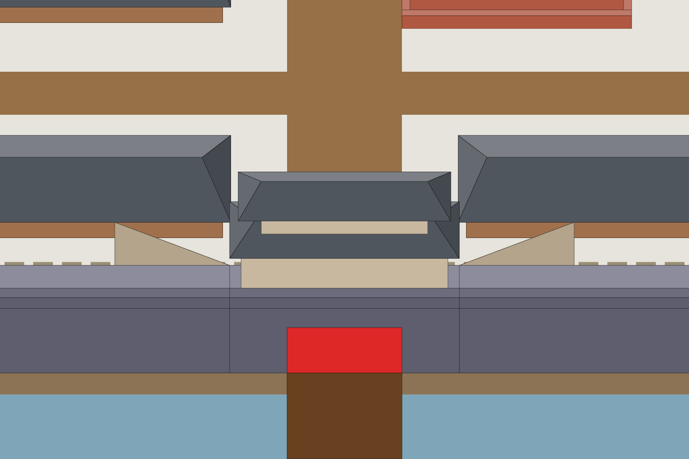

# S3-08 南墙马道重画

`s3-08-south-ramps` · 由 `node tools/build-siege-blockout.mjs` 生成，请改脚本而不是改这个文件。计划见 [01-chencang-art-plan.md](../../../01-chencang-art-plan.md) §9.2、§13。

- K4：只重画两块马道顶面和高端的内女墙开口，不改规则、地形或高度。西马道向东下行，东马道向西下行，朝南门下降。没有砖侧墙或抬高的石板。
- 从 S2-01 全图裁取 (1152,400)–(1920,912)，768×512，放大到 1536×1024 作为编辑输入；补丁缩回地图原尺寸，边沿羽化 6 地图像素。
- 三个独立 image_gen 编辑候选全部保留，逐个合成补丁与地图尺寸预览。previews/comparison.png 左起为现状、v1、v2、v3。
- 暂选 attempts/ramp-south-v3.webp，等待 planner 按图挑选；选择理由和逐图指标见 generation-manifest.json。
- Provisional recommendation: broad pale tread strips, thin shallow riser marks, fewer masonry cues and a low narrow upper curb. Best of the three at map scale. The triangular silhouette remains visually ambiguous; planner should judge stair direction and walkway continuity in the browser screenshot before accepting.
- 复现：node tools/build-siege-blockout.mjs --asset s3-08-south-ramps；node tools/compose-siege-states.mjs --asset s3-08-south-ramps。原图与真实工具请求记录位于仓库 attempts/s3-08/sources/。

## 参考图



叠图检查用 `grid.png`（透明底）：黑线是地面格子，红线是立体件的面，橙线是墙顶等顶面上的格子。

## 上传与提示词

尺寸 1536×1024。上传：

1. inputs/ramp-south.png：已贴平面石阶灰盒的唯一编辑对象。

### 南墙马道 v1、v2（ramp-south）

```text
Style priority — A 界画淡彩: The entire image is a TWO-DIMENSIONAL TRADITIONAL CHINESE JIEHUA PAINTING on warm rice paper. Finely ruled, uniform slender ink contours define the architecture with quiet precise architectural draughtsmanship. Flat, pale, transparent ochre and grey watercolour washes; broad untouched paper-white snow. Show soft ink diffusion and visible subtle paper fibres throughout the image. Keep brick and roof-tile marks sparse and deliberately drawn by hand, with generous calm untextured surfaces. The result must unmistakably read as fine Chinese ink-and-light-colour architectural painting, not a realistic digital environment. No photographic material textures, physically based rendering, glossy surfaces, dense mottling or dark heavy outlines. Preserve every block's location and silhouette from the reference, and keep open snow and roads free of added trees, rocks or extra buildings.

Edit task: precise-object-edit. The attached image is the edit target, a 768×512 crop of the finished Chencang map displayed at 1536×1024. Output exactly 1536×1024. Two pale triangular block-outs with thin ruled step guides replace the wrong ramps. Paint these as the visible TOP SURFACES of two flights of pale stone steps behind the south wall.

The camera looks north from above. The city wall hides almost all of each ramp. Only these flat triangular wedges are visible, flush with the walkway, not floating above it. West wedge canvas vertices: (256,496), (512,592), (256,592). East wedge: (1280,496), (1024,592), (1280,592). Preserve these silhouettes exactly. The west high end is at the left (west); its steps descend RIGHT towards the gate. The east high end is at the right (east); its steps descend LEFT towards the gate. The steps run parallel to the wall. The visible surface narrows to nothing near the gate as the descending ramp sinks behind the walkway. The entire horizontal bottom edge adjoins the walkway back edge.

Paint pale stone treads seen from above, with restrained shallow riser marks across the direction of travel, a soft wash and sparse stone joints. The steps are the ONLY thing inside each wedge: NO brick side wall, NO vertical masonry facade, NO raised slab, NO floating bridge, NO railings. A LOW stone curb follows only the sloping upper (north) edge. Do not turn that curb into a wall. At the high ends open the inner walkway parapet, canvas boxes west x=252..328,y=580..612 and east x=1208..1284,y=580..612, replacing the small obstructing parapet with continuous pale walking stone, so a soldier could clearly walk directly from the walkway onto the stairs. A viewer must read: from this wall, stairs go DOWN towards the gate.

Outside the two wedges and these parapet openings nothing changes. Keep everything else exactly as it is: do not move, redraw, recolour, sharpen or blur it, and keep the output aligned pixel for pixel with the input, at exactly the same size.

Paint the change with exactly the brushwork, line weight, colours and light of the painting around it, as if the same hand had painted it from the start. The flat pale shapes and ruled lines are geometry guides, not the finished art: replace them with painted stone steps, not a striped flag.

Camera: orthographic three-quarter top-down view, looking due north and tilted about 50 degrees down from the horizon. Strictly parallel projection: no perspective, no vanishing points, near and far objects the same size. Every vertical edge is perfectly vertical, every east-west edge perfectly horizontal, and north-south edges run straight up the image. Only top faces and south-facing front faces are visible; east and west side faces are never visible.

Light: low winter sun from the lower left (south-west). Front faces catch a pale warm light, top faces carry fresh snow, and soft cool blue-grey shadows fall toward the upper right.

Style: traditional Chinese ink-wash painting with light colour (水墨淡彩), with the precision of jiehua (界画) ruled-line architectural painting: crisp, straight, evenly weighted ink lines on walls, gate towers, timber and roof tiles; soft transparent washes on snow, earth, ice and water; subtle rice-paper grain. Restrained winter palette: warm paper-white snow, ochre rammed earth, grey brick, dark timber, slate roof tiles, muted pine green, with small accents of red lacquer.

Do not include: any text, letters, calligraphy, seals or signatures; grid lines; borders, frames or paper margins; legend or compass; people, soldiers, horses, flags, banners or pennants; perspective views, horizon or sky; vignette; modern objects.
```

### 南墙马道 v3：纠正竖直石板感

```text
Style priority — A 界画淡彩: The entire image is a TWO-DIMENSIONAL TRADITIONAL CHINESE JIEHUA PAINTING on warm rice paper. Finely ruled, uniform slender ink contours define the architecture with quiet precise architectural draughtsmanship. Flat, pale, transparent ochre and grey watercolour washes; broad untouched paper-white snow. Show soft ink diffusion and visible subtle paper fibres throughout the image. Keep brick and roof-tile marks sparse and deliberately drawn by hand, with generous calm untextured surfaces. The result must unmistakably read as fine Chinese ink-and-light-colour architectural painting, not a realistic digital environment. No photographic material textures, physically based rendering, glossy surfaces, dense mottling or dark heavy outlines. Preserve every block's location and silhouette from the reference, and keep open snow and roads free of added trees, rocks or extra buildings.

Edit task: precise-object-edit. The attached image is the edit target, a 768×512 crop of the finished Chencang map displayed at 1536×1024. Output exactly 1536×1024. Two pale triangular block-outs with thin ruled step guides replace the wrong ramps. Paint these as the visible TOP SURFACES of two flights of pale stone steps behind the south wall.

The camera looks north from above. The city wall hides almost all of each ramp. Only these flat triangular wedges are visible, flush with the walkway, not floating above it. West wedge canvas vertices: (256,496), (512,592), (256,592). East wedge: (1280,496), (1024,592), (1280,592). Preserve these silhouettes exactly. The west high end is at the left (west); its steps descend RIGHT towards the gate. The east high end is at the right (east); its steps descend LEFT towards the gate. The steps run parallel to the wall. The visible surface narrows to nothing near the gate as the descending ramp sinks behind the walkway. The entire horizontal bottom edge adjoins the walkway back edge.

Paint pale stone treads seen from above, with restrained shallow riser marks across the direction of travel, a soft wash and sparse stone joints. The steps are the ONLY thing inside each wedge: NO brick side wall, NO vertical masonry facade, NO raised slab, NO floating bridge, NO railings. A LOW stone curb follows only the sloping upper (north) edge. Do not turn that curb into a wall. At the high ends open the inner walkway parapet, canvas boxes west x=252..328,y=580..612 and east x=1208..1284,y=580..612, replacing the small obstructing parapet with continuous pale walking stone, so a soldier could clearly walk directly from the walkway onto the stairs. A viewer must read: from this wall, stairs go DOWN towards the gate.

Outside the two wedges and these parapet openings nothing changes. Keep everything else exactly as it is: do not move, redraw, recolour, sharpen or blur it, and keep the output aligned pixel for pixel with the input, at exactly the same size.

Paint the change with exactly the brushwork, line weight, colours and light of the painting around it, as if the same hand had painted it from the start. The flat pale shapes and ruled lines are geometry guides, not the finished art: replace them with painted stone steps, not a striped flag.

Camera: orthographic three-quarter top-down view, looking due north and tilted about 50 degrees down from the horizon. Strictly parallel projection: no perspective, no vanishing points, near and far objects the same size. Every vertical edge is perfectly vertical, every east-west edge perfectly horizontal, and north-south edges run straight up the image. Only top faces and south-facing front faces are visible; east and west side faces are never visible.

Light: low winter sun from the lower left (south-west). Front faces catch a pale warm light, top faces carry fresh snow, and soft cool blue-grey shadows fall toward the upper right.

Style: traditional Chinese ink-wash painting with light colour (水墨淡彩), with the precision of jiehua (界画) ruled-line architectural painting: crisp, straight, evenly weighted ink lines on walls, gate towers, timber and roof tiles; soft transparent washes on snow, earth, ice and water; subtle rice-paper grain. Restrained winter palette: warm paper-white snow, ochre rammed earth, grey brick, dark timber, slate roof tiles, muted pine green, with small accents of red lacquer.

Do not include: any text, letters, calligraphy, seals or signatures; grid lines; borders, frames or paper margins; legend or compass; people, soldiers, horses, flags, banners or pennants; perspective views, horizon or sky; vignette; modern objects.

Critical correction for this attempt: the narrow triangular area is a HORIZONTAL TOP VIEW of stairs, not an upright triangular retaining wall. Each tread is a broad north-south strip of pale walking stone. Draw each riser as a very thin paired ink line and tiny grey lip, across that strip, with only a 1–2 pixel shadow; do not draw tall vertical stone slabs, columns or masonry courses. No horizontal brick joints anywhere in the wedges. Treat the upper diagonal as a low curb seen from above, not the top of a vertical wall. At the high end the surface joins directly onto the horizontal light walkway through an obvious gap. The bottom horizontal boundary has no dark outlining, no vertical depth and no facade. Make the broad pale tread surfaces dominant, with subtle alternating light on shallow steps descending towards the central gate. Preserve the exact triangular silhouettes and every pixel outside the wedges/openings.
```

## 看什么

- 西侧向右下降，东侧向左下降；只见顶面，没有砖侧墙、浮起石板。
- 高端开口与走道相通，北边只有低石缘；两块三角轮廓不变。
- 补丁仅限两楔形、开口及 6px 羽化；现状与三个候选在地图尺寸下并排比较。
- README、job、generation-manifest 的提示词与原始工具请求日志完全相同；原图和补丁哈希可验证。

## 出图记录

出的图放进 `attempts/`，ramp-south-v1.webp、ramp-south-v2.webp、ramp-south-v3.webp；原尺寸 1536×1024，无损保存。
