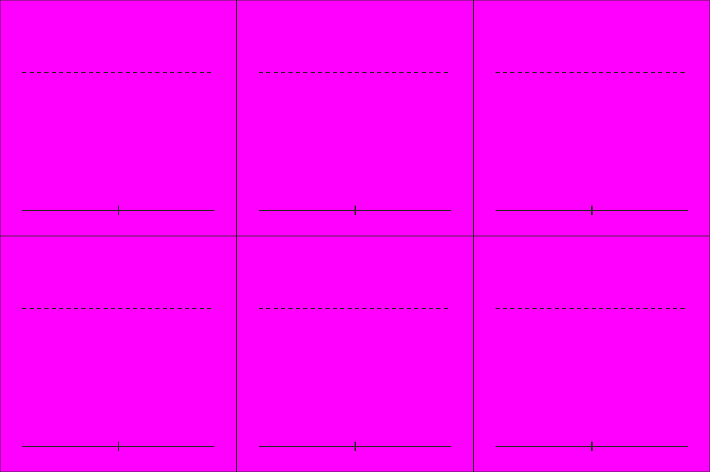

# S5-01 蜀步兵攀梯、运土

`s5-01-shu-siege-poses` · 由 `node tools/build-siege-blockout.mjs` 生成，请改脚本而不是改这个文件。计划见 [01-chencang-art-plan.md](../../../01-chencang-art-plan.md) §9.2、§13。

- 3×2 宫格，每格 512×512，同 S1-06 的版式。第一行攀梯（背面，朝北）：伸手、迈步、翻上墙头；第二行运土：背面扛土筐行进、侧面（朝东）扛土筐行进、背面把土倒下去。
- 同一个 S1-05 戟兵：攀梯和运土时戟和盾背在背上。梯子是 S4-02 的分件，这里不画，游戏把人摆在梯上。
- **2026-11-02 选定 `attempts/v2.webp`**（待你确认）：攀梯三格手脚交替最清楚，翻墙那格看得懂；和 S1-05 是同一个兵。透明版 `selected-transparent.png` 由 `attempts/key.py` 确定性抠出品红；逐格切出的姿态在 `poses/`，游戏尺寸的在 `poses-game/`，脚底锚点见 `poses.json`（`attempts/cut_poses.py` 切的，不重画）；每张的提示词、源文件和选择理由记在 `generation-manifest.json`。出图用 Codex 内置 image_gen（gpt-6.1-sol，xhigh）。

## 参考图



## 上传与提示词

尺寸 1536×1024。上传：

1. `guide.png`
2. `docs/siege/chencang/art/s1-05-shu-halberd-sheet/attempts/v5.webp`（第二张，蜀戟兵定稿）

```text
Subject: a character pose sheet of the same Shu-Han halberd infantryman as on the second attached sheet, for a strategy game, drawn six times in siege work. Arrange the sheet as a 3 by 2 grid of equal cells (512×512 pixels each) exactly as in the first attached guide: one figure per cell, every figure the same size (about 300 pixels from the soles to the top of the helmet, up to the dashed line), feet on the solid baseline.
Top row, all seen from behind (facing north, away from the viewer), climbing a scaling ladder that is NOT drawn (the ladder is a separate piece he will be placed on): reaching up with the right hand, left foot raised to the next rung; reaching up with the left hand, right foot raised; at the top, one leg swung up and over as if onto a wall top.
Bottom row, carrying earth to fill the city trench: seen from behind (north), marching with a wicker basket of earth on his right shoulder; seen from the side facing right (east), marching with the basket on his shoulder; seen from behind (north), tipping the basket forward so the earth pours out in front of him.
Camera: the same orthographic three-quarter top-down camera as the battlefield, about 50 degrees from above, so the top of the helmet and the shoulders are visible and the figure is slightly foreshortened.
The soldier: a bright jade-green (#5f9a5a) padded war coat with red (#a8432f) trim over dark iron lamellar armour, a fur-lined collar against the winter cold, wrapped leggings and boots, a rounded iron helmet with a neck guard; for this work his ji halberd and small round wooden shield are slung on his back. No facial features. Identical armour, colours and proportions in every cell, and the same soldier as on the second attached sheet.
Style: match the second attached sheet (the Shu-Han halberdier pose sheet) exactly in brushwork and colour handling: bold dark ink outline, flat ink-textured colour fills, no facial features. Match its style, proportions and figure size.
Light: low winter sun from the lower left (south-west); shade the figure only, with no cast shadow.

Isolated object only, on a perfectly flat solid magenta (#FF00FF) background with no gradient, texture or ground. Nothing else in the frame. Clean edges against the background, and no magenta tint reflected onto the object.

Do not include: any text, letters, calligraphy, seals or signatures; grid lines or guide marks; ground, scenery or cast shadows; additional figures, horses, flags, banners or pennants; modern objects.
```

## 看什么

- 把图缩到人物约 36px 高看：每个朝向、每个姿势都看得懂，转成灰度也分得出蜀魏。
- 和参考的 S1 定稿表是同一支军队、同一套画风；各格是同一个人，脚都踩在基线上。
- 攀梯三格手脚交替，看得出在往上爬；梯子没画。
- 运土三格的土筐一样大，倒土那格土是往前（北）倒的。

## 出图记录

出的图放进 `attempts/`，依次命名 `v1.webp`、`v2.webp`……
