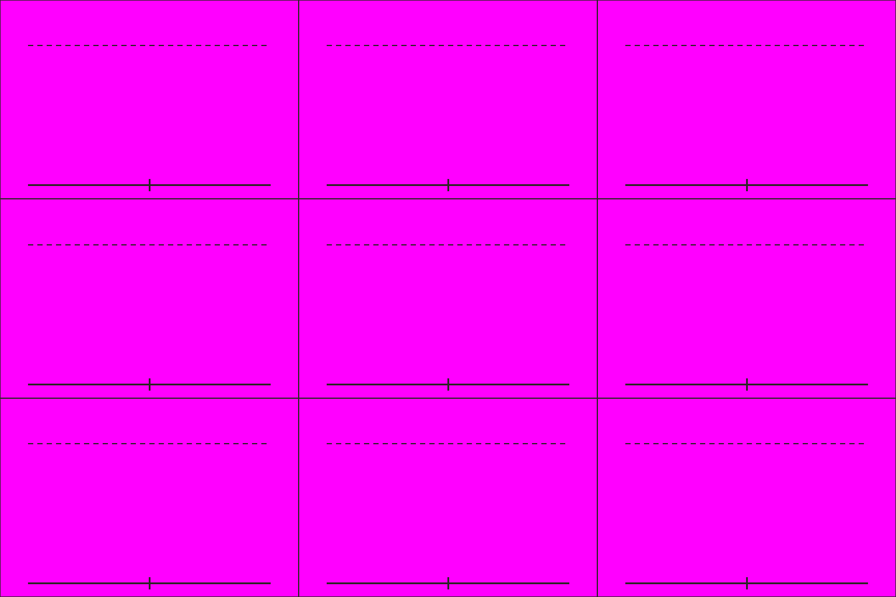

# S5-02 蜀弓弩兵姿态表

`s5-02-shu-crossbow-sheet` · 由 `node tools/build-siege-blockout.mjs` 生成，请改脚本而不是改这个文件。计划见 [01-chencang-art-plan.md](../../../01-chencang-art-plan.md) §9.2、§13。

- 3×3 宫格，每格约 512×341，同 S1-05 的版式：行是背面（朝北）、侧面（朝东）、正面（朝南），列是待机、行进、射击。
- 和戟兵同一支蜀军：同样的绿袍红边，但轻甲、皮盔、无盾，手持弩，腰挂箭箙，剪影要和戟兵分得开。井阑上射击用射击这一格。
- **2026-11-02 选定 `attempts/v1.webp`**（待你确认）：弩和箭箙清楚；皮帽、无盾，和戟兵一眼分得开。正面射击三张都朝侧面瞄（正对镜头很难画），可以接受。透明版 `selected-transparent.png` 由 `attempts/key.py` 确定性抠出品红；逐格切出的姿态在 `poses/`，游戏尺寸的在 `poses-game/`，脚底锚点见 `poses.json`（`attempts/cut_poses.py` 切的，不重画）；每张的提示词、源文件和选择理由记在 `generation-manifest.json`。出图用 Codex 内置 image_gen（gpt-6.1-sol，xhigh）。

## 参考图



## 上传与提示词

尺寸 1536×1024。上传：

1. `guide.png`
2. `docs/siege/chencang/art/s1-05-shu-halberd-sheet/attempts/v5.webp`（第二张，蜀戟兵定稿）

```text
Subject: a character pose sheet of one Shu-Han crossbowman for a strategy game, the same soldier drawn nine times, from the same army as the halberdier on the second attached sheet. Arrange the sheet as a 3 by 3 grid of equal cells (512×341 pixels each) exactly as in the first attached guide: one figure per cell, every figure the same size (about 240 pixels from the soles to the top of the cap, up to the dashed line), feet on the solid baseline.
Rows, top to bottom: seen from behind, facing away (north); seen from the side, facing right (east); seen from the front, facing the viewer (south).
Columns, left to right: standing ready, crossbow held across the body; marching mid-stride, crossbow on the shoulder; shooting, crossbow raised to the shoulder and aimed in the facing direction.
Camera: the same orthographic three-quarter top-down camera as the battlefield, about 50 degrees from above, so the top of the helmet and the shoulders are visible and the figure is slightly foreshortened.
The soldier: a bright jade-green (#5f9a5a) padded war coat with red (#a8432f) trim over dark iron lamellar armour, a fur-lined collar against the winter cold, wrapped leggings and boots, but lighter than the halberdier: a leather lamellar vest instead of full iron armour, a close-fitting leather cap with ear flaps instead of the iron helmet, no shield, a Han crossbow (弩) with a bronze trigger mechanism, and a quiver of bolts at the right hip. No facial features. Identical gear, colours and proportions in every cell.
Style: match the second attached sheet (the Shu-Han halberdier pose sheet) exactly in brushwork and colour handling: bold dark ink outline, flat ink-textured colour fills, no facial features. Match its style, proportions and figure size.
Light: low winter sun from the lower left (south-west); shade the figure only, with no cast shadow.

Isolated object only, on a perfectly flat solid magenta (#FF00FF) background with no gradient, texture or ground. Nothing else in the frame. Clean edges against the background, and no magenta tint reflected onto the object.

Do not include: any text, letters, calligraphy, seals or signatures; grid lines or guide marks; ground, scenery or cast shadows; additional figures, horses, flags, banners or pennants; modern objects.
```

## 看什么

- 把图缩到人物约 36px 高看：每个朝向、每个姿势都看得懂，转成灰度也分得出蜀魏。
- 和参考的 S1 定稿表是同一支军队、同一套画风；各格是同一个人，脚都踩在基线上。
- 和戟兵一眼分得开：无盾、皮帽、弩。
- 射击那一列弩都朝着这一行的朝向。

## 出图记录

出的图放进 `attempts/`，依次命名 `v1.webp`、`v2.webp`……
