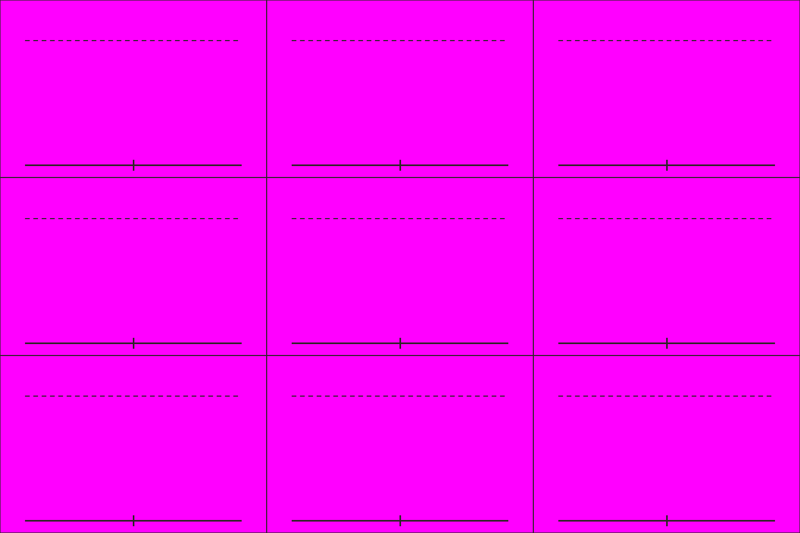

# S5-03 魏步兵姿态表

`s5-03-wei-infantry-sheet` · 由 `node tools/build-siege-blockout.mjs` 生成，请改脚本而不是改这个文件。计划见 [01-chencang-art-plan.md](../../../01-chencang-art-plan.md) §9.2、§13。

- 3×3 宫格，每格约 512×341：行是背面（朝北）、侧面（朝东）、正面（朝南），列是待机、格挡、攻击。守城时多是正面。
- 和 S1-06 魏弓兵同一支魏军：深靛袍、黑漆甲；环首刀加长方大盾，和蜀戟兵（戟、小圆盾）分得开。
- **2026-11-02 选定 `attempts/v1.webp`**（待你确认）：背面一行看得出是背面（没有脸、没有带扣，和 S1-06 的背面一致），格挡那一列大盾举过头。透明版 `selected-transparent.png` 由 `attempts/key.py` 确定性抠出品红；逐格切出的姿态在 `poses/`，游戏尺寸的在 `poses-game/`，脚底锚点见 `poses.json`（`attempts/cut_poses.py` 切的，不重画）；每张的提示词、源文件和选择理由记在 `generation-manifest.json`。出图用 Codex 内置 image_gen（gpt-6.1-sol，xhigh）。

## 参考图



## 上传与提示词

尺寸 1536×1024。上传：

1. `guide.png`
2. `docs/siege/chencang/art/s1-06-wei-archer-sheet/attempts/v4.webp`（第二张，魏弓兵定稿）

```text
Subject: a character pose sheet of one Wei infantryman for a strategy game, the same soldier drawn nine times, from the same army as the archer on the second attached sheet. Arrange the sheet as a 3 by 3 grid of equal cells (512×341 pixels each) exactly as in the first attached guide: one figure per cell, every figure the same size (about 240 pixels from the soles to the top of the helmet, up to the dashed line), feet on the solid baseline.
Rows, top to bottom: seen from behind, facing away (north); seen from the side, facing right (east); seen from the front, facing the viewer (south).
Columns, left to right: standing ready behind his shield; blocking, the shield raised high and braced against a blow from above; attacking, slashing forward with the sabre past the shield.
Camera: the same orthographic three-quarter top-down camera as the battlefield, about 50 degrees from above, so the top of the helmet and the shoulders are visible and the figure is slightly foreshortened.
The soldier: a deep indigo (#2f4a6e) padded war coat over black lacquered lamellar armour, a fur-lined collar against the winter cold, a round iron helmet with a neck guard like the archer's, a ring-pommel sabre (环首刀) and a tall rectangular wooden shield faced with lacquered hide. No facial features. Identical gear, colours and proportions in every cell.
Style: match the second attached sheet (the Wei archer pose sheet) exactly in brushwork and colour handling: bold dark ink outline, flat ink-textured colour fills, no facial features. Match its style, proportions and figure size.
Light: low winter sun from the lower left (south-west); shade the figure only, with no cast shadow.

Isolated object only, on a perfectly flat solid magenta (#FF00FF) background with no gradient, texture or ground. Nothing else in the frame. Clean edges against the background, and no magenta tint reflected onto the object.

Do not include: any text, letters, calligraphy, seals or signatures; grid lines or guide marks; ground, scenery or cast shadows; additional figures, horses, flags, banners or pennants; modern objects.
```

## 看什么

- 把图缩到人物约 36px 高看：每个朝向、每个姿势都看得懂，转成灰度也分得出蜀魏。
- 和参考的 S1 定稿表是同一支军队、同一套画风；各格是同一个人，脚都踩在基线上。
- 和 S1-06 魏弓兵放在一起是同一支军队。
- 格挡那一列盾举过头，能看懂是在挡上面砸下来的东西。

## 出图记录

出的图放进 `attempts/`，依次命名 `v1.webp`、`v2.webp`……
