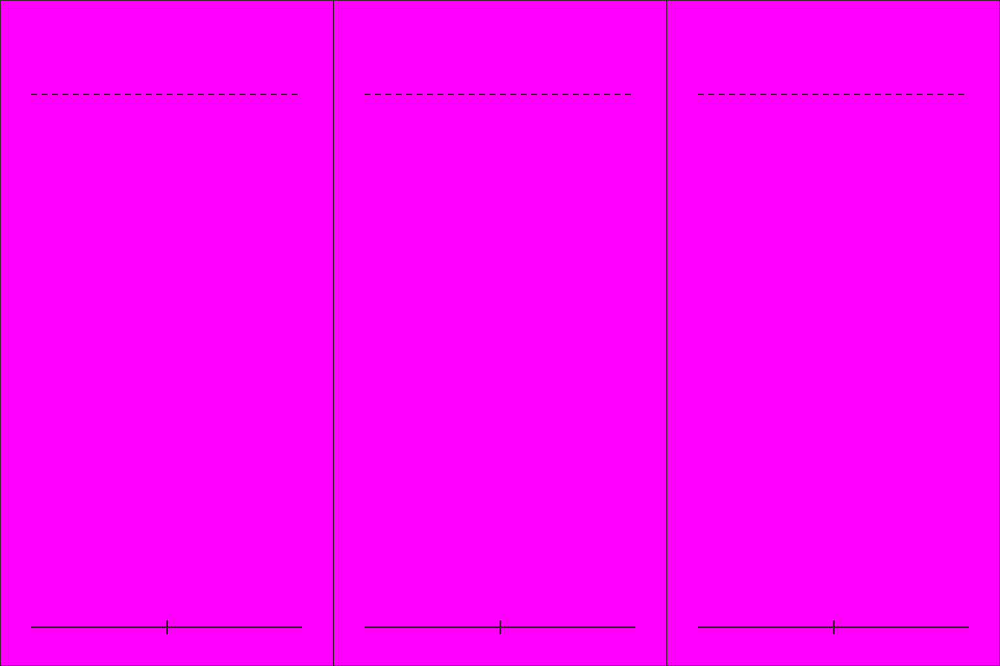

# S5-04 旗帜

`s5-04-banners` · 由 `node tools/build-siege-blockout.mjs` 生成，请改脚本而不是改这个文件。计划见 [01-chencang-art-plan.md](../../../01-chencang-art-plan.md) §9.2、§13。

- 三面旗，每格 512×1024，旗杆底端踩在基线上：认旗（每支部队一面，旗面浅色，由程序按势力着色）、丞相帅旗（大旗，深红）、"郝"字旗（魏，深靛）。
- 旗面都留白，字由程序写；旗面画得平一点，飘动由程序做（MVP 计划 §8.3）。
- **2026-11-02 选定 `attempts/v2.webp`**（待你确认）：旗面都空着，旗杆竖直，丞相帅旗最气派。第一次出图时排除项里还写着"不画旗"，停掉重出。透明版 `selected-transparent.png` 由 `attempts/key.py` 确定性抠出品红；逐格切出的姿态在 `poses/`，游戏尺寸的在 `poses-game/`，脚底锚点见 `poses.json`（`attempts/cut_poses.py` 切的，不重画）；每张的提示词、源文件和选择理由记在 `generation-manifest.json`。出图用 Codex 内置 image_gen（gpt-6.1-sol，xhigh）。

## 参考图



## 上传与提示词

尺寸 1536×1024。上传：

1. `guide.png`
2. `docs/siege/chencang/art/s1-05-shu-halberd-sheet/attempts/v5.webp`（第二张，蜀戟兵定稿）

```text
Subject: three separate flags for a strategy game, each on its own pole, one centred in each cell. Arrange the sheet as a 3 by 1 grid of equal cells (512×1024 pixels each) exactly as in the first attached guide: one figure per cell, every figure the same size (each pole from its foot on the baseline up to about the dashed line), feet on the solid baseline.
Left: a unit recognition flag (认旗): a slim bamboo pole with a small iron spearhead finial and a narrow vertical rectangular flag of plain off-white silk hanging from a crossbar near the top, with a short dark border; the flag face is left blank so the game can colour and letter it.
Middle: the chancellor's great banner (丞相帅旗): a tall heavy lacquered pole with a gilded finial and red tassels, carrying a large vertical deep-red silk banner with a black border and a scalloped edge; a large plain panel in the middle is left blank for a character the game writes.
Right: the Wei commander's banner of Hao Zhao (郝字旗): a sturdy pole with an iron finial carrying a square deep-indigo (#2f4a6e) silk banner with a white border; the middle is left blank for a character the game writes.
Each flag hangs almost flat with only a gentle wave, seen from the front, so the game can animate it.
Camera: the same orthographic three-quarter top-down camera as the battlefield, about 50 degrees from above, so the top of the helmet and the shoulders are visible and the figure is slightly foreshortened.
Style: match the second attached sheet (the Shu-Han halberdier pose sheet) exactly in brushwork and colour handling: bold dark ink outline, flat ink-textured colour fills, no facial features. Match its style, proportions and figure size.
Light: low winter sun from the lower left (south-west); shade the figure only, with no cast shadow.

Isolated object only, on a perfectly flat solid magenta (#FF00FF) background with no gradient, texture or ground. Nothing else in the frame. Clean edges against the background, and no magenta tint reflected onto the object.

Do not include: any text, letters, calligraphy, seals or signatures; grid lines or guide marks; ground, scenery or cast shadows; people, soldiers or horses; any writing, characters or emblems on the flags; modern objects.
```

## 看什么

- 把图缩到人物约 36px 高看：每个朝向、每个姿势都看得懂，转成灰度也分得出蜀魏。
- 和参考的 S1 定稿表是同一支军队、同一套画风；各格是同一个人，脚都踩在基线上。
- 三面旗的旗面都是空的，没有任何字或花纹。
- 旗面平整、轻微飘动，方便程序做飘动；旗杆竖直。

## 出图记录

出的图放进 `attempts/`，依次命名 `v1.webp`、`v2.webp`……
