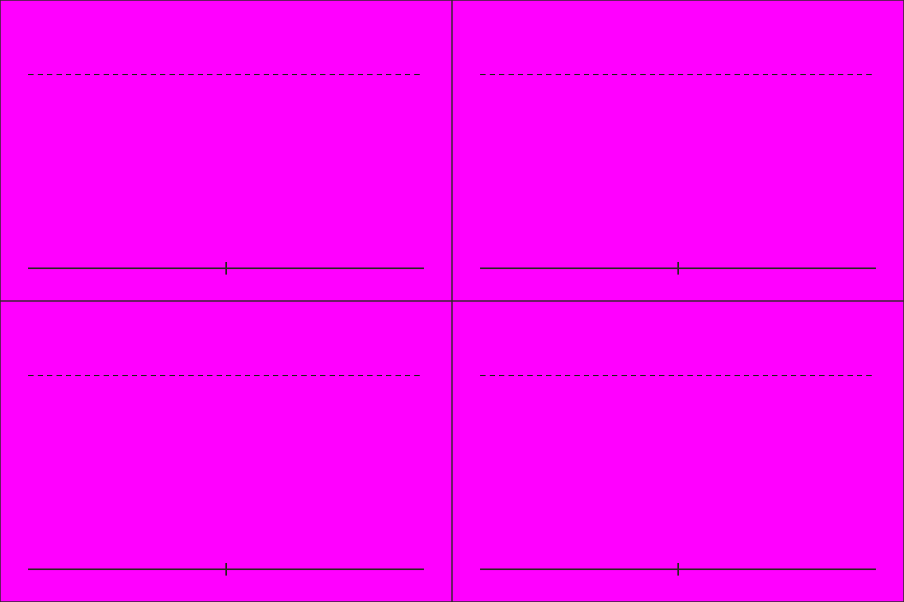

# S5-05 诸葛亮乘四轮车

`s5-05-zhuge-liang-carriage` · 由 `node tools/build-siege-blockout.mjs` 生成，请改脚本而不是改这个文件。计划见 [01-chencang-art-plan.md](../../../01-chencang-art-plan.md) §9.2、§13。

- 2×2 宫格，每格 768×512：行是朝北（背面）、朝南（正面），列是端坐、挥扇指挥。人连车从轮底到纶巾顶约 330px，比小兵（300px）略高。
- 羽扇纶巾、鹤氅，坐四轮小车，由两名蜀兵在后推（战场武将形象，美术 F01）。和小兵一样不画五官。
- **2026-11-02 选定 `attempts/v1.webp`**（待你确认）：羽扇纶巾一眼认得出，推车的两名蜀兵和 S1-05 一致。透明版 `selected-transparent.png` 由 `attempts/key.py` 确定性抠出品红；逐格切出的姿态在 `poses/`，游戏尺寸的在 `poses-game/`，脚底锚点见 `poses.json`（`attempts/cut_poses.py` 切的，不重画）；每张的提示词、源文件和选择理由记在 `generation-manifest.json`。出图用 Codex 内置 image_gen（gpt-6.1-sol，xhigh）。

## 参考图



## 上传与提示词

尺寸 1536×1024。上传：

1. `guide.png`
2. `docs/siege/chencang/art/s1-05-shu-halberd-sheet/attempts/v5.webp`（第二张，蜀戟兵定稿）

```text
Subject: a character pose sheet of Zhuge Liang, the Shu-Han chancellor, seated in his small four-wheeled carriage (四轮车) and pushed by two Shu-Han soldiers, for a strategy game, drawn four times. Arrange the sheet as a 2 by 2 grid of equal cells (768×512 pixels each) exactly as in the first attached guide: one figure per cell, every figure the same size (about 330 pixels from the bottom of the wheels to the top of his kerchief cap, up to the dashed line), feet on the solid baseline.
Top row: the whole group seen from behind, heading north, away from the viewer (the two soldiers pushing at the near end). Bottom row: the group seen from the front, facing the viewer (south), the soldiers behind the carriage.
Left column: Zhuge Liang sitting upright and calm, the feather fan resting in his lap. Right column: commanding, the white feather fan raised and pointing forward.
Camera: the same orthographic three-quarter top-down camera as the battlefield, about 50 degrees from above, so the top of the helmet and the shoulders are visible and the figure is slightly foreshortened.
Zhuge Liang: a white crane-feather cloak (鹤氅) over a pale robe, a dark silk kerchief cap (纶巾), a white feather fan (羽扇); the carriage is a light open timber chair on four spoked wheels with a low railing and a small canopy-less seat. The two soldiers wear a bright jade-green (#5f9a5a) padded war coat with red (#a8432f) trim over dark iron lamellar armour, a fur-lined collar against the winter cold, wrapped leggings and boots and rounded iron helmets, as on the second attached sheet. No facial features on anyone. Same carriage, figures and proportions in every cell.
Style: match the second attached sheet (the Shu-Han halberdier pose sheet) exactly in brushwork and colour handling: bold dark ink outline, flat ink-textured colour fills, no facial features. Match its style, proportions and figure size.
Light: low winter sun from the lower left (south-west); shade the figure only, with no cast shadow.

Isolated object only, on a perfectly flat solid magenta (#FF00FF) background with no gradient, texture or ground. Nothing else in the frame. Clean edges against the background, and no magenta tint reflected onto the object.

Do not include: any text, letters, calligraphy, seals or signatures; grid lines or guide marks; ground, scenery or cast shadows; additional figures, horses, flags, banners or pennants; modern objects.
```

## 看什么

- 把图缩到人物约 36px 高看：每个朝向、每个姿势都看得懂，转成灰度也分得出蜀魏。
- 和参考的 S1 定稿表是同一支军队、同一套画风；各格是同一个人，脚都踩在基线上。
- 羽扇纶巾一眼认得出是诸葛亮；车是四轮的。
- 推车的两名蜀兵和 S1-05 戟兵是同一支军队。

## 出图记录

出的图放进 `attempts/`，依次命名 `v1.webp`、`v2.webp`……
