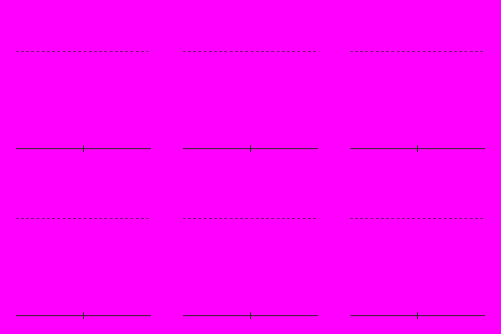

# S5-06 郝昭城头形象

`s5-06-hao-zhao-wall` · 由 `node tools/build-siege-blockout.mjs` 生成，请改脚本而不是改这个文件。计划见 [01-chencang-art-plan.md](../../../01-chencang-art-plan.md) §9.2、§13。

- 3×2 宫格，每格 512×512：第一行正面（朝南）：按剑而立、拔剑指挥、张弓；第二行侧面（朝东）站立、侧面行进、背面（朝北）站立。
- 魏将：比 S1-06 魏弓兵的甲更重、有披风和红缨，站在城头时一眼认得出是主将（战场武将形象，美术 F01）。
- **2026-11-02 选定 `attempts/v3.webp`**（待你确认）：指挥那格按剑、另一手前指最清楚，背面披风最好。透明版 `selected-transparent.png` 由 `attempts/key.py` 确定性抠出品红；逐格切出的姿态在 `poses/`，游戏尺寸的在 `poses-game/`，脚底锚点见 `poses.json`（`attempts/cut_poses.py` 切的，不重画）；每张的提示词、源文件和选择理由记在 `generation-manifest.json`。出图用 Codex 内置 image_gen（gpt-6.1-sol，xhigh）。

## 参考图



## 上传与提示词

尺寸 1536×1024。上传：

1. `guide.png`
2. `docs/siege/chencang/art/s1-06-wei-archer-sheet/attempts/v4.webp`（第二张，魏弓兵定稿）

```text
Subject: a character pose sheet of Hao Zhao, the Wei general defending Chencang, for a strategy game, the same man drawn six times, from the same army as the archer on the second attached sheet. Arrange the sheet as a 3 by 2 grid of equal cells (512×512 pixels each) exactly as in the first attached guide: one figure per cell, every figure the same size (about 300 pixels from the soles to the top of the helmet, not counting its plume, up to the dashed line), feet on the solid baseline.
Top row, all seen from the front, facing the viewer (south): standing firm with his left hand on his sword hilt; commanding, his sword drawn and pointing forward and down over a wall; drawing a bow.
Bottom row: standing, seen from the side facing right (east); walking, seen from the side facing right; standing, seen from behind (north).
Camera: the same orthographic three-quarter top-down camera as the battlefield, about 50 degrees from above, so the top of the helmet and the shoulders are visible and the figure is slightly foreshortened.
Hao Zhao: a deep indigo (#2f4a6e) padded war coat over black lacquered lamellar armour, a fur-lined collar against the winter cold, but a general's heavier armour with shoulder guards, a dark red cloak, a round iron helmet with a short red plume, a straight sword at his hip and a bow on his back. No facial features. Identical gear, colours and proportions in every cell.
Style: match the second attached sheet (the Wei archer pose sheet) exactly in brushwork and colour handling: bold dark ink outline, flat ink-textured colour fills, no facial features. Match its style, proportions and figure size.
Light: low winter sun from the lower left (south-west); shade the figure only, with no cast shadow.

Isolated object only, on a perfectly flat solid magenta (#FF00FF) background with no gradient, texture or ground. Nothing else in the frame. Clean edges against the background, and no magenta tint reflected onto the object.

Do not include: any text, letters, calligraphy, seals or signatures; grid lines or guide marks; ground, scenery or cast shadows; additional figures, horses, flags, banners or pennants; modern objects.
```

## 看什么

- 把图缩到人物约 36px 高看：每个朝向、每个姿势都看得懂，转成灰度也分得出蜀魏。
- 和参考的 S1 定稿表是同一支军队、同一套画风；各格是同一个人，脚都踩在基线上。
- 放在魏弓兵、魏步兵中间，一眼看得出是主将（披风、红缨）。
- 六格是同一个人。

## 出图记录

出的图放进 `attempts/`，依次命名 `v1.webp`、`v2.webp`……
