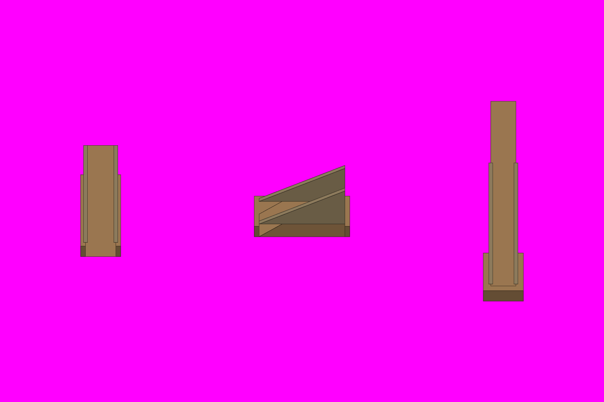

# S8-01 蒙皮云梯车与蒙皮云梯

`s8-01-covered-ladder` · 由 `node tools/build-siege-blockout.mjs` 生成，请改脚本而不是改这个文件。计划见 [03-chencang-v0.2-plan.md](../../../03-chencang-v0.2-plan.md) §9。

- 几何：三格。左：蒙皮云梯车朝北，1×2 格，同 `ladderCart` 的车体和 2.5 层梯架，梯架两侧挂到地面的生牛皮帘（灰盒加两块 `HIDE` 色的薄板，从梯架顶沿两侧垂到车厢上沿）。中：朝东，2×1 格，同上。右：蒙皮云梯架上墙，几何同 `ladderOnWall`（车在墙前第 3 行，梯跨两行城堑到 3 层墙头），梯身两侧挂皮帘到梯的下半段。
- **2026-11-03 选定 `attempts/v1.webp`**（planner 已选）：Hides cover the lower two thirds of the raised ladder; rungs stay visible。透明版 `selected-transparent.png` 由 `attempts/key.py` 确定性抠出品红（不重画）；实际 alpha 框、相对灰盒的偏移和脚底中心见 `footprints.json`；每张的提示词、源文件哈希、选择理由和检查记在 `generation-manifest.json`，候选对比在 `comparison.png`。出图用 Codex 内置 image_gen（gpt-6.1-sol，xhigh），日志在仓库根目录 `attempts/s8-01/codex.log`。
- 本件实际只有 v1、v2 两张候选；没有 v3，也不补出图。

## 参考图



叠图检查用 `grid.png`（透明底）：黑线是地面格子，红线是立体件的面，橙线是墙顶等顶面上的格子。

## 上传与提示词

尺寸 1536×1024。上传：

1. `blockout.png`
2. `docs/siege/chencang/art/s1-02-south-gate/attempts/v4.webp`
3. `docs/siege/chencang/art/s4-01-ladder-cart/attempts/v2.webp`

```text
Output requirements: create an image exactly 1536 by 1024 pixels. Treat the first attached block-out as the exact 1536×1024 registration canvas. Paint only the requested pieces; every empty background pixel must be perfectly uniform pure magenta RGB(255,0,255), hex #FF00FF. Apply paper grain and watercolour texture only inside their silhouettes, never on the magenta background. No paper sheet, paper margin, background texture, cast shadow, floor or haze.

Registration landmarks on this canvas (pixel boxes measured from the block-out):
Piece 1, the covered ladder cart, heading north:
- whole piece: x=205..307, y=370..654
- ground footprint, where it stands: x=192..320, y=476..668
Piece 2, the covered ladder cart, heading east:
- whole piece: x=646..890, y=421..603
- ground footprint, where it stands: x=640..896, y=526..622
Piece 3, the covered ladder raised against the wall:
- whole piece: x=1229..1331, y=258..767
- ground footprint, where it stands: x=1216..1344, y=402..786
- wallFoot registration anchor: x=1280, y=402; world (0.5, 17, 0)
- wallTop registration anchor: x=1280, y=258; world (0.5, 17, 3)
- cartBase registration anchor: x=1280, y=738; world (0.5, 20.5, 0)
Keep each piece inside its whole-piece box and stand it on its ground footprint; match heights to the block-out rather than making anything taller.

Match the brushwork, line weight, colours and lighting of the second attached image exactly.

Style priority — A 界画淡彩: Paint the object as a TWO-DIMENSIONAL TRADITIONAL CHINESE JIEHUA PAINTING. Finely ruled, uniform slender ink contours define the architecture with quiet precise architectural draughtsmanship. Flat, pale, transparent ochre and grey watercolour washes with soft ink diffusion; snow left as clean paper-white. Keep brick and roof-tile marks sparse and deliberately drawn by hand, with generous calm untextured surfaces. The result must unmistakably read as fine Chinese ink-and-light-colour architectural painting, not a realistic digital render. No photographic material textures, physically based rendering, glossy surfaces, dense mottling or dark heavy outlines.

The first attached image is a colour-coded 3D block-out, not a style reference. Strictly preserve the position, footprint, height and outline of every block: each block's top face and front face must stay within about a quarter of a grid cell of where it is drawn. Replace the flat colours with finished materials and keep straight architecture straight. Natural features (snow drifts, ice edges, trench banks, paths) may have soft organic edges, within half a cell of where they are marked.

Camera: orthographic three-quarter top-down view, looking due north and tilted about 50 degrees down from the horizon. Strictly parallel projection: no perspective, no vanishing points, near and far objects the same size. Every vertical edge is perfectly vertical, every east-west edge perfectly horizontal, and north-south edges run straight up the image. Only top faces and south-facing front faces are visible; east and west side faces are never visible.

Subject: the same Shu-Han siege ladder cart (云梯车) as on the third attached sheet, now protected against fire arrows with raw ox-hides (蒙生牛皮), three separate pieces side by side, one centred in each third of the image. Fresh, stiff, wet-looking ox-hides, hair side out, in mottled dun and dark brown, are lashed with cord to both sides of the ladder truss and hang down to the top of the chassis like curtains; a few hides are also pegged over the crew shelter at the rear. The rungs of the ladder remain visible between the hide curtains. Left: the covered cart heading north, away from the viewer, the truss rising toward its far (north) end. Middle: the same covered cart heading east, seen from its side, the truss rising toward its right (east) end. Right: the covered ladder raised against a city wall (the wall itself is NOT drawn): the cart stands at the bottom, the ladder leans north across the trench rows up to the height of a three-level wall top, and the hide curtains hang along the lower two thirds of the ladder; snow has settled on the top edges of the hides. Same cart, same size, same timber and hides in all three; no fire, no scorch marks.
In the block-out, one grid cell is 128 pixels wide and 96 pixels deep, and one height level is 48 pixels.

Isolated object only, on a perfectly flat solid magenta (#FF00FF) background with no gradient, texture or ground. Nothing else in the frame. Clean edges against the background, and no magenta tint reflected onto the object.

Light: low winter sun from the lower left (south-west). Front faces catch a pale warm light and top faces carry fresh snow. Shade the object itself only; do not paint any cast shadow on the ground.

Style: traditional Chinese ink-wash painting with light colour (水墨淡彩), with the precision of jiehua (界画) ruled-line architectural painting: crisp, straight, evenly weighted ink lines on walls, gate towers, timber and roof tiles; soft transparent washes on snow, earth, ice and water; subtle rice-paper grain. Restrained winter palette: warm paper-white snow, ochre rammed earth, grey brick, dark timber, slate roof tiles, muted pine green, with small accents of red lacquer.

Do not include: any text, letters, calligraphy, seals or signatures; grid lines or guide marks; ground, snowfield, cast shadows or anything besides the requested pieces; people, soldiers, horses, flags, banners or pennants; modern objects.
```

## 看什么

- 和 S1-02 标准件、S1-01 v2-a 是不是同一套笔法、颜色和光照。
- 每件都在自己的框里，底边落在灰盒的地面框上；背景纯品红，没有地面、雪地和落地影子。
- 和 S4-01、S4-02 是同一辆车，只多了皮帘；皮帘是绷紧的生牛皮，毛面朝外，缝线和木钉看得见；梯级在皮帘之间仍露出来，游戏要把人摆上去。
- 把图缩到一半（游戏 100% 的大小）看：放在 S1-01 的雪地上不突兀。

## 出图记录

出的图放进 `attempts/`，依次命名 `v1.webp`、`v2.webp`……
