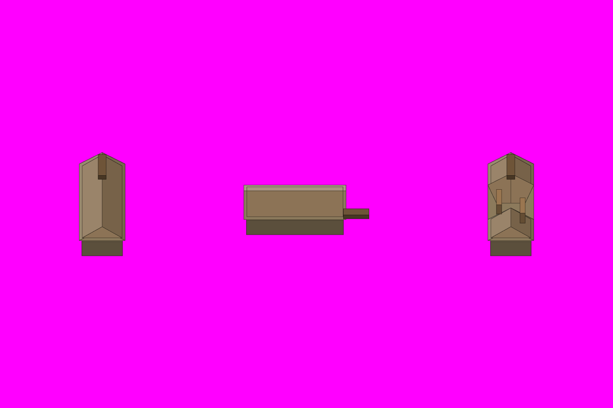

# S8-02 轒輼车，蒙皮冲车

`s8-02-covered-ram` · 由 `node tools/build-siege-blockout.mjs` 生成，请改脚本而不是改这个文件。计划见 [03-chencang-v0.2-plan.md](../../../03-chencang-v0.2-plan.md) §9。

- 几何：三格。左：朝北，1×2 格，同 `ram` 的几何（车棚高 0.9 层、脊 1.5 层），棚顶加一层 `HIDE` 色的厚皮并铺湿泥（顶面略隆起 0.15 层）。中：朝东，2×1 格。右：被石磨砸中但未毁：同朝北的几何，棚顶正中凹下一块（高度降到 0.6 层），皮和椽子破开，但车体和撞木完好。
- **2026-11-03 选定 `attempts/v2.webp`**（planner 已选）：The damaged piece reads as crushed at game size, with the chassis and beam intact。透明版 `selected-transparent.png` 由 `attempts/key.py` 确定性抠出品红（不重画）；实际 alpha 框、相对灰盒的偏移和脚底中心见 `footprints.json`；每张的提示词、源文件哈希、选择理由和检查记在 `generation-manifest.json`，候选对比在 `comparison.png`。出图用 Codex 内置 image_gen（gpt-6.1-sol，xhigh），日志在仓库根目录 `attempts/s8-02/codex.log`。

## 参考图



叠图检查用 `grid.png`（透明底）：黑线是地面格子，红线是立体件的面，橙线是墙顶等顶面上的格子。

## 上传与提示词

尺寸 1536×1024。上传：

1. `blockout.png`
2. `docs/siege/chencang/art/s1-02-south-gate/attempts/v4.webp`
3. `docs/siege/chencang/art/s4-03-ram/attempts/v1.webp`

```text
Output requirements: create an image exactly 1536 by 1024 pixels. Treat the first attached block-out as the exact 1536×1024 registration canvas. Paint only the requested pieces; every empty background pixel must be perfectly uniform pure magenta RGB(255,0,255), hex #FF00FF. Apply paper grain and watercolour texture only inside their silhouettes, never on the magenta background. No paper sheet, paper margin, background texture, cast shadow, floor or haze.

Registration landmarks on this canvas (pixel boxes measured from the block-out):
Piece 1, the covered ram, heading north:
- whole piece: x=198..314, y=383..642
- ground footprint, where it stands: x=192..320, y=462..654
Piece 2, the covered ram, heading east:
- whole piece: x=611..925, y=464..589
- ground footprint, where it stands: x=611..867, y=510..606
Piece 3, the covered ram, dented but usable:
- whole piece: x=1222..1338, y=383..642
- ground footprint, where it stands: x=1216..1344, y=462..654
Keep each piece inside its whole-piece box and stand it on its ground footprint; match heights to the block-out rather than making anything taller.

Match the brushwork, line weight, colours and lighting of the second attached image exactly.

Style priority — A 界画淡彩: Paint the object as a TWO-DIMENSIONAL TRADITIONAL CHINESE JIEHUA PAINTING. Finely ruled, uniform slender ink contours define the architecture with quiet precise architectural draughtsmanship. Flat, pale, transparent ochre and grey watercolour washes with soft ink diffusion; snow left as clean paper-white. Keep brick and roof-tile marks sparse and deliberately drawn by hand, with generous calm untextured surfaces. The result must unmistakably read as fine Chinese ink-and-light-colour architectural painting, not a realistic digital render. No photographic material textures, physically based rendering, glossy surfaces, dense mottling or dark heavy outlines.

The first attached image is a colour-coded 3D block-out, not a style reference. Strictly preserve the position, footprint, height and outline of every block: each block's top face and front face must stay within about a quarter of a grid cell of where it is drawn. Replace the flat colours with finished materials and keep straight architecture straight. Natural features (snow drifts, ice edges, trench banks, paths) may have soft organic edges, within half a cell of where they are marked.

Camera: orthographic three-quarter top-down view, looking due north and tilted about 50 degrees down from the horizon. Strictly parallel projection: no perspective, no vanishing points, near and far objects the same size. Every vertical edge is perfectly vertical, every east-west edge perfectly horizontal, and north-south edges run straight up the image. Only top faces and south-facing front faces are visible; east and west side faces are never visible.

Subject: the same Shu-Han battering ram (冲车) as on the third attached sheet, rebuilt as a fenwen cart (轒輼车) with a reinforced roof, three separate pieces side by side, one centred in each third of the image. The roofed shed on wheels now carries a double layer of raw ox-hides lashed over the roof and sides, with a thick coat of wet grey mud smeared over the hides against fire and falling stones; the iron-capped ram beam still projects from the front. Left: heading north, away from the viewer. Middle: the same cart heading east, seen from its side. Right: the same cart heading north after a millstone has been dropped on it from the wall: the middle of the roof is crushed into a shallow dent, hides torn and a few rafters splintered and poking up, mud flaked off around the dent, but the chassis, wheels and ram beam are intact and the cart is still usable. Same cart, same size, timber and hides in all three; no fire.
In the block-out, one grid cell is 128 pixels wide and 96 pixels deep, and one height level is 48 pixels.

Isolated object only, on a perfectly flat solid magenta (#FF00FF) background with no gradient, texture or ground. Nothing else in the frame. Clean edges against the background, and no magenta tint reflected onto the object.

Light: low winter sun from the lower left (south-west). Front faces catch a pale warm light and top faces carry fresh snow. Shade the object itself only; do not paint any cast shadow on the ground.

Style: traditional Chinese ink-wash painting with light colour (水墨淡彩), with the precision of jiehua (界画) ruled-line architectural painting: crisp, straight, evenly weighted ink lines on walls, gate towers, timber and roof tiles; soft transparent washes on snow, earth, ice and water; subtle rice-paper grain. Restrained winter palette: warm paper-white snow, ochre rammed earth, grey brick, dark timber, slate roof tiles, muted pine green, with small accents of red lacquer.

Do not include: any text, letters, calligraphy, seals or signatures; grid lines or guide marks; ground, snowfield, cast shadows or anything besides the requested pieces; people, soldiers, horses, flags, banners or pennants; modern objects.
```

## 看什么

- 和 S1-02 标准件、S1-01 v2-a 是不是同一套笔法、颜色和光照。
- 每件都在自己的框里，底边落在灰盒的地面框上；背景纯品红，没有地面、雪地和落地影子。
- 三件是 S4-03 那辆冲车加了厚皮顶；受损那件看得出被砸过，但还能用（撞木没断，轮子没掉）。
- 把图缩到一半（游戏 100% 的大小）看：放在 S1-01 的雪地上不突兀。

## 出图记录

出的图放进 `attempts/`，依次命名 `v1.webp`、`v2.webp`……
