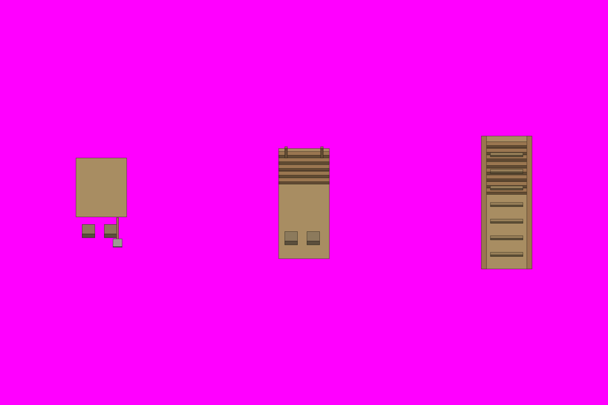

# S8-03 土山三态

`s8-03-earth-mound` · 由 `node tools/build-siege-blockout.mjs` 生成，请改脚本而不是改这个文件。计划见 [03-chencang-v0.2-plan.md](../../../03-chencang-v0.2-plan.md) §9。

- 几何：三格，每件占 1×2 格（城堑的外侧行 y 18 和内侧行 y 17，已填平），北端贴着城墙正面。左「起土」：一堆土 0.8 层高，南半格是空筐和铲；中「半高」：土堆 1.8 层，北面用原木井字架（`WOOD`）围住，南面是斜坡，顶上插两根木桩；右「成坡」：从南端地面升到北端 3 层的夯土斜坡（`EARTH`），两侧原木护坡，坡面有踏出的梯级，北端和墙头前沿齐平（墙不画）。灰盒用 `slope(..., 'n', rise)` 做坡，rise 分别 0.8、1.8、3。
- 北端统一在世界 y=17（南墙 y=16 的正面），占 y=17、18 两行；与 S4-02 的梯顶在同一条墙前沿，成坡顶高严格为 3 层。

## 参考图



叠图检查用 `grid.png`（透明底）：黑线是地面格子，红线是立体件的面，橙线是墙顶等顶面上的格子。

## 上传与提示词

尺寸 1536×1024。上传：

1. `blockout.png`
2. `docs/siege/chencang/art/s1-02-south-gate/attempts/v4.webp`

```text
Output requirements: create an image exactly 1536 by 1024 pixels. Treat the first attached block-out as the exact 1536×1024 registration canvas. Paint only the requested pieces; every empty background pixel must be perfectly uniform pure magenta RGB(255,0,255), hex #FF00FF. Apply paper grain and watercolour texture only inside their silhouettes, never on the magenta background. No paper sheet, paper margin, background texture, cast shadow, floor or haze.

Registration landmarks on this canvas (pixel boxes measured from the block-out):
Piece 1, the earth mound, just begun:
- whole piece: x=192..320, y=400..625
- ground footprint, where it stands: x=192..320, y=438..630
- wallFoot registration anchor: x=256, y=438; world (0.5, 17, 0)
- rampCrest registration anchor: x=256, y=399.6; world (0.5, 17, 0.8)
- wallTop registration anchor: x=256, y=294; world (0.5, 17, 3)
- southBase registration anchor: x=256, y=630; world (0.5, 19, 0)
Piece 2, the earth mound, half built:
- whole piece: x=704..832, y=371..654
- ground footprint, where it stands: x=704..832, y=462..654
- wallFoot registration anchor: x=768, y=462; world (0.5, 17, 0)
- rampCrest registration anchor: x=768, y=375.6; world (0.5, 17, 1.8)
- wallTop registration anchor: x=768, y=318; world (0.5, 17, 3)
- southBase registration anchor: x=768, y=654; world (0.5, 19, 0)
Piece 3, the earth mound, finished:
- whole piece: x=1216..1344, y=344..680
- ground footprint, where it stands: x=1216..1344, y=488..680
- wallFoot registration anchor: x=1280, y=488; world (0.5, 17, 0)
- rampCrest registration anchor: x=1280, y=344; world (0.5, 17, 3)
- wallTop registration anchor: x=1280, y=344; world (0.5, 17, 3)
- southBase registration anchor: x=1280, y=680; world (0.5, 19, 0)
Keep each piece inside its whole-piece box and stand it on its ground footprint; match heights to the block-out rather than making anything taller.

Match the brushwork, line weight, colours and lighting of the second attached image exactly.

Style priority — A 界画淡彩: Paint the object as a TWO-DIMENSIONAL TRADITIONAL CHINESE JIEHUA PAINTING. Finely ruled, uniform slender ink contours define the architecture with quiet precise architectural draughtsmanship. Flat, pale, transparent ochre and grey watercolour washes with soft ink diffusion; snow left as clean paper-white. Keep brick and roof-tile marks sparse and deliberately drawn by hand, with generous calm untextured surfaces. The result must unmistakably read as fine Chinese ink-and-light-colour architectural painting, not a realistic digital render. No photographic material textures, physically based rendering, glossy surfaces, dense mottling or dark heavy outlines.

The first attached image is a colour-coded 3D block-out, not a style reference. Strictly preserve the position, footprint, height and outline of every block: each block's top face and front face must stay within about a quarter of a grid cell of where it is drawn. Replace the flat colours with finished materials and keep straight architecture straight. Natural features (snow drifts, ice edges, trench banks, paths) may have soft organic edges, within half a cell of where they are marked.

Camera: orthographic three-quarter top-down view, looking due north and tilted about 50 degrees down from the horizon. Strictly parallel projection: no perspective, no vanishing points, near and far objects the same size. Every vertical edge is perfectly vertical, every east-west edge perfectly horizontal, and north-south edges run straight up the image. Only top faces and south-facing front faces are visible; east and west side faces are never visible.

Subject: a Shu-Han siege earthwork (土山) heaped against a city wall to make a ramp up to its top, in three stages, three separate pieces side by side, one centred in each third of the image; the wall itself is NOT drawn. Each piece occupies one cell wide by two cells deep, its north end touching where the wall face would be. Left, just begun: a low heap of freshly dug ochre earth about a fifth of the wall's height, a few dropped wicker baskets and a wooden shovel at its south side, snow already dusting the top. Middle, half built: the heap now almost two levels high, its north face held by a crib of stacked logs notched at the corners, its south face a rough slope, two wooden stakes driven into the top, baskets of earth part-emptied on the slope. Right, finished: a solid rammed-earth ramp rising from ground level at the south end to the full three-level height of the wall top at the north end, log revetments along both sides, a trodden path of steps up the middle of the slope, the top edge flush with where the wall's parapet would be. Same earth colour and the same logs in all three; no soldiers.
In the block-out, one grid cell is 128 pixels wide and 96 pixels deep, and one height level is 48 pixels.

Isolated object only, on a perfectly flat solid magenta (#FF00FF) background with no gradient, texture or ground. Nothing else in the frame. Clean edges against the background, and no magenta tint reflected onto the object.

Light: low winter sun from the lower left (south-west). Front faces catch a pale warm light and top faces carry fresh snow. Shade the object itself only; do not paint any cast shadow on the ground.

Style: traditional Chinese ink-wash painting with light colour (水墨淡彩), with the precision of jiehua (界画) ruled-line architectural painting: crisp, straight, evenly weighted ink lines on walls, gate towers, timber and roof tiles; soft transparent washes on snow, earth, ice and water; subtle rice-paper grain. Restrained winter palette: warm paper-white snow, ochre rammed earth, grey brick, dark timber, slate roof tiles, muted pine green, with small accents of red lacquer.

Do not include: any text, letters, calligraphy, seals or signatures; grid lines or guide marks; ground, snowfield, cast shadows or anything besides the requested pieces; people, soldiers, horses, flags, banners or pennants; modern objects.
```

## 看什么

- 和 S1-02 标准件、S1-01 v2-a 是不是同一套笔法、颜色和光照。
- 每件都在自己的框里，底边落在灰盒的地面框上；背景纯品红，没有地面、雪地和落地影子。
- 三态是同一个位置越堆越高；成坡那件的北端正好到 3 层，看得出人能从南面走上去；雪落在土堆顶上，坡面因为踩踏是土色。
- 把图缩到一半（游戏 100% 的大小）看：放在 S1-01 的雪地上不突兀。

## 出图记录

出的图放进 `attempts/`，依次命名 `v1.webp`、`v2.webp`……
