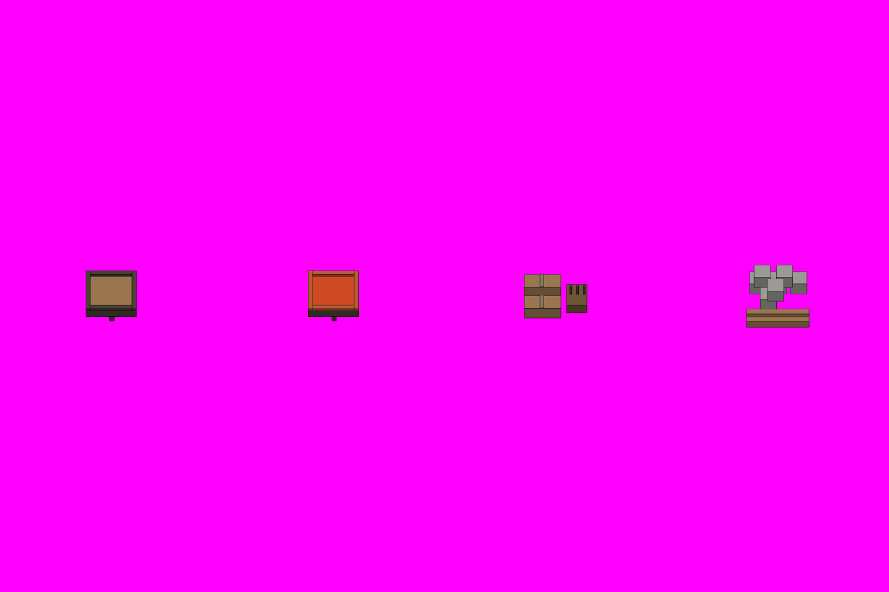

# S8-04 城头备物

`s8-04-wall-top-preparations` · 由 `node tools/build-siege-blockout.mjs` 生成，请改脚本而不是改这个文件。计划见 [03-chencang-v0.2-plan.md](../../../03-chencang-v0.2-plan.md) §9。

- 几何：四件，都是放在墙顶走道上的小件（游戏抬高 3 层，同 S4-07）：火盆未燃（0.6 层，三足铁盆，盆里是柴）；火盆燃着（同样的盆，柴烧红、盆口发亮，**不画火苗和烟**，程序加）；柴薪捆（0.5 层，两捆扎好的柴和一捆浸油的布箭）；礌石堆（0.7 层，六七块石头和两根滚木堆在女墙内侧）。每件 1 格，四件各居一个四分之一宽。
- footprints.json 的 anchor 是每件地面占格的底面中心；游戏整体抬高 3 层放到墙顶走道。
- **2026-11-03 选定 `attempts/v1.webp`**（planner 已选）：Rounded boulders; the brazier is a square iron pan, not the prompt's bowl, accepted as legible。透明版 `selected-transparent.png` 由 `attempts/key.py` 确定性抠出品红（不重画）；实际 alpha 框、相对灰盒的偏移和脚底中心见 `footprints.json`；每张的提示词、源文件哈希、选择理由和检查记在 `generation-manifest.json`，候选对比在 `comparison.png`。出图用 Codex 内置 image_gen（gpt-6.1-sol，xhigh），日志在仓库根目录 `attempts/s8-04/codex.log`。

## 参考图



叠图检查用 `grid.png`（透明底）：黑线是地面格子，红线是立体件的面，橙线是墙顶等顶面上的格子。

## 上传与提示词

尺寸 1536×1024。上传：

1. `blockout.png`
2. `docs/siege/chencang/art/s1-02-south-gate/attempts/v4.webp`

```text
Output requirements: create an image exactly 1536 by 1024 pixels. Treat the first attached block-out as the exact 1536×1024 registration canvas. Paint only the requested pieces; every empty background pixel must be perfectly uniform pure magenta RGB(255,0,255), hex #FF00FF. Apply paper grain and watercolour texture only inside their silhouettes, never on the magenta background. No paper sheet, paper margin, background texture, cast shadow, floor or haze.

Registration landmarks on this canvas (pixel boxes measured from the block-out):
Piece 1, the unlit brazier:
- whole piece: x=148..236, y=469..555
- ground footprint, where it stands: x=128..256, y=482..578
- baseCentre registration anchor: x=192, y=530; world (0.5, 16.5, 0)
Piece 2, the lit brazier, embers only:
- whole piece: x=532..620, y=469..555
- ground footprint, where it stands: x=512..640, y=482..578
- baseCentre registration anchor: x=576, y=530; world (0.5, 16.5, 0)
Piece 3, fire-arrow supplies:
- whole piece: x=906..1014, y=474..550
- ground footprint, where it stands: x=896..1024, y=474..570
- baseCentre registration anchor: x=960, y=522; world (0.5, 16.5, 0)
Piece 4, boulders and rolling logs:
- whole piece: x=1290..1398, y=459..566
- ground footprint, where it stands: x=1280..1408, y=473..569
- baseCentre registration anchor: x=1344, y=521; world (0.5, 16.5, 0)
Keep each piece inside its whole-piece box and stand it on its ground footprint; match heights to the block-out rather than making anything taller.

Match the brushwork, line weight, colours and lighting of the second attached image exactly.

Style priority — A 界画淡彩: Paint the object as a TWO-DIMENSIONAL TRADITIONAL CHINESE JIEHUA PAINTING. Finely ruled, uniform slender ink contours define the architecture with quiet precise architectural draughtsmanship. Flat, pale, transparent ochre and grey watercolour washes with soft ink diffusion; snow left as clean paper-white. Keep brick and roof-tile marks sparse and deliberately drawn by hand, with generous calm untextured surfaces. The result must unmistakably read as fine Chinese ink-and-light-colour architectural painting, not a realistic digital render. No photographic material textures, physically based rendering, glossy surfaces, dense mottling or dark heavy outlines.

The first attached image is a colour-coded 3D block-out, not a style reference. Strictly preserve the position, footprint, height and outline of every block: each block's top face and front face must stay within about a quarter of a grid cell of where it is drawn. Replace the flat colours with finished materials and keep straight architecture straight. Natural features (snow drifts, ice edges, trench banks, paths) may have soft organic edges, within half a cell of where they are marked.

Camera: orthographic three-quarter top-down view, looking due north and tilted about 50 degrees down from the horizon. Strictly parallel projection: no perspective, no vanishing points, near and far objects the same size. Every vertical edge is perfectly vertical, every east-west edge perfectly horizontal, and north-south edges run straight up the image. Only top faces and south-facing front faces are visible; east and west side faces are never visible.

Subject: four small pieces of a Wei garrison's wall-top equipment (守城备物) for a strategy game, four separate pieces side by side, one centred in each quarter of the image, each standing on a single grid cell of a wall walkway (the walkway itself is NOT drawn). First: an unlit iron brazier (火盆), a shallow three-legged iron bowl heaped with split firewood and kindling. Second: the same brazier lit, the wood glowing deep red and orange with bright embers and a warm glow on the iron rim, but NO flames and NO smoke (the game adds them). Third: fire-arrow supplies, two bundles of split firewood tied with rope and a bundle of arrows with oil-soaked cloth heads standing in a wooden tub. Fourth: a pile of boulders (礌石), six or seven rough grey stones the size of a man's head stacked with two rolling logs, ready to be pushed over the parapet. Each piece small enough to sit within one cell, with snow on the upper surfaces of the wood and stone.
In the block-out, one grid cell is 128 pixels wide and 96 pixels deep, and one height level is 48 pixels.

Isolated object only, on a perfectly flat solid magenta (#FF00FF) background with no gradient, texture or ground. Nothing else in the frame. Clean edges against the background, and no magenta tint reflected onto the object.

Light: low winter sun from the lower left (south-west). Front faces catch a pale warm light and top faces carry fresh snow. Shade the object itself only; do not paint any cast shadow on the ground.

Style: traditional Chinese ink-wash painting with light colour (水墨淡彩), with the precision of jiehua (界画) ruled-line architectural painting: crisp, straight, evenly weighted ink lines on walls, gate towers, timber and roof tiles; soft transparent washes on snow, earth, ice and water; subtle rice-paper grain. Restrained winter palette: warm paper-white snow, ochre rammed earth, grey brick, dark timber, slate roof tiles, muted pine green, with small accents of red lacquer.

Do not include: any text, letters, calligraphy, seals or signatures; grid lines or guide marks; ground, snowfield, cast shadows or anything besides the requested pieces; people, soldiers, horses, flags, banners or pennants; modern objects.
```

## 看什么

- 和 S1-02 标准件、S1-01 v2-a 是不是同一套笔法、颜色和光照。
- 每件都在自己的框里，底边落在灰盒的地面框上；背景纯品红，没有地面、雪地和落地影子。
- 都是能放在一格宽的走道上的小物件，缩到游戏尺寸还认得出是火盆、柴、石头；燃着的火盆只有红光，没有火苗。
- 把图缩到一半（游戏 100% 的大小）看：放在 S1-01 的雪地上不突兀。

## 出图记录

出的图放进 `attempts/`，依次命名 `v1.webp`、`v2.webp`……
