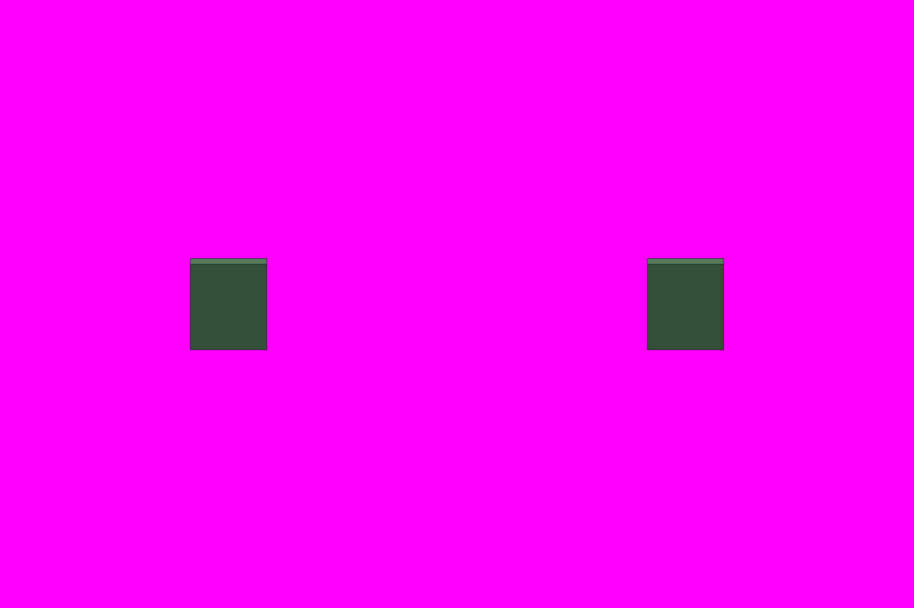

# S8-06 蚁附强攻群像

`s8-06-storming-cluster` · 由 `node tools/build-siege-blockout.mjs` 生成，请改脚本而不是改这个文件。计划见 [03-chencang-v0.2-plan.md](../../../03-chencang-v0.2-plan.md) §9。

- 几何：两件，每件 1 格宽、3 层高，贴在城墙正面（墙不画），占地格是墙前那一格（梯底或墙脚）。左「攀附」：十到十四个 S1-05 的蜀兵密密麻麻攀在墙面上，用绳索、挠钩和两架短梯，最高的已到女墙下，最低的在格底堆成一团往上挤。右「溃退」：同一位置，绳索空荡，三四个兵正从半高处滑下，格底一堆兵举盾退开，两个倒在地上（墨色晕开，不画血）。灰盒用一块 1×3 层的立面（`box` 高 3，薄 0.1 格）标出贴墙的面。
- 灰盒两件只标出贴墙立面，不代画人群；anchor 是北边贴墙面的底部中心，wallFoot/wallTop 同时给出墙脚与墙顶的世界和像素坐标。

## 参考图



叠图检查用 `grid.png`（透明底）：黑线是地面格子，红线是立体件的面，橙线是墙顶等顶面上的格子。

## 上传与提示词

尺寸 1536×1024。上传：

1. `blockout.png`
2. `docs/siege/chencang/art/s1-02-south-gate/attempts/v4.webp`
3. `docs/siege/chencang/art/s1-05-shu-halberd-sheet/attempts/v5.webp`

```text
Output requirements: create an image exactly 1536 by 1024 pixels. Treat the first attached block-out as the exact 1536×1024 registration canvas. Paint only the requested pieces; every empty background pixel must be perfectly uniform pure magenta RGB(255,0,255), hex #FF00FF. Apply paper grain and watercolour texture only inside their silhouettes, never on the magenta background. No paper sheet, paper margin, background texture, cast shadow, floor or haze.

Registration landmarks on this canvas (pixel boxes measured from the block-out):
Piece 1, the storming mass, climbing:
- whole piece: x=320..448, y=435..589
- ground footprint, where it stands: x=320..448, y=589..685
- wallFoot registration anchor: x=384, y=589; world (0.5, 17, 0)
- wallTop registration anchor: x=384, y=445; world (0.5, 17, 3)
Piece 2, the storming mass, repulsed:
- whole piece: x=1088..1216, y=435..589
- ground footprint, where it stands: x=1088..1216, y=589..685
- wallFoot registration anchor: x=1152, y=589; world (0.5, 17, 0)
- wallTop registration anchor: x=1152, y=445; world (0.5, 17, 3)
Keep each piece inside its whole-piece box and stand it on its ground footprint; match heights to the block-out rather than making anything taller.

Match the brushwork, line weight, colours and lighting of the second attached image exactly.

Style priority — A 界画淡彩: Paint the object as a TWO-DIMENSIONAL TRADITIONAL CHINESE JIEHUA PAINTING. Finely ruled, uniform slender ink contours define the architecture with quiet precise architectural draughtsmanship. Flat, pale, transparent ochre and grey watercolour washes with soft ink diffusion; snow left as clean paper-white. Keep brick and roof-tile marks sparse and deliberately drawn by hand, with generous calm untextured surfaces. The result must unmistakably read as fine Chinese ink-and-light-colour architectural painting, not a realistic digital render. No photographic material textures, physically based rendering, glossy surfaces, dense mottling or dark heavy outlines.

The first attached image is a colour-coded 3D block-out, not a style reference. Strictly preserve the position, footprint, height and outline of every block: each block's top face and front face must stay within about a quarter of a grid cell of where it is drawn. Replace the flat colours with finished materials and keep straight architecture straight. Natural features (snow drifts, ice edges, trench banks, paths) may have soft organic edges, within half a cell of where they are marked.

Camera: orthographic three-quarter top-down view, looking due north and tilted about 50 degrees down from the horizon. Strictly parallel projection: no perspective, no vanishing points, near and far objects the same size. Every vertical edge is perfectly vertical, every east-west edge perfectly horizontal, and north-south edges run straight up the image. Only top faces and south-facing front faces are visible; east and west side faces are never visible.

Subject: two pieces showing a mass of Shu-Han infantry storming a city wall by swarming up its face (蚁附攻城), for a strategy game, two separate pieces side by side, one centred in each half of the image; the wall itself is NOT drawn, only the men on it, so paint them as if clinging to an invisible vertical face one cell wide and three levels tall, with their feet at the bottom of the piece. Left, the assault: twelve to fourteen soldiers in jade-green coats, the same soldiers as on the third attached sheet, packed shoulder to shoulder and climbing with knotted ropes, iron grapnels and two short wooden ladders; the highest man reaches up just below where the parapet would be, the lowest men crowd at the base pushing upward, shields raised over their heads, halberds slung. Right, the repulse: the same place a moment later, the ropes hanging loose, three or four men sliding and tumbling down the face, a knot of men at the base backing away under raised shields, and two figures lying crumpled at the foot drawn only as soft dissolving ink blots, with no blood and no wounds shown. Both pieces are the same width and height; the figures are drawn at the same scale as the soldiers on the third attached sheet, so each man is about the height of one wall level.
In the block-out, one grid cell is 128 pixels wide and 96 pixels deep, and one height level is 48 pixels.

Isolated object only, on a perfectly flat solid magenta (#FF00FF) background with no gradient, texture or ground. Nothing else in the frame. Clean edges against the background, and no magenta tint reflected onto the object.

Light: low winter sun from the lower left (south-west). Front faces catch a pale warm light and top faces carry fresh snow. Shade the object itself only; do not paint any cast shadow on the ground.

Style: traditional Chinese ink-wash painting with light colour (水墨淡彩), with the precision of jiehua (界画) ruled-line architectural painting: crisp, straight, evenly weighted ink lines on walls, gate towers, timber and roof tiles; soft transparent washes on snow, earth, ice and water; subtle rice-paper grain. Restrained winter palette: warm paper-white snow, ochre rammed earth, grey brick, dark timber, slate roof tiles, muted pine green, with small accents of red lacquer.

Do not include: any text, letters, calligraphy, seals or signatures; grid lines or guide marks; ground, snowfield, cast shadows or anything besides the requested pieces; additional people or soldiers beyond the requested clusters, horses, flags, banners or pennants; modern objects.
```

## 看什么

- 和 S1-02 标准件、S1-01 v2-a 是不是同一套笔法、颜色和光照。
- 每件都在自己的框里，底边落在灰盒的地面框上；背景纯品红，没有地面、雪地和落地影子。
- 和 S1-05 是同一支军队；看得出是「一群人往上爬」而不是一个人；缩到游戏尺寸（约 64×144px）仍能看出人形的密集感；溃退那件没有血。
- 把图缩到一半（游戏 100% 的大小）看：放在 S1-01 的雪地上不突兀。

## 出图记录

出的图放进 `attempts/`，依次命名 `v1.webp`、`v2.webp`……
