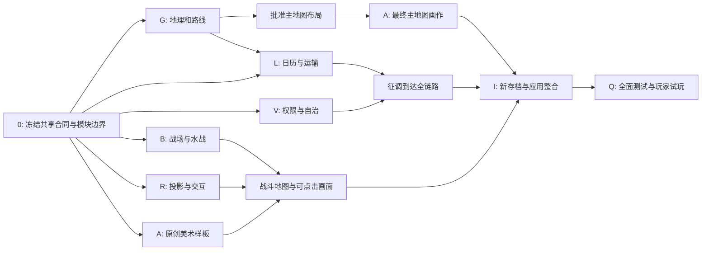

# v0.3 实施总览：地理行军、太守自治、大型水陆战场

**更新：2026-10-21。状态：原 F01–F08 已修复，核心玩法已接入，现有自动化矩阵通过；二次复核发现新的界面推进阻塞、地图布局及易用性问题。** 当前版本优先完成[可玩性复核与小范围待办](playability-review-and-todo.md)，其中包含实际浏览器证据、负责人和验收标准；本次仅修订文档，没有实现 RV01–RV10。当前实施状态、测试结果和人工门槛见[实施状态台账](implementation-status.md)及[接续实施计划](implementation-plan.md)。[完整代码复核](implementation-audit.md)是修复前的历史快照；其中 F01–F08 与本次新发现分开记录。本目录取代[最初提案](../improvement_proposals_261021.md)。

**这是独立发展的新三国游戏。** BAYE 是项目的历史来源，旧规则复刻与旧存档兼容不再是产品目标。沿用有价值的工程基础和真实来源记录；产品暂名《Hegemony of the Three Kingdoms》。

## 1. 已确定的版本体验

- 城市位置经过历史地理核对，路线距离与行军时间有可查依据。直线距离、估计道路里程和历史条件下的粗略日数分别标明；汉中—长安不再硬塞一个 30 日下限。
- 内部按日，30 日/月；玩家推进 1 日、1 旬或到下个事件。出征、运输、调任与返程会真实耗时。
- 太守辖城自治、君主本城直辖。任免在月界生效；玩家对辖城征调资源、命令出征，具体内政由太守组织，缺额必须答复。
- 战场固定 24×20，共 480 格；保留中式水墨、高视角斜俯视、小地图和可读的近景操作。
- **没有任何攻城系统。** 城市争夺由城外野战/水陆战及其结果处理，不包含城墙、城门、攀墙、破门、攻城器或市街阶段。
- **所有单位都可进入水格，不需要水军技能。** 所有在水单位降低攻击与防御，岸上单位在正常射程内可攻击水中单位；水上状态必须可见且规则一致。
- 可以手动指挥玩家部队作战。城市自治不剥夺临阵指挥。
- 仅支持 v0.3 新存档，不做旧档迁移、双规则引擎或旧版行为哈希兼容。

确定的用户决策与具体实现初值分开记录在 [00：决定与合同](00-decisions-and-contracts.md)。例如水上攻击 ×0.75、承伤 ×1.25 是建议调参起点，不是用户指定数值。

### 地理调查已经给出的初始基准

[G 轨](01-geography-and-routes.md) 已逐项列出 **24 个城市锚点、42 条现有连接**，计算大圆距离，并给出有明确算法的路线/行军估计。示例：

| 路线      | 大圆距离  | 估算道路长度            | 普通军队名义行程 |
| --------- | --------- | ----------------------- | ---------------- |
| 汉中—长安 | 约 225 km | 400–450 km，名义 425 km | 33 日            |
| 陈留—许县 | 约 90 km  | 100–120 km，名义 110 km | 6 日             |
| 宛城—襄阳 | 约 115 km | 130–155 km，名义 140 km | 7 日             |

这些数值来自可复算的初始模型，路线长度和日速仍含研究估计。五个低置信古城锚点、跨年代迁城和优先核查的长途路线均在 G 轨明确列出；不能把整张表称为已测绘的汉末道路。正式素材和最终行程配置在这些记录上继续收敛。

### Campaign map paper candidate (draft)

The current campaign map background includes painted terrain washes that are only illustrative. This alternate ImageGen paper substrate avoids assigning river or mountain locations in the raster; program overlays remain the geographic source. It is not active in the game and remains draft until it is reviewed with the city, river, ridge, and route overlays. See the [asset manifest](assets/manifest.json) and [generation provenance](assets/provenance.md).

## 2. 分轨文档与负责人

| 轨道            | 任务书                                                  | 唯一领域责任                                  | 可独立启动的工作                                     |
| --------------- | ------------------------------------------------------- | --------------------------------------------- | ---------------------------------------------------- |
| G 地理/数据     | [01 地理、真实距离与路线](01-geography-and-routes.md)   | 古城指代、坐标、全部连接距离、行军基准与来源  | 历史锚点、距离计算、路线核查                         |
| L 日历/后勤     | [02 按日模拟、行军与补给](02-calendar-and-logistics.md) | 全局日期、在途实体、预留/消耗/交付、返程      | 用固定测试路线实现状态机                             |
| V 治理/战略 AI  | [03 太守自治与权限](03-governors-and-authority.md)      | 任免、权限、征调/出征方案、自治规划与报告     | 权限矩阵、用假运输服务测试命令流程                   |
| B 战斗规则      | [04 大战场与水战](04-battlefields-and-water-combat.md)  | 24×20 地形逻辑、部署、寻路、水战公式、战术 AI | 纯数据地图与规则测试，不需要最终贴图                 |
| R 渲染/地图 UI  | [05 斜俯视与地图操作](05-rendering-and-map-ui.md)       | 投影、命中、镜头、小地图、路线、单位水上状态  | 合同固定后以矢量占位实现真实交互                     |
| A imagegen/美术 | [06 图片生成与素材生产](06-imagegen-and-artwork.md)     | 原创绘画、变体、透明素材、资源清单、来源      | 先做地表/单位/运输标记样板；地理成稿后再画最终主地图 |
| I 集成/存储     | [07 集成、QA 与交付](07-integration-and-validation.md)  | 共享类型/命令、应用装配、新存档、Wiki、README | 拆模块边界、新版保存合同与整合夹具                   |
| Q 验证/平衡     | [07 验证清单](07-integration-and-validation.md)         | 集成场景、性能、长战役、故障与人工体验证据    | 固定指标、种子和测试矩阵；实现可用后持续验证         |

编码时每轨可以独立交付；I/Q 是独立角色，可由同一代理按顺序承担。表格列出领域责任；实际完成状态以实施台账和代码/测试为准。

## 3. 初始并行安排与当前接续

以下依赖图保留原实施顺序。初始模块和基础接口已存在；后续代理从[接续工作包 P01–P11](implementation-plan.md)开始，先修复已确认失败场景，再补齐玩法、视觉和测量，不重复从零搭建。共享 `engine.ts`、`App.tsx` 等仍由 I 单一写入。

**波次 0：接口冻结。** I 与各 owner 确认 C1–C6、状态命名、字段、投影/锚点、事件顺序、源文件写入权。交付可运行的空领域边界与共享夹具，不等最终美术。

**波次 1：独立实现。** G 校正地理；L/V 用假接口；B 用逻辑地图；R 用矢量占位；A 用批准投影生成地形与单位原型；Q 准备验收场景。A 不必等 B 写完 AI，B 不必等 imagegen，R 不在图里实现伤害。

**波次 2：按合同接线。** G→L 接入真实路线，G→R/A 确定地图布局；L↔V 完成征调/出征；L↔B 完成多战场日调度；B↔R 接规则查询；A→R 接资源清单。I 统一新保存格式与 UI。

**波次 3：候选验证。** Q 对已整合版本运行全套测试、长战役与人工试玩；更新 Wiki 与真实截图，再判断是否交付。此前不能以概念图或一张漂亮地图宣布完成。

## 4. 启动某轨时给编码代理的任务模板

> 阅读 `docs/v0.3/README.md`、`00-decisions-and-contracts.md` 与分配轨道的任务书。仅修改被分配的领域文件；共享类型、命令总入口与 App 装配由 I 集成。先确认依赖合同与固定夹具，在有假服务可用时不等待其他轨全部结束。完成本轨实现、相关测试、中文/英文说明与交接记录。遇到真实设计缺口请说明受影响场景、建议和可继续工作；不要重新询问已批准的 D1–D10。不要为通过测试删除有意义的失败案例，也不要恢复已取消的攻城或旧档兼容要求。

每轨交接必须给出：代码/数据/资源文件、合同版本、提供/消费的接口、测试命令与结果、未通过项、截图/诊断路径、运行条件及需要 I 接线的清单。资源候选和已集成资源分开；引用不存在的文件不算交付。

## 5. 里程碑与完成定义

| 里程碑        | 可验证结果                                                            |
| ------------- | --------------------------------------------------------------------- |
| M0 合同       | 已定决定无冲突；每个共享文件一个 owner；地理/战斗/绘画有共同输入输出  |
| M1 在途世界   | 汉中—长安与其他路线按真实数据基准耗时，跨月、吃粮、返程和到达可存读档 |
| M2 太守自治   | 直接内政被规则层拒绝；征调/出征有方案、缺口和实际运输，任免不刷额度   |
| M3 水陆战场   | 24×20，所有兵种可下水、统一减攻防、岸对水攻击；无攻城、无寻路卡死     |
| M4 水墨画面   | 高视角镜头、小地图、近景可读；地理底图/地形/单位与逻辑一致            |
| M5 新游戏候选 | v0.3 保存和全链路测试通过，长战役/性能有证据，Wiki/README 与实机一致  |

当前实施状态：核心地理、日历/行军、太守权限、战斗规则与界面、原创图像、存档和中英 Wiki 已进入新 v0.3 应用。已完成与未完成的验收边界列在[实施状态台账](implementation-status.md)；请勿把人工试玩或图像候选误记为已批准。

里程碑复核（2026-10-21）：M0–M3 的主要接口、账本、权限和战斗规则已集成并有自动化回归；M4 的相机、小地图和地图交互已接线。既有单元/构建/浏览器矩阵复跑通过，但没有覆盖本次复现的 RV01 日历阻塞与 RV02 地图布局失败，不能据此关闭 M4/M5。96 个月诊断的战略缺口已由玩家接受；四场玩家试玩、真实低端机、地图精度与运行时视觉审查仍待证据。素材保持 `draft`，等具体修订意见；优先修好布局后再评审画面。

## 6. 不随本轮自动纳入的内容

完整攻城、攻城兵器、城内第二阶段、单挑、武将人生、开放世界截击、舰船建造科技、额外水军技能、旧存档转换、原 BAYE 数值复刻不属于本轮。v0.2 的其他 backlog 保留为背景，不挤入已确定的 v0.3 轨道。

上述排除不影响战略运输中的水路配置、普通城市地图符号或野战营地目标；它们不提供攻城功能。所有范围变更记录在共同合同，不能在美术或规则支线里悄悄追加。
