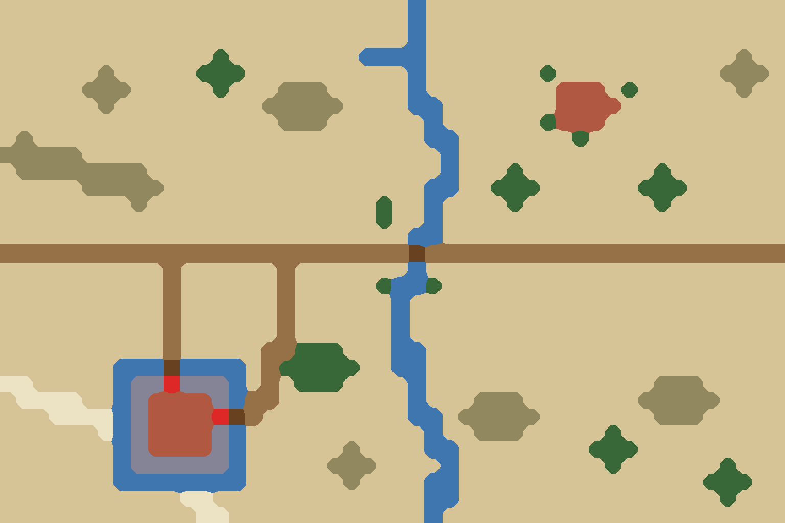

# ① 北方旷野

`bf01-north-plain` · 第一轮 · 由 `node tools/build-battlefield-art.mjs` 生成，请改脚本而不是改这个文件。

- 河北、鲁北平原：麦田、土路、杨柳、小河。界桥之战一类的正面会战。
- 右上是开放的村落，房舍间只有几棵树；左下是带护城壕的坞堡，东门朝大路，北门朝田野，各有一座小桥过壕。
- 散布六处低土岗、一道土梁和一条干河床，平原但不平坦。

## 参考图



## 格子布局（48×32）

x 0–47 从左到右，y 0–31 从上到下。攻方在左，守方在右。`a`/`d` 是攻方、守方营地。

```
.........................~......................
.........................~......................
.........................~......................
.............T........~~~~...................^..
......^.....TTT..........~.......T..........^^^.
.....^^^.....T...^^^.....~........VVV.T......^..
......^.........^^^^^....~~.......VVVV..........
.................^^^......~......TVVV...........
.^........................~~.......T............
^^^^^......................~....................
.^^^^^^^^..................~...T........T.......
.....^^^^^................~~..TTT......TTT......
........^..............T..~....T........T.......
.......................T..~.....................
.........................~~.....................
+++++a+++++++++++++++++++=++++++++++++++++d+++++
..........+......+.......~......................
..........+......+.....T~~T.....................
..........+......+......~.......................
..........+......+......~.......................
..........+......+......~.......................
..........+.....++TTT...~~......................
.......~~~=~~~~.+TTTTT..~~......................
__.....~WWGWWW~.+.TTT....~..............^^^.....
.____..~WVVVVW~++........~...^^^.......^^^^^....
...____~WVVVVG=+.........~~.^^^^^.......^^^.....
......_~WVVVVW~...........~..^^^.....T..........
.......~WVVVVW~......^....~~........TTT.........
.......~WWWWWW~.....^^^....~.........T......T...
.......~~~~~~~~......^....~~...............TTT..
...........__.............~~................T...
............__............~.....................
```

| 符号 | 画面 | 规则格子 | 参考图颜色 |
| --- | --- | --- | --- |
| `.` | 田地、空地 | 平原 | #d6c496 |
| `+` | 道路、小径 | 平原 | #967046 |
| `=` | 桥、栈道、码头 | 平原 | #684220 |
| `_` | 沙洲、河滩、干河床 | 平原 | #ece2c4 |
| `V` | 村落、房舍 | 平原 | #b05842 |
| `G` | 城门、寨门 | 平原 | #de2828 |
| `T` | 树林 | 森林 | #386838 |
| `^` | 丘陵、土岗、堤 | 丘陵 | #928860 |
| `~` | 水 | 水 | #4076b0 |
| `W` | 城墙、关墙（夯土、砖石） | 峭壁 | #848496 |

- 攻方部署区：x 10–13，y 11–20，可用 40 格
- 守方部署区：x 34–37，y 11–20，可用 40 格

| 规则格子 | 实际 | 目标 |
| --- | --- | --- |
| 平原 | 87% | 82% |
| 森林 | 3% | 8% |
| 丘陵 | 4% | 6% |
| 水 | 5% | 4% |
| 峭壁 | 1% | 0% |

## 提示词

上传 `layout.png`，尺寸 1536×1024，粘贴：

```text
Strictly preserve the positions, shapes and sizes of every feature in the attached layout image. The attached image is a color-coded layout map, not a style reference: repaint it as a finished illustration while keeping every boundary in the same place.

The flat color blocks only mark where each feature goes. Paint natural, organic shapes: rivers and shores curve smoothly, groves have soft irregular outlines, hills are rounded, fields are irregular plots. Never copy the square stair-step edges of the blocks. Keep every feature within about half a block of where it is marked.

Walls and palisades are exactly one block thick: paint them as a single continuous line along the marked blocks, never as a wide band. Paint every red gate block as a clear open gateway in the wall, wide enough to read at a glance; the red only marks the opening, so never paint the gate itself red. A timber palisade is a light fence of sharpened stakes, visibly lighter and thinner than an earth or stone wall.

Subject: a top-down 2D battlefield map for a Three Kingdoms strategy game. Camera is straight overhead (orthographic, 90 degrees down). No perspective, no horizon, no sky, no tilted or isometric view. Output 1536×1024, landscape, the whole frame filled edge to edge.

Layout legend (each color in the layout image means exactly this):
- #d6c496 (beige): open winter wheat fields with faint straight field ridges
- #967046 (brown): packed dirt roads
- #684220 (dark brown): small plank bridges: one on the main road over the river, two over the manor moat
- #ece2c4 (pale cream): a pale, dry old river channel
- #b05842 (red-brown): houses of rammed-earth courtyards with grey tile roofs; the upper-right village is open, with fields right up to its houses
- #de2828 (bright red): the two gates of the manor (east and north), each facing a small plank bridge over its moat
- #386838 (dark green): small groves of bare willows and poplars standing in the fields
- #928860 (olive): low, gentle loess earth mounds and one long earth ridge
- #4076b0 (blue): a narrow shallow meandering river, a tiny pond, and the moat around the walled manor
- #848496 (blue-grey): the rammed-earth wall of a fortified manor (坞堡)

Setting: Hebei plain in the late Eastern Han dynasty, around 190 AD. Dry early winter, light loess dust, quiet farmland. Palette: muted ochre, warm grey-brown, pale straw yellow, dull grey-green trees, soft grey-blue water.

Style: traditional Chinese ink-wash painting with light color (水墨淡彩). Soft brush texture, subtle rice-paper grain, gentle ink outlines on roads, banks, walls and cliff edges. Light from the upper left with very soft shadows.

Game readability: keep open ground calm, flat and low-contrast so game unit tokens placed on top stay readable. Keep detail density even across the whole map, with no vignette and no darkened corners.

Do not include: any text, letters, labels, seals or signatures; grid lines; borders, frames, scroll edges or paper margins; compass or legend; people, soldiers, horses, carts, boats with crews, flags, tents or banners; horizon, sky or distant mountains; modern objects.
```

## 出图记录

出的图放进 `attempts/`，文件名用 `v1.webp`、`v2.webp` 依次编号。
