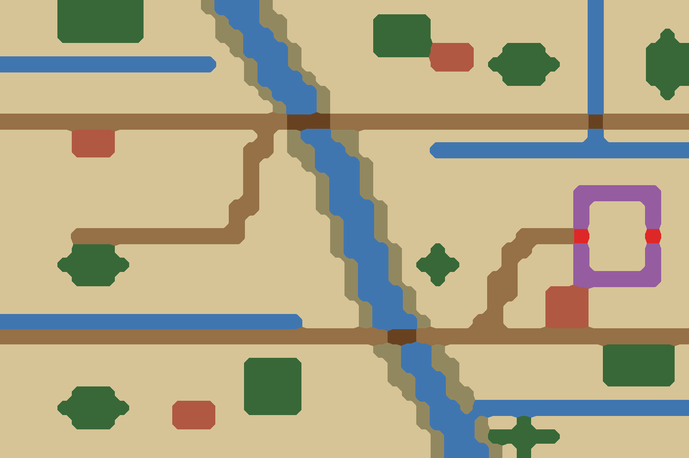

# ② 中原沃野

`bf02-central-farmland` · 第一轮 · 由 `node tools/build-battlefield-art.mjs` 生成，请改脚本而不是改这个文件。

- 黄淮平原：一条两岸有土堤的运河斜穿全图，两条驿道各有一座桥过河。
- 横向沟渠把田地切成方块，村落密集，桑林成片；守方营地有一圈木栅。

## 参考图



## 格子布局（48×32）

x 0–47 从左到右，y 0–31 从上到下。攻方在左，守方在右。`a`/`d` 是攻方、守方营地。

```
....TTTTTT....^~~~^......................~......
....TTTTTT.....^~~^^......TTTT...........~......
....TTTTTT.....^^~~^......TTTT...........~....T.
................^~~~^.....TTTTVVV..TTT...~...TTT
~~~~~~~~~~~~~~~..^~~^.........VVV.TTTTT..~...TTT
.................^~~~^.............TTT...~...TTT
..................^~~~^..................~....T.
...................^~~^..................~......
++++++++++++++++++++===++++++++++++++++++=++++++
.....VVV..........+.^~~^^................~......
.....VVV.........++.^^~~^.....~~~~~~~~~~~~~~~~~~
.................+...^~~~^......................
.................+....^~~^......................
.................+....^~~^..............PPPPPP..
................++....^~~~^.............P....P..
................+......^~~^.............P....P..
.....a+++++++++++......^~~^.........++++G.d..G..
.....TTT...............^~~~^..T....++...P....P..
....TTTTT...............^~~^.TTT...+....P....P..
.....TTT................^~~^..T...++....PPPPPP..
........................^~~~^.....++..VVV.......
.........................^~~^.....+...VVV.......
~~~~~~~~~~~~~~~~~~~~~....^~~~^...++...VVV.......
+++++++++++++++++++++++++++==+++++++++++++++++++
..........................^^~~^...........TTTTT.
.................TTTT......^~~^^..........TTTTT.
.................TTTT......^^~~^..........TTTTT.
.....TTT.........TTTT.......^~~^^...............
....TTTTT...VVV..TTTT........^~~^~~~~~~~~~~~~~~~
.....TTT....VVV..............^~~~^..T...........
..............................^~~^TTTTT.........
..............................^~~~^.T...........
```

| 符号 | 画面 | 规则格子 | 参考图颜色 |
| --- | --- | --- | --- |
| `.` | 田地、空地 | 平原 | #d6c496 |
| `+` | 道路、小径 | 平原 | #967046 |
| `=` | 桥、栈道、码头 | 平原 | #684220 |
| `V` | 村落、房舍 | 平原 | #b05842 |
| `G` | 城门、寨门 | 平原 | #de2828 |
| `T` | 树林 | 森林 | #386838 |
| `P` | 木栅、鹿角 | 森林 | #965ca0 |
| `^` | 丘陵、土岗、堤 | 丘陵 | #928860 |
| `~` | 水 | 水 | #4076b0 |

- 攻方部署区：x 10–13，y 11–20，可用 40 格
- 守方部署区：x 34–37，y 11–20，可用 40 格

| 规则格子 | 实际 | 目标 |
| --- | --- | --- |
| 平原 | 77% | 67% |
| 森林 | 9% | 12% |
| 丘陵 | 4% | 8% |
| 水 | 10% | 13% |
| 峭壁 | 0% | 0% |

## 提示词

上传 `layout.png`，尺寸 1536×1024，粘贴：

```text
Strictly preserve the positions, shapes and sizes of every feature in the attached layout image. The attached image is a color-coded layout map, not a style reference: repaint it as a finished illustration while keeping every boundary in the same place.

The flat color blocks only mark where each feature goes. Paint natural, organic shapes: rivers and shores curve smoothly, groves have soft irregular outlines, hills are rounded, fields are irregular plots. Never copy the square stair-step edges of the blocks. Keep every feature within about half a block of where it is marked.

Walls and palisades are exactly one block thick: paint them as a single continuous line along the marked blocks, never as a wide band. Paint every red gate block as a clear open gateway in the wall, wide enough to read at a glance; the red only marks the opening, so never paint the gate itself red. A timber palisade is a light fence of sharpened stakes, visibly lighter and thinner than an earth or stone wall.

Subject: a top-down 2D battlefield map for a Three Kingdoms strategy game. Camera is straight overhead (orthographic, 90 degrees down). No perspective, no horizon, no sky, no tilted or isometric view. Output 1536×1024, landscape, the whole frame filled edge to edge.

Layout legend (each color in the layout image means exactly this):
- #d6c496 (beige): small irregular plots of green wheat and fallow land, densely farmed
- #967046 (brown): straight post roads and village lanes
- #684220 (dark brown): wooden bridges over the canal
- #b05842 (red-brown): dense villages of rammed-earth courtyards with grey tile roofs
- #de2828 (bright red): the front and rear gates of the palisade
- #386838 (dark green): mulberry and elm groves planted in rows
- #965ca0 (purple): a square timber palisade of a field fort
- #928860 (olive): grassy earth embankments along both banks of the canal
- #4076b0 (blue): a straight-banked canal crossing the map diagonally, and narrow irrigation ditches

Setting: Central Plains between Chenliu and Xuchang, late Eastern Han dynasty, around 200 AD. Mild early spring. Palette: fresh pale green, warm ochre earth, grey-blue water, dark green groves.

Style: traditional Chinese ink-wash painting with light color (水墨淡彩). Soft brush texture, subtle rice-paper grain, gentle ink outlines on roads, banks, walls and cliff edges. Light from the upper left with very soft shadows.

Game readability: keep open ground calm, flat and low-contrast so game unit tokens placed on top stay readable. Keep detail density even across the whole map, with no vignette and no darkened corners.

Do not include: any text, letters, labels, seals or signatures; grid lines; borders, frames, scroll edges or paper margins; compass or legend; people, soldiers, horses, carts, boats with crews, flags, tents or banners; horizon, sky or distant mountains; modern objects.
```

## 出图记录

出的图放进 `attempts/`，文件名用 `v1.webp`、`v2.webp` 依次编号。
