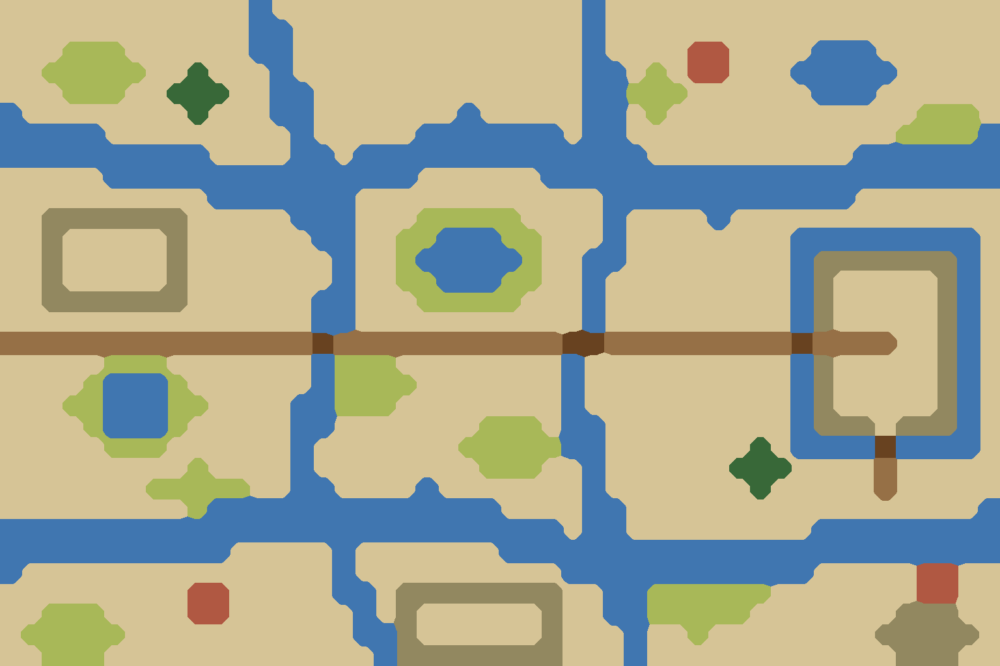

# ④北 水网泽国（淮泗）

`bf04-wetland-north` · 第一轮 · 由 `node tools/build-battlefield-art.mjs` 生成，请改脚本而不是改这个文件。

- 淮河—泗水下游：网状水道、湖塘、芦苇荡、圩田，陆地被切成几块，靠桥和堤相连。
- 守方营地在一块四面环水的高地上，只有两座桥通进去（呼应下邳、寿春）。

## 参考图



## 格子布局（48×32）

x 0–47 从左到右，y 0–31 从上到下。攻方在左，守方在右。`a`/`d` 是攻方、守方营地。

```
............~...............~...................
............~~..............~...................
...rrr......~~..............~....VV....~~~......
..rrrrr..T...~..............~~.r.VV...~~~~~.....
...rrr..TTT..~~.............~~rrr......~~~......
~........T...~~.......~.....~~.r............rrr.
~~~~~.........~.....~~~~~~~.~~.............rrrr~
~~~~~~~~~~....~~.~~~~~~~~~~~~~~..........~~~~~~~
.....~~~~~~~~~~~~~~~......~~~~~~~~~~~~~~~~~~~~~~
..........~~~~~~~............~~~~~~~~~~~~.......
..^^^^^^^.....~~~...rrrrr....~....~.............
..^.....^......~~..rr~~~rr...~........~~~~~~~~~.
..^.....^.......~..r~~~~~r..~~........~^^^^^^^~.
..^.....^.......~..rr~~~rr..~.........~^.....^~.
..^^^^^^^......~~...rrrrr...~.........~^.....^~.
...............~~...........~.........~^.....^~.
+++++a+++++++++=+++++++++++==+++++++++=+++d..^~.
.....rrr.......~rrr........~..........~^.....^~.
....r~~~r......~rrrr.......~..........~^.....^~.
...rr~~~rr....~~rrr........~..........~^.....^~.
....r~~~r.....~~.......rrr.~~.........~^^^.^^^~.
.....rrr......~.......rrrrr~~.......T.~~~~=~~~~.
.........r....~........rrr..~......TTT....+.....
.......rrrrr..~~....~.......~.......T.....+.....
.........r~~~~~~~~~~~~~~....~~.................~
~~~~~~~~~~~~~~~~~~~~~~~~~~~.~~.........~~~~~~~~~
~~~~~~~~~~~.....~.......~~~~~~~~~~~~~~~~~~~~~~~~
~...............~..........~~~~~~~~~~~~.....VV..
.........VV.....~~.^^^^^^^^..~~rrrrrr.......VV..
..rrr....VV......~.^......^..~~rrrrr.......^^^..
.rrrrr...........~~^......^...~..r........^^^^^.
..rrr.............~^^^^^^^^...~............^^^..
```

| 符号 | 画面 | 规则格子 | 参考图颜色 |
| --- | --- | --- | --- |
| `.` | 田地、空地 | 平原 | #d6c496 |
| `+` | 道路、小径 | 平原 | #967046 |
| `=` | 桥、栈道、码头 | 平原 | #684220 |
| `V` | 村落、房舍 | 平原 | #b05842 |
| `T` | 树林 | 森林 | #386838 |
| `r` | 芦苇荡 | 森林 | #a8b858 |
| `^` | 丘陵、土岗、堤 | 丘陵 | #928860 |
| `~` | 水 | 水 | #4076b0 |

- 攻方部署区：x 10–13，y 11–20，可用 40 格
- 守方部署区：x 34–37，y 11–20，可用 40 格

| 规则格子 | 实际 | 目标 |
| --- | --- | --- |
| 平原 | 65% | 45% |
| 森林 | 8% | 15% |
| 丘陵 | 5% | 10% |
| 水 | 23% | 30% |
| 峭壁 | 0% | 0% |

## 提示词

上传 `layout.png`，尺寸 1536×1024，粘贴：

```text
Strictly preserve the positions, shapes and sizes of every feature in the attached layout image. The attached image is a color-coded layout map, not a style reference: repaint it as a finished illustration while keeping every boundary in the same place.

The flat color blocks only mark where each feature goes. Paint natural, organic shapes: rivers and shores curve smoothly, groves have soft irregular outlines, hills are rounded, fields are irregular plots. Never copy the square stair-step edges of the blocks. Keep every feature within about half a block of where it is marked.

Subject: a top-down 2D battlefield map for a Three Kingdoms strategy game. Camera is straight overhead (orthographic, 90 degrees down). No perspective, no horizon, no sky, no tilted or isometric view. Output 1536×1024, landscape, the whole frame filled edge to edge.

Layout legend (each color in the layout image means exactly this):
- #d6c496 (beige): wet, low-lying fields between the waterways
- #967046 (brown): a raised causeway road
- #684220 (dark brown): small wooden and stone bridges
- #b05842 (red-brown): small marsh villages
- #386838 (dark green): a few willows
- #a8b858 (yellow-green): dense reed beds around the ponds and along the creeks
- #928860 (olive): polder dikes and a raised mound ringed by water on the right
- #4076b0 (blue): a web of winding creeks, two broad channels and shallow ponds

Setting: The lower Huai and Si rivers near Xiapi, late Eastern Han dynasty, around 198 AD. Damp late autumn. Palette: yellow-green reeds, olive marsh, grey-green water, muted ochre fields.

Style: traditional Chinese ink-wash painting with light color (水墨淡彩). Soft brush texture, subtle rice-paper grain, gentle ink outlines on roads, banks, walls and cliff edges. Light from the upper left with very soft shadows.

Game readability: keep open ground calm, flat and low-contrast so game unit tokens placed on top stay readable. Keep detail density even across the whole map, with no vignette and no darkened corners.

Do not include: any text, letters, labels, seals or signatures; grid lines; borders, frames, scroll edges or paper margins; compass or legend; people, soldiers, horses, carts, boats with crews, flags, tents or banners; horizon, sky or distant mountains; modern objects.
```

## 出图记录

出的图放进 `attempts/`，文件名用 `v1.webp`、`v2.webp` 依次编号。
