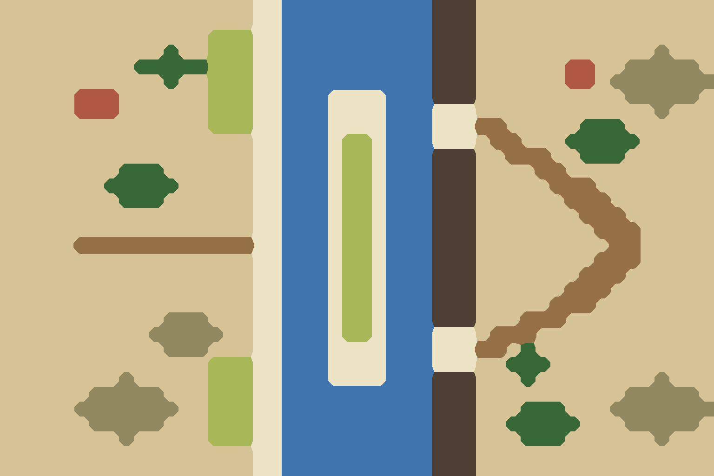

# ⑤B 大江·渡江

`bf05-yangtze-crossing` · 第一轮 · 由 `node tools/build-battlefield-art.mjs` 生成，请改脚本而不是改这个文件。

- 从北面攻建业：大江竖贯，中间一条长长的江心洲，两侧各 3 格水。
- 守方岸是一整段临江悬崖，只留两处登陆滩口；攻方岸是滩涂和芦苇荡。

## 参考图



## 格子布局（48×32）

x 0–47 从左到右，y 0–31 从上到下。攻方在左，守方在右。`a`/`d` 是攻方、守方营地。

```
.................__~~~~~~~~~~###................
.................__~~~~~~~~~~###................
..............rrr__~~~~~~~~~~###................
...........T..rrr__~~~~~~~~~~###............^...
.........TTTTTrrr__~~~~~~~~~~###......VV..^^^^^.
...........T..rrr__~~~~~~~~~~###......VV.^^^^^^^
.....VVV......rrr__~~~____~~~###..........^^^^^.
.....VVV......rrr__~~~____~~~___............^...
..............rrr__~~~____~~~___++.....TTT......
.................__~~~_rr_~~~___.++...TTTTT.....
.................__~~~_rr_~~~###..+++..TTT......
........TTT......__~~~_rr_~~~###....++..........
.......TTTTT.....__~~~_rr_~~~###.....+++........
........TTT......__~~~_rr_~~~###......+++.......
.................__~~~_rr_~~~###.......+++......
.................__~~~_rr_~~~###........+++.....
.....a+++++++++++__~~~_rr_~~~###.........+d.....
.................__~~~_rr_~~~###........+++.....
.................__~~~_rr_~~~###.......+++......
.................__~~~_rr_~~~###......+++.......
.................__~~~_rr_~~~###.....+++........
...........^^^...__~~~_rr_~~~###...+++..........
..........^^^^^..__~~~_rr_~~~___.+++............
...........^^^...__~~~____~~~___++.T............
..............rrr__~~~____~~~___..TTT...........
........^.....rrr__~~~____~~~###...T........^...
......^^^^^...rrr__~~~~~~~~~~###..........^^^^^.
.....^^^^^^^..rrr__~~~~~~~~~~###...TTT...^^^^^^^
......^^^^^...rrr__~~~~~~~~~~###..TTTTT...^^^^^.
........^.....rrr__~~~~~~~~~~###...TTT......^...
.................__~~~~~~~~~~###................
.................__~~~~~~~~~~###................
```

| 符号 | 画面 | 规则格子 | 参考图颜色 |
| --- | --- | --- | --- |
| `.` | 田地、空地 | 平原 | #d6c496 |
| `+` | 道路、小径 | 平原 | #967046 |
| `_` | 沙洲、河滩、干河床 | 平原 | #ece2c4 |
| `V` | 村落、房舍 | 平原 | #b05842 |
| `T` | 树林 | 森林 | #386838 |
| `r` | 芦苇荡 | 森林 | #a8b858 |
| `^` | 丘陵、土岗、堤 | 丘陵 | #928860 |
| `~` | 水 | 水 | #4076b0 |
| `#` | 峭壁、岩壁 | 峭壁 | #4e3e34 |

- 攻方部署区：x 10–13，y 11–20，可用 40 格
- 守方部署区：x 34–37，y 11–20，可用 40 格

| 规则格子 | 实际 | 目标 |
| --- | --- | --- |
| 平原 | 68% | 40% |
| 森林 | 7% | 15% |
| 丘陵 | 4% | 10% |
| 水 | 16% | 25% |
| 峭壁 | 5% | 10% |

## 提示词

上传 `layout.png`，尺寸 1536×1024，粘贴：

```text
Strictly preserve the positions, shapes and sizes of every feature in the attached layout image. The attached image is a color-coded layout map, not a style reference: repaint it as a finished illustration while keeping every boundary in the same place.

The flat color blocks only mark where each feature goes. Paint natural, organic shapes: rivers and shores curve smoothly, groves have soft irregular outlines, hills are rounded, fields are irregular plots. Never copy the square stair-step edges of the blocks. Keep every feature within about half a block of where it is marked.

Subject: a top-down 2D battlefield map for a Three Kingdoms strategy game. Camera is straight overhead (orthographic, 90 degrees down). No perspective, no horizon, no sky, no tilted or isometric view. Output 1536×1024, landscape, the whole frame filled edge to edge.

Layout legend (each color in the layout image means exactly this):
- #d6c496 (beige): fields and grass
- #967046 (brown): dirt roads
- #ece2c4 (pale cream): pale mud flats on the left bank, a long sandy midstream island, and two small landing beaches
- #b05842 (red-brown): hamlets
- #386838 (dark green): small woods
- #a8b858 (yellow-green): reed beds on the island and the left bank
- #928860 (olive): rounded hills
- #4076b0 (blue): the broad grey-green Yangtze river flowing top to bottom
- #4e3e34 (dark grey-brown): steep riverside cliffs along the whole right bank

Setting: The lower Yangtze above Jianye, late Eastern Han dynasty. Overcast spring morning. Palette: grey-green water, pale sand, yellow-green reeds, dark grey-brown cliffs.

Style: traditional Chinese ink-wash painting with light color (水墨淡彩). Soft brush texture, subtle rice-paper grain, gentle ink outlines on roads, banks, walls and cliff edges. Light from the upper left with very soft shadows.

Game readability: keep open ground calm, flat and low-contrast so game unit tokens placed on top stay readable. Keep detail density even across the whole map, with no vignette and no darkened corners.

Do not include: any text, letters, labels, seals or signatures; grid lines; borders, frames, scroll edges or paper margins; compass or legend; people, soldiers, horses, carts, boats with crews, flags, tents or banners; horizon, sky or distant mountains; modern objects.
```

## 出图记录

出的图放进 `attempts/`，文件名用 `v1.webp`、`v2.webp` 依次编号。
