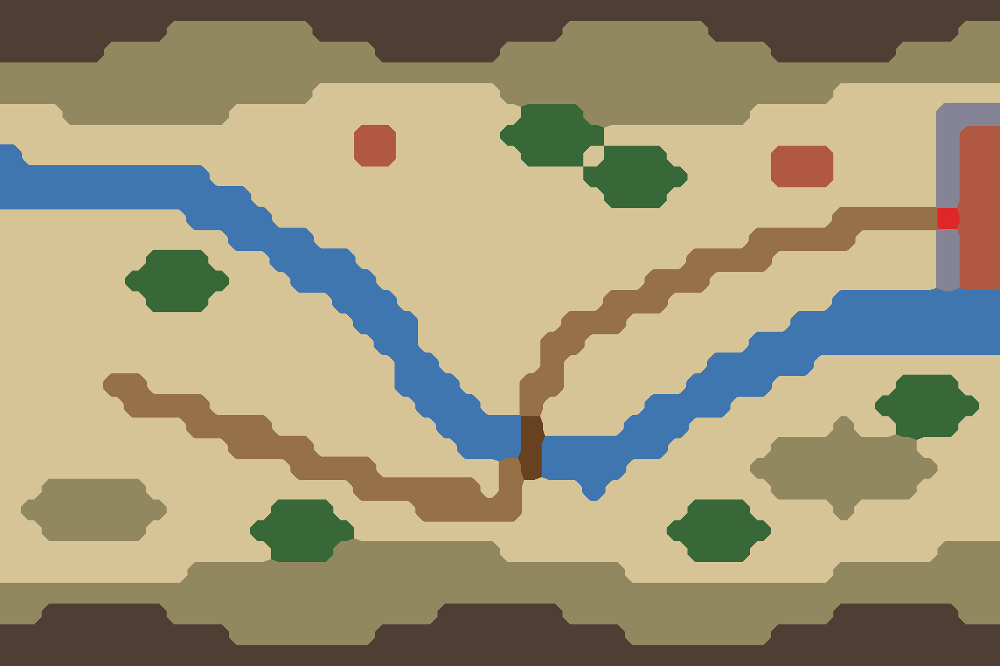

# ⑥南 河谷川地（汉水）

`bf06-valley-south` · 第一轮 · 由 `node tools/build-battlefield-art.mjs` 生成，请改脚本而不是改这个文件。

- 汉水谷地：与 ⑥北 同一布局，换成稻田、绿色山坡；城池一角是襄阳。

## 参考图



## 格子布局（48×32）

x 0–47 从左到右，y 0–31 从上到下。攻方在左，守方在右。`a`/`d` 是攻方、守方营地。

```
################################################
########^^^^^^^############^^^^^^^############^^
#####^^^^^^^^^^^^^######^^^^^^^^^^^^^######^^^^^
^^^^^^^^^^^^^^^^^^^^^^^^^^^^^^^^^^^^^^^^^^^^^^^^
^^^^^^^^^^^^^^^.........^^^^^^^^^^^^^^^^........
...^^^^^^^^..............TTT^^^^^^^^.........WWW
.................VV.....TTTTT................WVV
~................VV......TTT.TTT.....VVV.....WVV
~~~~~~~~~~..................TTTTT....VVV.....WVV
~~~~~~~~~~~~.................TTT.............WVV
.........~~~~...........................++d++GVV
...........~~~~.....................+++++....WVV
.......TTT...~~~~................++++........WVV
......TTTTT...~~~~.............+++...........WVV
.......TTT......~~~..........+++........~~~~~~~~
.................~~~.......+++........~~~~~~~~~~
..................~~......++........~~~~~~~~~~~~
...................~~.....+.......~~~~~.........
.....a+............~~~...++......~~~~......TTT..
......++++..........~~~..+.....~~~~.......TTTTT.
.........++++........~~~~=....~~~.......^..TTT..
...........++++.......~~~=~~~~~~.....^^^^^^^....
..............++++......+=~~~~......^^^^^^^^^...
..^^^^^..........++++++.+...~........^^^^^^^....
.^^^^^^^.....TTT....+++++........TTT....^.......
..^^^^^.....TTTTT...............TTTTT...........
.............TTT^^^^^^^^.........TTT.........^^^
.........^^^^^^^^^^^^^^^^^^^^^..........^^^^^^^^
^^^^^^^^^^^^^^^^^^^^^^^^^^^^^^^^^^^^^^^^^^^^^^^^
^^######^^^^^^^^^^^^^######^^^^^^^^^^^^^######^^
###########^^^^^^^############^^^^^^^###########
################################################
```

| 符号 | 画面 | 规则格子 | 参考图颜色 |
| --- | --- | --- | --- |
| `.` | 田地、空地 | 平原 | #d6c496 |
| `+` | 道路、小径 | 平原 | #967046 |
| `=` | 桥、栈道、码头 | 平原 | #684220 |
| `V` | 村落、房舍 | 平原 | #b05842 |
| `G` | 城门、寨门 | 平原 | #de2828 |
| `T` | 树林 | 森林 | #386838 |
| `^` | 丘陵、土岗、堤 | 丘陵 | #928860 |
| `~` | 水 | 水 | #4076b0 |
| `#` | 峭壁、岩壁 | 峭壁 | #4e3e34 |
| `W` | 城墙、关墙（夯土、砖石） | 峭壁 | #848496 |

- 攻方部署区：x 10–13，y 13–22，可用 40 格
- 守方部署区：x 34–37，y 6–14，可用 36 格

| 规则格子 | 实际 | 目标 |
| --- | --- | --- |
| 平原 | 54% | 49% |
| 森林 | 4% | 10% |
| 丘陵 | 21% | 22% |
| 水 | 8% | 10% |
| 峭壁 | 13% | 9% |

## 提示词

上传 `layout.png`，尺寸 1536×1024，粘贴：

```text
Strictly preserve the positions, shapes and sizes of every feature in the attached layout image. The attached image is a color-coded layout map, not a style reference: repaint it as a finished illustration while keeping every boundary in the same place.

The flat color blocks only mark where each feature goes. Paint natural, organic shapes: rivers and shores curve smoothly, groves have soft irregular outlines, hills are rounded, fields are irregular plots. Never copy the square stair-step edges of the blocks. Keep every feature within about half a block of where it is marked.

Walls and palisades are exactly one block thick: paint them as a single continuous line along the marked blocks, never as a wide band. Paint every red gate block as a clear open gateway in the wall, wide enough to read at a glance; the red only marks the opening, so never paint the gate itself red. A timber palisade is a light fence of sharpened stakes, visibly lighter and thinner than an earth or stone wall.

Subject: a top-down 2D battlefield map for a Three Kingdoms strategy game. Camera is straight overhead (orthographic, 90 degrees down). No perspective, no horizon, no sky, no tilted or isometric view. Output 1536×1024, landscape, the whole frame filled edge to edge.

Layout legend (each color in the layout image means exactly this):
- #d6c496 (beige): green rice paddies and vegetable fields on the valley floor
- #967046 (brown): the valley road
- #684220 (dark brown): a wooden bridge over the river
- #b05842 (red-brown): villages, and the rooftops of the walled city of Xiangyang at the right edge
- #de2828 (bright red): the city gate
- #386838 (dark green): camphor and broadleaf groves
- #928860 (olive): green wooded hill slopes along the top and bottom edges
- #4076b0 (blue): the jade-green Han River winding through the valley in an S-curve
- #4e3e34 (dark grey-brown): grey rock outcrops at the very top and bottom edges
- #848496 (blue-grey): a corner of the city wall

Setting: The Han River valley at Xiangyang, late Eastern Han dynasty. Early summer. Palette: jade green water, fresh green paddies, dark green hills, grey walls.

Style: traditional Chinese ink-wash painting with light color (水墨淡彩). Soft brush texture, subtle rice-paper grain, gentle ink outlines on roads, banks, walls and cliff edges. Light from the upper left with very soft shadows.

Game readability: keep open ground calm, flat and low-contrast so game unit tokens placed on top stay readable. Keep detail density even across the whole map, with no vignette and no darkened corners.

Do not include: any text, letters, labels, seals or signatures; grid lines; borders, frames, scroll edges or paper margins; compass or legend; people, soldiers, horses, carts, boats with crews, flags, tents or banners; horizon, sky or distant mountains; modern objects.
```

## 出图记录

出的图放进 `attempts/`，文件名用 `v1.webp`、`v2.webp` 依次编号。
