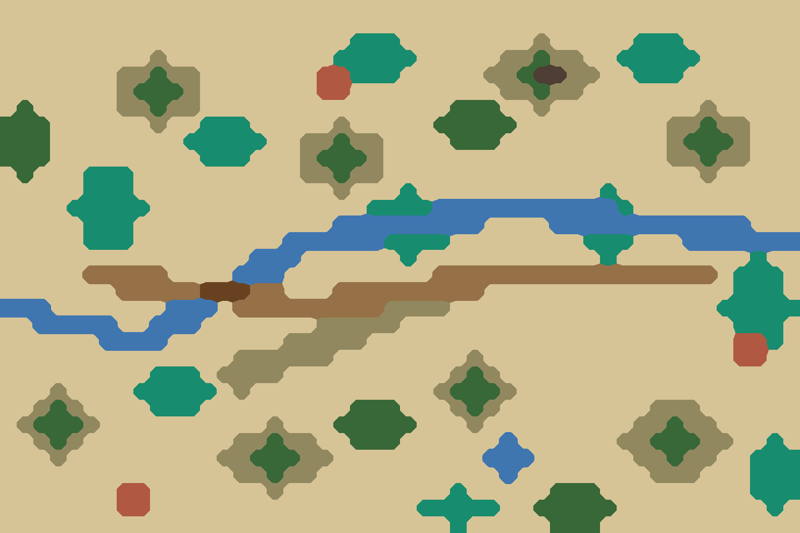

# ⑧ 南方丘陵

`bf08-south-hills` · 第一轮 · 由 `node tools/build-battlefield-art.mjs` 生成，请改脚本而不是改这个文件。

- 巴蜀、荆门丘陵：圆丘散布，丘间水田，竹林成片，一条溪流蜿蜒穿过。
- 攻方一侧有一段缓缓上升的长坡（长坂坡意象）。

## 参考图



## 格子布局（48×32）

x 0–47 从左到右，y 0–31 从上到下。攻方在左，守方在右。`a`/`d` 是攻方、守方营地。

```
................................................
................................................
.....................bbb........^.....bbb.......
.........^..........bbbbb.....^^T^^..bbbbb......
.......^^T^^.......VVbbb.....^^T##^^..bbb.......
.......^TTT^.......VV.........^^T^^.............
.T.....^^T^^...............TTT..^.........^.....
TTT......^..bbb.....^.....TTTTT.........^^T^^...
TTT........bbbbb..^^T^^....TTT..........^TTT^...
TTT.........bbb...^TTT^.................^^T^^...
.T...bbb..........^^T^^...................^.....
.....bbb............^...b...........b...........
....bbbbb.............bbbb~~~~~~~~~~~b..........
.....bbb............~~~~~~~~~....~~~~~~~~~~~~...
.....bbb.........~~~~~~bbbb........bbb...~~~~~~~
...............~~~......b...........b........b..
.....a++++....~~~.........++++++++++++++++d.bbb.
.......+++++===++...+++++++++...............bbb.
~~~.......~~~.+++++++++^^^^................bbbbb
..~~~~~..~~~.......^^^^^....................bbb.
......~~~~.......^^^^^......................VVb.
..............^^^^^^........^...............VV..
.........bbb.^^^^..........^T^..................
...^....bbbbb.^...........^TTT^.................
..^T^....bbb.........TTT...^T^.........^^^......
.^TTT^..........^...TTTTT...^.........^^T^^.....
..^T^.........^^T^^..TTT......~......^^TTT^^..b.
...^.........^^TTT^^.........~~~......^^T^^..bbb
..............^^T^^...........~........^^^...bbb
.......VV.......^..........b.....TTT.........bbb
.......VV................bbbbb..TTTTT.........b.
...........................b.....TTT............
```

| 符号 | 画面 | 规则格子 | 参考图颜色 |
| --- | --- | --- | --- |
| `.` | 田地、空地 | 平原 | #d6c496 |
| `+` | 道路、小径 | 平原 | #967046 |
| `=` | 桥、栈道、码头 | 平原 | #684220 |
| `V` | 村落、房舍 | 平原 | #b05842 |
| `T` | 树林 | 森林 | #386838 |
| `b` | 竹林 | 森林 | #188c6e |
| `^` | 丘陵、土岗、堤 | 丘陵 | #928860 |
| `~` | 水 | 水 | #4076b0 |
| `#` | 峭壁、岩壁 | 峭壁 | #4e3e34 |

- 攻方部署区：x 10–13，y 11–20，可用 35 格
- 守方部署区：x 34–37，y 11–20，可用 33 格

| 规则格子 | 实际 | 目标 |
| --- | --- | --- |
| 平原 | 74% | 40% |
| 森林 | 13% | 25% |
| 丘陵 | 8% | 25% |
| 水 | 5% | 8% |
| 峭壁 | 0% | 2% |

## 提示词

上传 `layout.png`，尺寸 1536×1024，粘贴：

```text
Strictly preserve the positions, shapes and sizes of every feature in the attached layout image. The attached image is a color-coded layout map, not a style reference: repaint it as a finished illustration while keeping every boundary in the same place.

The flat color blocks only mark where each feature goes. Paint natural, organic shapes: rivers and shores curve smoothly, groves have soft irregular outlines, hills are rounded, fields are irregular plots. Never copy the square stair-step edges of the blocks. Keep every feature within about half a block of where it is marked.

Subject: a top-down 2D battlefield map for a Three Kingdoms strategy game. Camera is straight overhead (orthographic, 90 degrees down). No perspective, no horizon, no sky, no tilted or isometric view. Output 1536×1024, landscape, the whole frame filled edge to edge.

Layout legend (each color in the layout image means exactly this):
- #d6c496 (beige): terraced and flat rice paddies between the hills
- #967046 (brown): red-earth footpaths
- #684220 (dark brown): a small plank bridge
- #b05842 (red-brown): hamlets with dark tile roofs
- #386838 (dark green): broadleaf woods on the hilltops
- #188c6e (teal green): dense bamboo groves
- #928860 (olive): round green hills and one long gentle slope
- #4076b0 (blue): a winding stream and a small pond
- #4e3e34 (dark grey-brown): a small grey rock outcrop on a hilltop

Setting: The hills of Jingmen and the Sichuan basin, late Eastern Han dynasty. Humid spring with light mist. Palette: fresh greens, teal bamboo, red-brown earth paths, silver water.

Style: traditional Chinese ink-wash painting with light color (水墨淡彩). Soft brush texture, subtle rice-paper grain, gentle ink outlines on roads, banks, walls and cliff edges. Light from the upper left with very soft shadows.

Game readability: keep open ground calm, flat and low-contrast so game unit tokens placed on top stay readable. Keep detail density even across the whole map, with no vignette and no darkened corners.

Do not include: any text, letters, labels, seals or signatures; grid lines; borders, frames, scroll edges or paper margins; compass or legend; people, soldiers, horses, carts, boats with crews, flags, tents or banners; horizon, sky or distant mountains; modern objects.
```

## 出图记录

出的图放进 `attempts/`，文件名用 `v1.webp`、`v2.webp` 依次编号。
