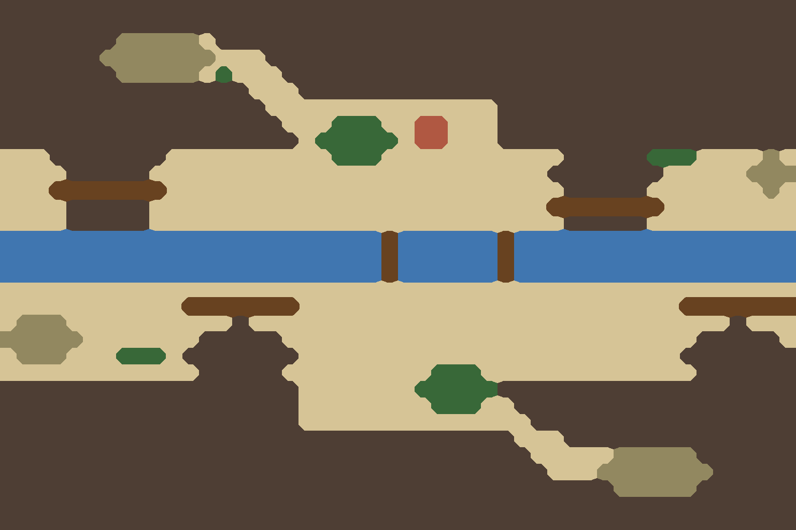

# ⑨峡谷 峡谷栈道

`bf09-gorge` · 第一轮 · 由 `node tools/build-battlefield-art.mjs` 生成，请改脚本而不是改这个文件。

- 秦岭褒斜道、祁山道：深峡横贯，谷底急流；岩嘴把谷底挤成 1 格栈道。
- 中段一块开阔谷地作主战场，上下各一条侧谷通往伏兵台地。

## 参考图



## 格子布局（48×32）

x 0–47 从左到右，y 0–31 从上到下。攻方在左，守方在右。`a`/`d` 是攻方、守方营地。

```
################################################
################################################
#######^^^^^.###################################
######^^^^^^^...################################
#######^^^^^.T...###############################
###############...##############################
################..............##################
#################...TTT..VV...##################
##################.TTTTT.VV...##################
...#######..........TTT...........#####TTT....^.
....#####........................#######.....^^^
...=======........................#####....d..^.
....#####........................=======........
....#####.........................#####.........
~~~~~~~~~~~~~~~~~~~~~~~=~~~~~~=~~~~~~~~~~~~~~~~~
~~~~~~~~~~~~~~~~~~~~~~~=~~~~~~=~~~~~~~~~~~~~~~~~
~~~~~~~~~~~~~~~~~~~~~~~=~~~~~~=~~~~~~~~~~~~~~~~~
................................................
...........=======.......................=======
.^^^a.........#.............................#...
^^^^^.......#####.........................#####.
.^^^...TTT.#######.......................#######
............#####.........TTT.............######
##################.......TTTTT##################
##################........TTT..#################
##################..............################
###############################...##############
################################.....^^^^^######
#################################...^^^^^^^#####
#####################################^^^^^######
################################################
################################################
```

| 符号 | 画面 | 规则格子 | 参考图颜色 |
| --- | --- | --- | --- |
| `.` | 田地、空地 | 平原 | #d6c496 |
| `=` | 桥、栈道、码头 | 平原 | #684220 |
| `V` | 村落、房舍 | 平原 | #b05842 |
| `T` | 树林 | 森林 | #386838 |
| `^` | 丘陵、土岗、堤 | 丘陵 | #928860 |
| `~` | 水 | 水 | #4076b0 |
| `#` | 峭壁、岩壁 | 峭壁 | #4e3e34 |

- 攻方部署区：x 10–13，y 9–22，可用 37 格
- 守方部署区：x 34–37，y 9–22，可用 28 格

| 规则格子 | 实际 | 目标 |
| --- | --- | --- |
| 平原 | 33% | 22% |
| 森林 | 2% | 8% |
| 丘陵 | 3% | 15% |
| 水 | 9% | 10% |
| 峭壁 | 53% | 45% |

## 提示词

上传 `layout.png`，尺寸 1536×1024，粘贴：

```text
Strictly preserve the positions, shapes and sizes of every feature in the attached layout image. The attached image is a color-coded layout map, not a style reference: repaint it as a finished illustration while keeping every boundary in the same place.

The flat color blocks only mark where each feature goes. Paint natural, organic shapes: rivers and shores curve smoothly, groves have soft irregular outlines, hills are rounded, fields are irregular plots. Never copy the square stair-step edges of the blocks. Keep every feature within about half a block of where it is marked.

Subject: a top-down 2D battlefield map for a Three Kingdoms strategy game. Camera is straight overhead (orthographic, 90 degrees down). No perspective, no horizon, no sky, no tilted or isometric view. Output 1536×1024, landscape, the whole frame filled edge to edge.

Layout legend (each color in the layout image means exactly this):
- #d6c496 (beige): the gorge floor: gravel banks and small level clearings
- #684220 (dark brown): timber plank roads (栈道) bolted to the cliff face, and two log bridges over the torrent
- #b05842 (red-brown): a tiny post station
- #386838 (dark green): clinging pines
- #928860 (olive): small high terraces at the head of side gullies
- #4076b0 (blue): a fast, white-flecked mountain torrent
- #4e3e34 (dark grey-brown): sheer misty cliffs filling the top and bottom of the map

Setting: The Baoxie plank road through the Qinling Mountains, late Eastern Han dynasty. Damp autumn with drifting cloud. Palette: blue-grey rock, ink black shadows, moss green, white water.

Style: traditional Chinese ink-wash painting with light color (水墨淡彩). Soft brush texture, subtle rice-paper grain, gentle ink outlines on roads, banks, walls and cliff edges. Light from the upper left with very soft shadows.

Game readability: keep open ground calm, flat and low-contrast so game unit tokens placed on top stay readable. Keep detail density even across the whole map, with no vignette and no darkened corners.

Do not include: any text, letters, labels, seals or signatures; grid lines; borders, frames, scroll edges or paper margins; compass or legend; people, soldiers, horses, carts, boats with crews, flags, tents or banners; horizon, sky or distant mountains; modern objects.
```

## 出图记录

出的图放进 `attempts/`，文件名用 `v1.webp`、`v2.webp` 依次编号。
