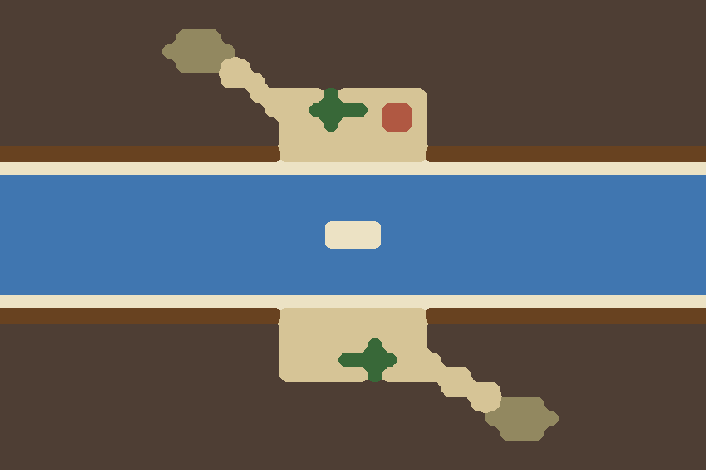

# ⑨三峡 峡谷栈道（三峡）

`bf09-three-gorges` · 第二轮 · 由 `node tools/build-battlefield-art.mjs` 生成，请改脚本而不是改这个文件。

- 三峡：大江从峡底横贯，两岸是贴崖的纤道，中段一小块河谷盆地。

## 参考图



## 格子布局（48×32）

x 0–47 从左到右，y 0–31 从上到下。攻方在左，守方在右。`a`/`d` 是攻方、守方营地。

```
################################################
################################################
############^^^#################################
###########^^^^^################################
############^^^..###############################
###############...##############################
#################.....T......###################
##################...TTTT.VV.###################
###################...T...VV.###################
###################..........###################
==============a====..........====d==============
________________________________________________
~~~~~~~~~~~~~~~~~~~~~~~~~~~~~~~~~~~~~~~~~~~~~~~~
~~~~~~~~~~~~~~~~~~~~~~~~~~~~~~~~~~~~~~~~~~~~~~~~
~~~~~~~~~~~~~~~~~~~~~~~~~~~~~~~~~~~~~~~~~~~~~~~~
~~~~~~~~~~~~~~~~~~~~~~____~~~~~~~~~~~~~~~~~~~~~~
~~~~~~~~~~~~~~~~~~~~~~____~~~~~~~~~~~~~~~~~~~~~~
~~~~~~~~~~~~~~~~~~~~~~~~~~~~~~~~~~~~~~~~~~~~~~~~
~~~~~~~~~~~~~~~~~~~~~~~~~~~~~~~~~~~~~~~~~~~~~~~~
~~~~~~~~~~~~~~~~~~~~~~~~~~~~~~~~~~~~~~~~~~~~~~~~
________________________________________________
===================..........===================
###################..........###################
###################......T...###################
###################....TTTT...##################
###################......T......################
##############################....##############
################################..^^^###########
#################################^^^^^##########
##################################^^^###########
################################################
################################################
```

| 符号 | 画面 | 规则格子 | 参考图颜色 |
| --- | --- | --- | --- |
| `.` | 田地、空地 | 平原 | #d6c496 |
| `=` | 桥、栈道、码头 | 平原 | #684220 |
| `_` | 沙洲、河滩、干河床 | 平原 | #ece2c4 |
| `V` | 村落、房舍 | 平原 | #b05842 |
| `T` | 树林 | 森林 | #386838 |
| `^` | 丘陵、土岗、堤 | 丘陵 | #928860 |
| `~` | 水 | 水 | #4076b0 |
| `#` | 峭壁、岩壁 | 峭壁 | #4e3e34 |

- 攻方部署区：x 10–13，y 10–21，可用 16 格
- 守方部署区：x 34–37，y 10–21，可用 16 格

| 规则格子 | 实际 | 目标 |
| --- | --- | --- |
| 平原 | 19% | 22% |
| 森林 | 1% | 4% |
| 丘陵 | 1% | 6% |
| 水 | 24% | 25% |
| 峭壁 | 55% | 43% |

## 提示词

上传 `layout.png`，尺寸 1536×1024，粘贴：

```text
Strictly preserve the positions, shapes and sizes of every feature in the attached layout image. The attached image is a color-coded layout map, not a style reference: repaint it as a finished illustration while keeping every boundary in the same place.

The flat color blocks only mark where each feature goes. Paint natural, organic shapes: rivers and shores curve smoothly, groves have soft irregular outlines, hills are rounded, fields are irregular plots. Never copy the square stair-step edges of the blocks. Keep every feature within about half a block of where it is marked.

Subject: a top-down 2D battlefield map for a Three Kingdoms strategy game. Camera is straight overhead (orthographic, 90 degrees down). No perspective, no horizon, no sky, no tilted or isometric view. Output 1536×1024, landscape, the whole frame filled edge to edge.

Layout legend (each color in the layout image means exactly this):
- #d6c496 (beige): a small riverside basin and gully floors
- #684220 (dark brown): narrow towpaths cut into the cliffs along both banks
- #ece2c4 (pale cream): a gravel bar in midstream and boulder banks between the towpaths and the water
- #b05842 (red-brown): a tiny riverside village
- #386838 (dark green): clinging trees
- #928860 (olive): small high terraces
- #4076b0 (blue): the green Yangtze racing through the gorge
- #4e3e34 (dark grey-brown): towering limestone gorge walls

Setting: The Three Gorges of the Yangtze, late Eastern Han dynasty. Misty spring. Palette: grey-white limestone, deep green water, moss green.

Style: traditional Chinese ink-wash painting with light color (水墨淡彩). Soft brush texture, subtle rice-paper grain, gentle ink outlines on roads, banks, walls and cliff edges. Light from the upper left with very soft shadows.

Game readability: keep open ground calm, flat and low-contrast so game unit tokens placed on top stay readable. Keep detail density even across the whole map, with no vignette and no darkened corners.

Do not include: any text, letters, labels, seals or signatures; grid lines; borders, frames, scroll edges or paper margins; compass or legend; people, soldiers, horses, carts, boats with crews, flags, tents or banners; horizon, sky or distant mountains; modern objects.
```

## 出图记录

出的图放进 `attempts/`，文件名用 `v1.webp`、`v2.webp` 依次编号。
