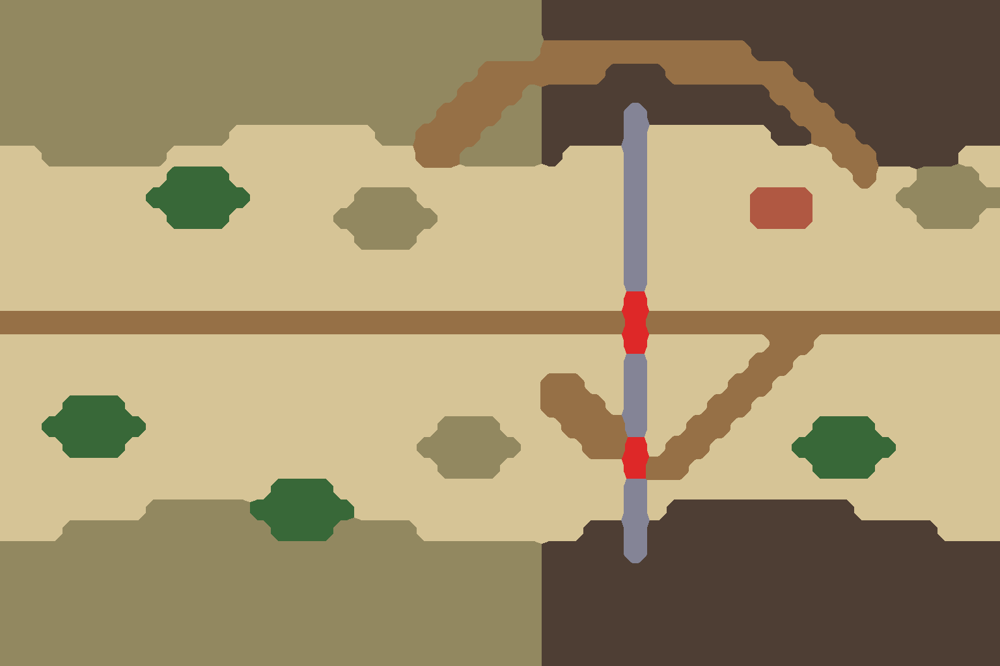

# ⑩ 雄关隘口

`bf10-mountain-pass` · 第一轮 · 由 `node tools/build-battlefield-art.mjs` 生成，请改脚本而不是改这个文件。

- 潼关、虎牢关、剑门关：上下两山夹峙，一道关墙横断山口；大路上是 3 格宽的主城门，南面另有一座 2 格宽的侧门。关前缓坡，关后营地。
- 一条 1 格险峻小道翻过北面山崖绕过关隘。

## 参考图



## 格子布局（48×32）

x 0–47 从左到右，y 0–31 从上到下。攻方在左，守方在右。`a`/`d` 是攻方、守方营地。

```
^^^^^^^^^^^^^^^^^^^^^^^^^^######################
^^^^^^^^^^^^^^^^^^^^^^^^^^######################
^^^^^^^^^^^^^^^^^^^^^^^^^^++++++++++############
^^^^^^^^^^^^^^^^^^^^^^^++++++###++++++##########
^^^^^^^^^^^^^^^^^^^^^^+++^###########++#########
^^^^^^^^^^^^^^^^^^^^^+++^^####W#######++########
^^^^^^^^^^^.......^^+++^^^####W......##++#######
..^^^^^^............++^^^^#...W.........++####..
........TTT...................W..........+..^^^.
.......TTTTT.....^^^..........W.....VVV....^^^^^
........TTT.....^^^^^.........W.....VVV.....^^^.
.................^^^..........W.................
..............................W.................
..............................W.................
..............................G.................
+++++a++++++++++++++++++++++++G+++++++++++d+++++
..............................G......++.........
..............................W.....++..........
..........................++..W....++...........
...TTT....................+++.W...++............
..TTTTT..............^^^...+++W..++....TTT......
...TTT..............^^^^^...++G.++....TTTTT.....
.....................^^^......G++......TTT......
.............TTT..............W.................
.......^^^^^TTTTT.............W.#########.......
...^^^^^^^^^^TTT^^^^........##W##############...
^^^^^^^^^^^^^^^^^^^^^^^^^^####W#################
^^^^^^^^^^^^^^^^^^^^^^^^^^######################
^^^^^^^^^^^^^^^^^^^^^^^^^^######################
^^^^^^^^^^^^^^^^^^^^^^^^^^######################
^^^^^^^^^^^^^^^^^^^^^^^^^^######################
^^^^^^^^^^^^^^^^^^^^^^^^^^######################
```

| 符号 | 画面 | 规则格子 | 参考图颜色 |
| --- | --- | --- | --- |
| `.` | 田地、空地 | 平原 | #d6c496 |
| `+` | 道路、小径 | 平原 | #967046 |
| `V` | 村落、房舍 | 平原 | #b05842 |
| `G` | 城门、寨门 | 平原 | #de2828 |
| `T` | 树林 | 森林 | #386838 |
| `^` | 丘陵、土岗、堤 | 丘陵 | #928860 |
| `#` | 峭壁、岩壁 | 峭壁 | #4e3e34 |
| `W` | 城墙、关墙（夯土、砖石） | 峭壁 | #848496 |

- 攻方部署区：x 10–13，y 11–20，可用 40 格
- 守方部署区：x 34–37，y 11–20，可用 40 格

| 规则格子 | 实际 | 目标 |
| --- | --- | --- |
| 平原 | 53% | 40% |
| 森林 | 3% | 10% |
| 丘陵 | 25% | 25% |
| 水 | 0% | 0% |
| 峭壁 | 19% | 25% |

## 提示词

上传 `layout.png`，尺寸 1536×1024，粘贴：

```text
Strictly preserve the positions, shapes and sizes of every feature in the attached layout image. The attached image is a color-coded layout map, not a style reference: repaint it as a finished illustration while keeping every boundary in the same place.

The flat color blocks only mark where each feature goes. Paint natural, organic shapes: rivers and shores curve smoothly, groves have soft irregular outlines, hills are rounded, fields are irregular plots. Never copy the square stair-step edges of the blocks. Keep every feature within about half a block of where it is marked.

Walls and palisades are exactly one block thick: paint them as a single continuous line along the marked blocks, never as a wide band. Paint every red gate block as a clear open gateway in the wall, wide enough to read at a glance; the red only marks the opening, so never paint the gate itself red. A timber palisade is a light fence of sharpened stakes, visibly lighter and thinner than an earth or stone wall.

Subject: a top-down 2D battlefield map for a Three Kingdoms strategy game. Camera is straight overhead (orthographic, 90 degrees down). No perspective, no horizon, no sky, no tilted or isometric view. Output 1536×1024, landscape, the whole frame filled edge to edge.

Layout legend (each color in the layout image means exactly this):
- #d6c496 (beige): an open grassy approach slope and the ground behind the pass
- #967046 (brown): the road through the gate, and a perilous narrow trail over the crags
- #b05842 (red-brown): barracks behind the wall
- #de2828 (bright red): the main fortified gate with a gate tower on the road, and a smaller side gate to the south
- #386838 (dark green): pine groves
- #928860 (olive): rugged hill slopes on the approach side
- #4e3e34 (dark grey-brown): steep rock cliffs and crags
- #848496 (blue-grey): a massive rammed-earth and brick pass wall running from cliff to cliff

Setting: Tong Pass between the mountains, late Eastern Han dynasty. Clear cold autumn. Palette: ochre walls, grey rock, dry grass, dark pine green.

Style: traditional Chinese ink-wash painting with light color (水墨淡彩). Soft brush texture, subtle rice-paper grain, gentle ink outlines on roads, banks, walls and cliff edges. Light from the upper left with very soft shadows.

Game readability: keep open ground calm, flat and low-contrast so game unit tokens placed on top stay readable. Keep detail density even across the whole map, with no vignette and no darkened corners.

Do not include: any text, letters, labels, seals or signatures; grid lines; borders, frames, scroll edges or paper margins; compass or legend; people, soldiers, horses, carts, boats with crews, flags, tents or banners; horizon, sky or distant mountains; modern objects.
```

## 出图记录

出的图放进 `attempts/`，文件名用 `v1.webp`、`v2.webp` 依次编号。
