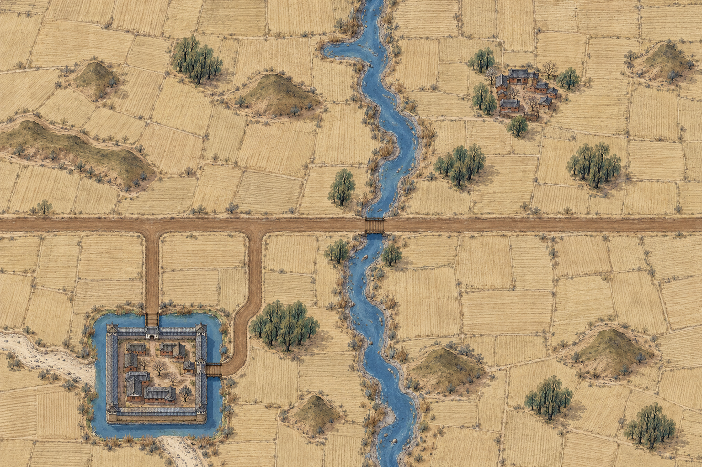
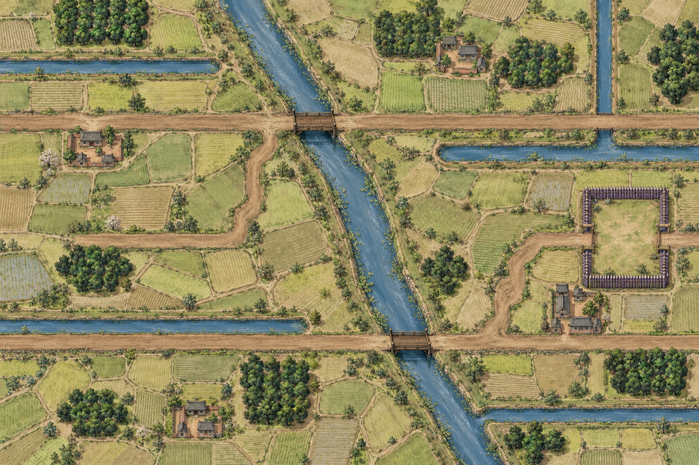
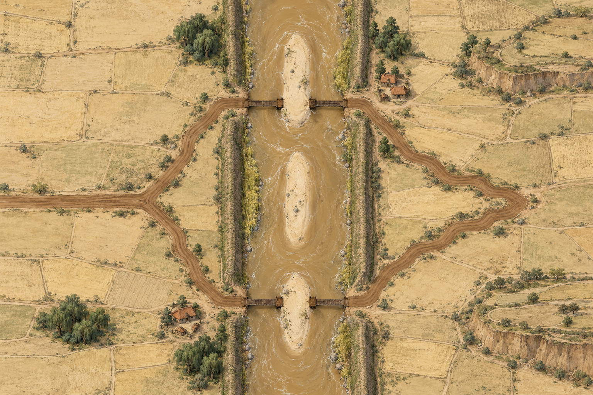
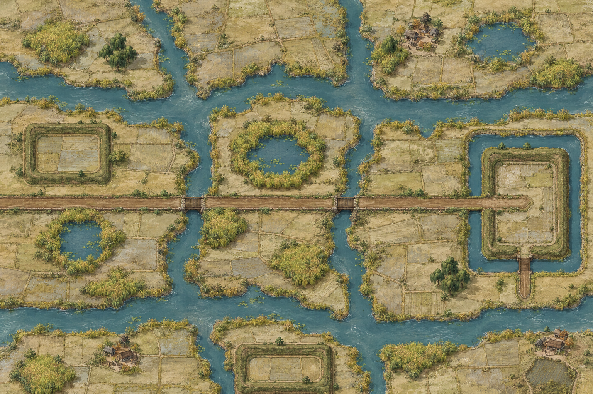
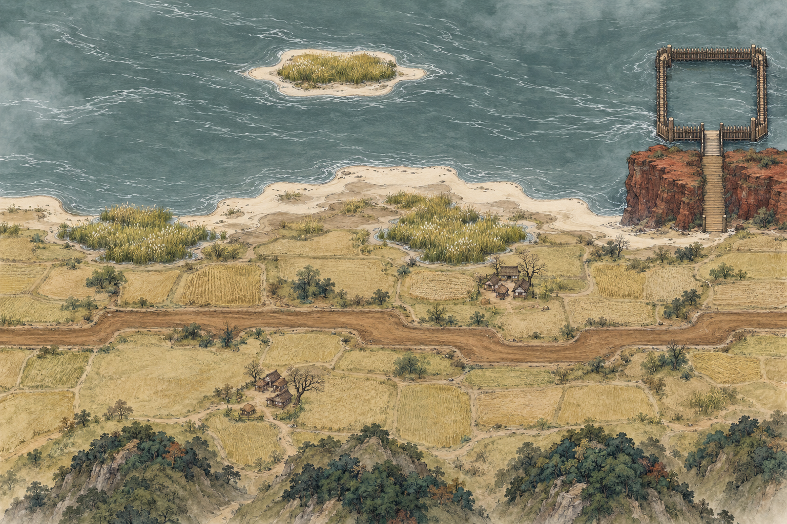
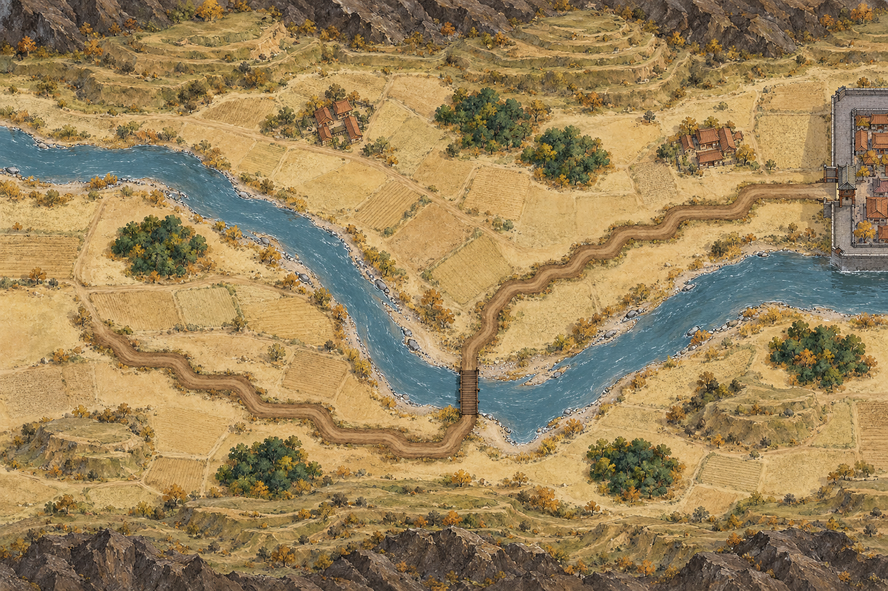
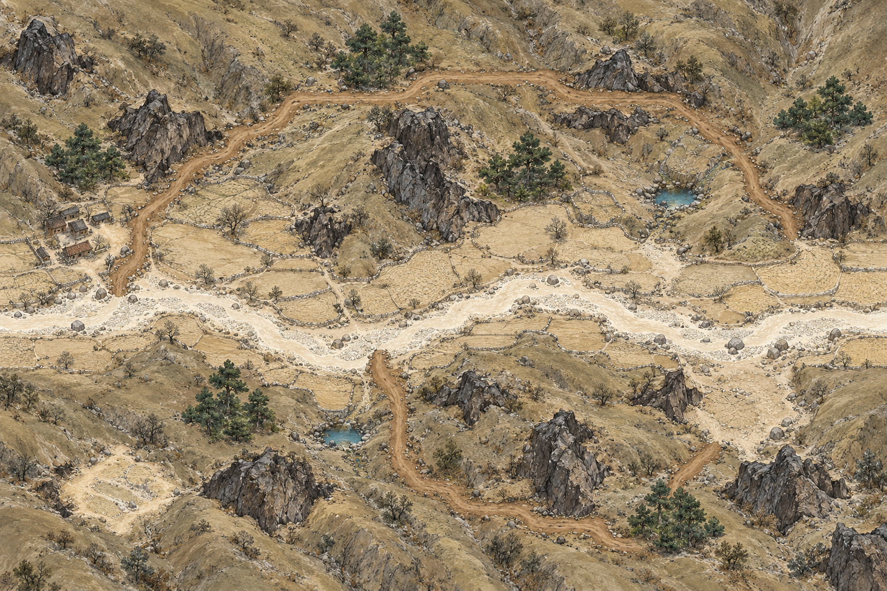
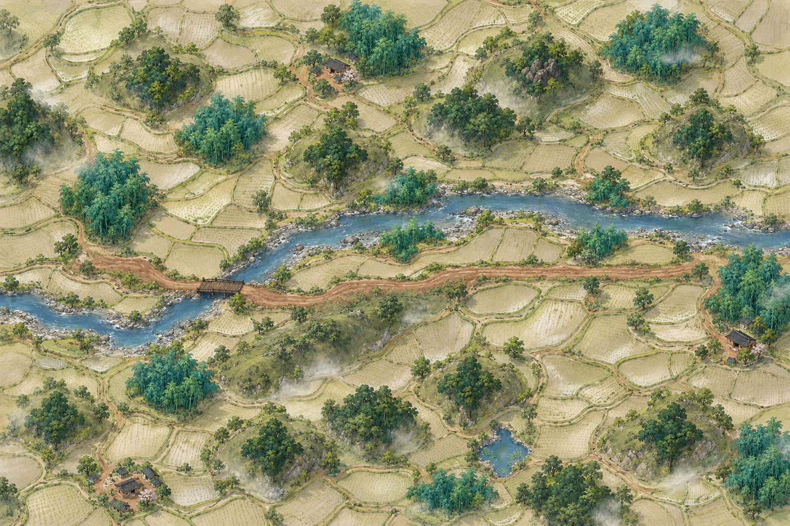
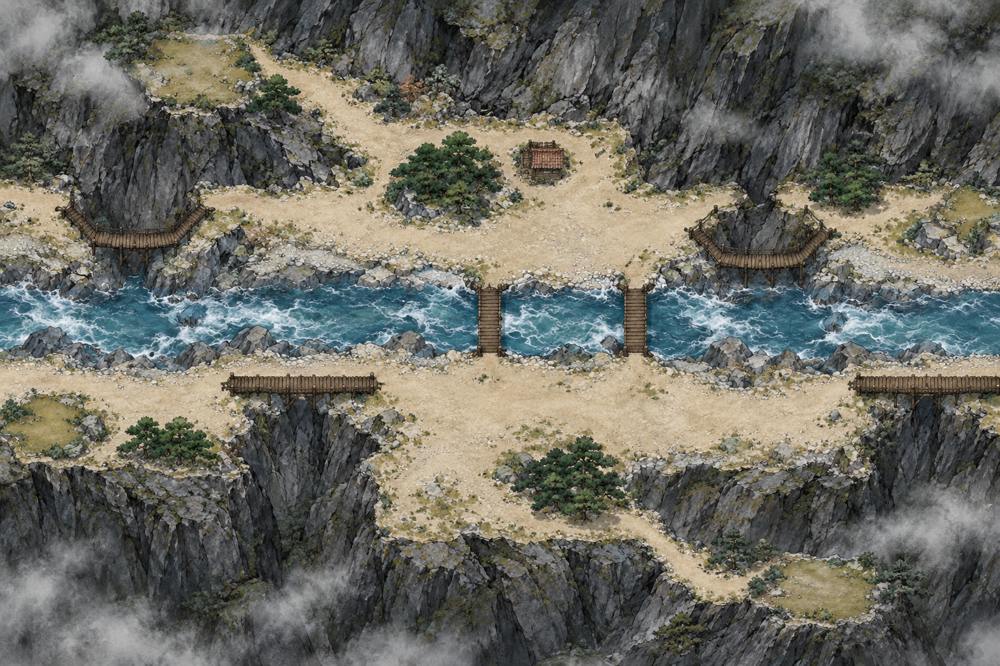
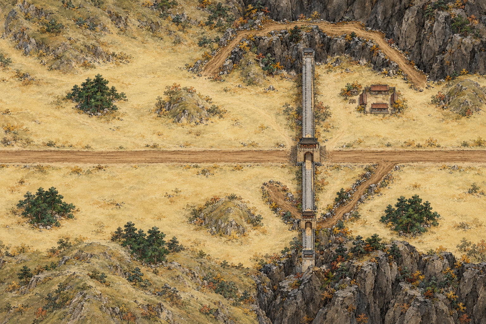

# 十个战场候选图 · 2026-10-23

按最新的各战场 README 提示词和 layout.png，每个战场独立生成一张。内置 image_gen；1536×1024；待用户审核。

①、② 上一批四张候选图及相应记录已从项目中移除。当前选用①—⑩的基础变体：淮泗、沿江、渭水、太行、秦岭峡谷。

本批只供美术审阅。⑤—⑩的山崖、坡地和建筑仍有斜俯视倾向；对位、通道开口和单位叠放可读性需继续检查。

完整提示词、输入布局 SHA-256 和原始文件路径见 [生成记录](battlefield-review-2026-10-23.json)。

| 编号 | 战场 | 图像 |
| --- | --- | --- |
| 1 | ① 北方旷野 | [v4](../../docs/v0.3/battlefield-art/bf01-north-plain/attempts/v4.webp) |
| 2 | ② 中原沃野 | [v3](../../docs/v0.3/battlefield-art/bf02-central-farmland/attempts/v3.webp) |
| 3 | ③ 黄河津渡 | [v1](../../docs/v0.3/battlefield-art/bf03-yellow-river-ford/attempts/v1.webp) |
| 4 | ④北 水网泽国（淮泗） | [v1](../../docs/v0.3/battlefield-art/bf04-wetland-north/attempts/v1.webp) |
| 5 | ⑤A 大江·沿江 | [v1](../../docs/v0.3/battlefield-art/bf05-yangtze-bank/attempts/v1.webp) |
| 6 | ⑥北 河谷川地（渭水） | [v1](../../docs/v0.3/battlefield-art/bf06-valley-north/attempts/v1.webp) |
| 7 | ⑦太行 北方山丘（太行） | [v1](../../docs/v0.3/battlefield-art/bf07-taihang/attempts/v1.webp) |
| 8 | ⑧ 南方丘陵 | [v1](../../docs/v0.3/battlefield-art/bf08-south-hills/attempts/v1.webp) |
| 9 | ⑨峡谷 峡谷栈道 | [v1](../../docs/v0.3/battlefield-art/bf09-gorge/attempts/v1.webp) |
| 10 | ⑩ 雄关隘口 | [v1](../../docs/v0.3/battlefield-art/bf10-mountain-pass/attempts/v1.webp) |

## ① 北方旷野 · v4

## ② 中原沃野 · v3

## ③ 黄河津渡 · v1

## ④北 水网泽国（淮泗） · v1

## ⑤A 大江·沿江 · v1

## ⑥北 河谷川地（渭水） · v1

## ⑦太行 北方山丘（太行） · v1

## ⑧ 南方丘陵 · v1

## ⑨峡谷 峡谷栈道 · v1

## ⑩ 雄关隘口 · v1

