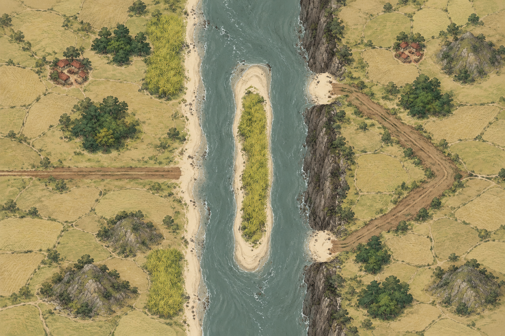
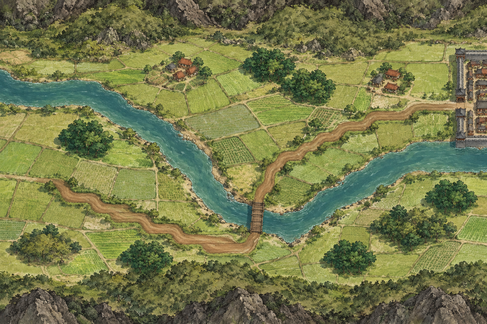
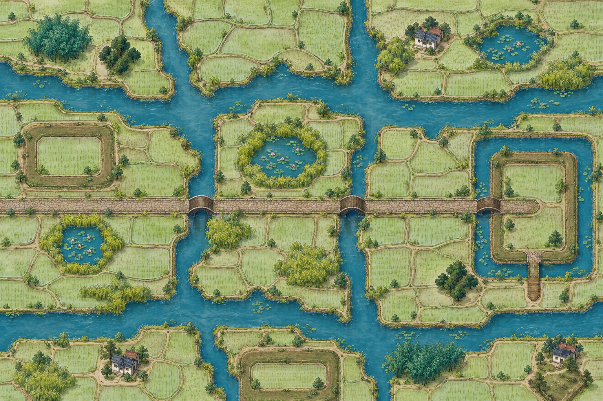
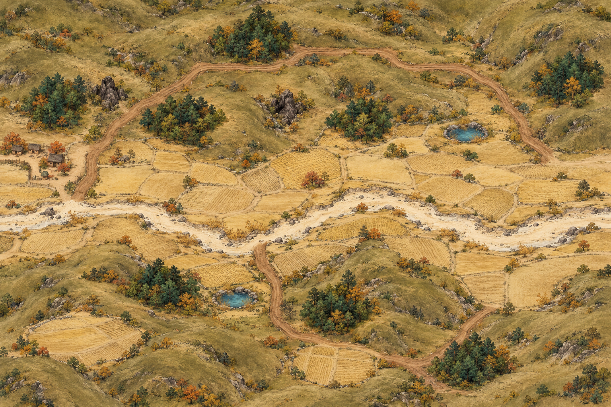
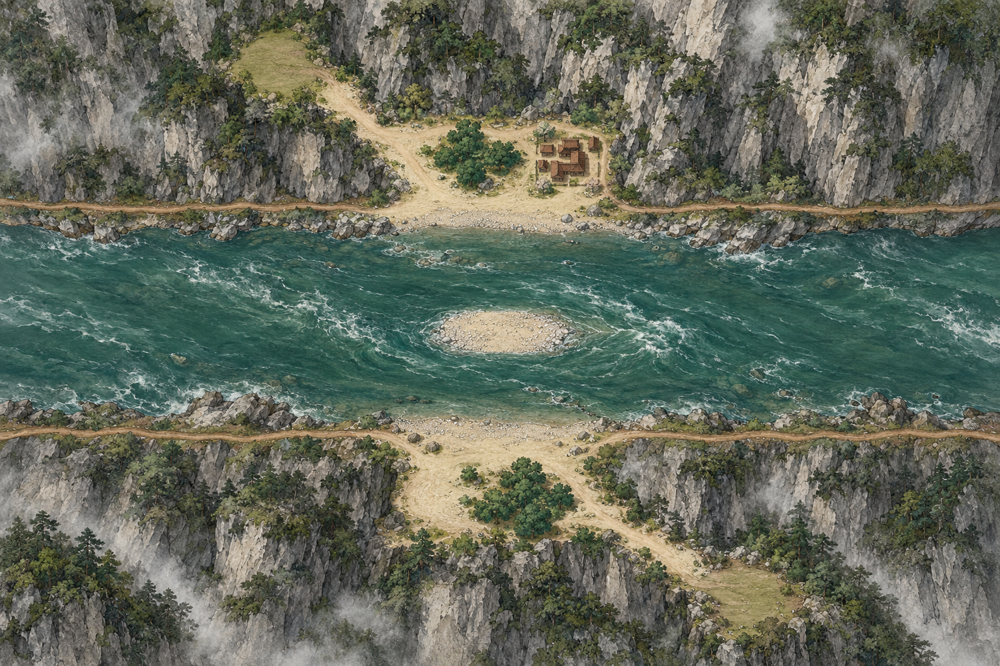

# 战场补图五张 · 2026-10-23

按各目录最新完整提示词及 layout.png，每个战场独立生成一张。内置 image_gen；1536×1024；待用户审核。

本批补齐第一轮缺少的⑤B、⑥南，以及第二轮的④南、⑦丘陵、⑨三峡。全部十五个战场变体现均有候选图。

山崖、坡地与建筑仍有斜俯视倾向；布局对位、通道开口及单位叠放可读性需审核。本批尚未做逐像素布局验收。

[完整 prompts 与生成记录](battlefield-review-remaining-2026-10-23.json) · [上一批十张](battlefield-review-2026-10-23.md)

| 轮次 | 战场 | 图像 |
| --- | --- | --- |
| 1 | ⑤B 大江·渡江 | [v1](../../docs/v0.3/battlefield-art/bf05-yangtze-crossing/attempts/v1.webp) |
| 1 | ⑥南 河谷川地（汉水） | [v1](../../docs/v0.3/battlefield-art/bf06-valley-south/attempts/v1.webp) |
| 2 | ④南 水网泽国（江南） | [v1](../../docs/v0.3/battlefield-art/bf04-wetland-south/attempts/v1.webp) |
| 2 | ⑦丘陵 北方山丘（沂蒙、方城） | [v1](../../docs/v0.3/battlefield-art/bf07-rolling-hills/attempts/v1.webp) |
| 2 | ⑨三峡 峡谷栈道（三峡） | [v1](../../docs/v0.3/battlefield-art/bf09-three-gorges/attempts/v1.webp) |

## ⑤B 大江·渡江

## ⑥南 河谷川地（汉水）

## ④南 水网泽国（江南）

## ⑦丘陵 北方山丘（沂蒙、方城）

## ⑨三峡 峡谷栈道（三峡）

